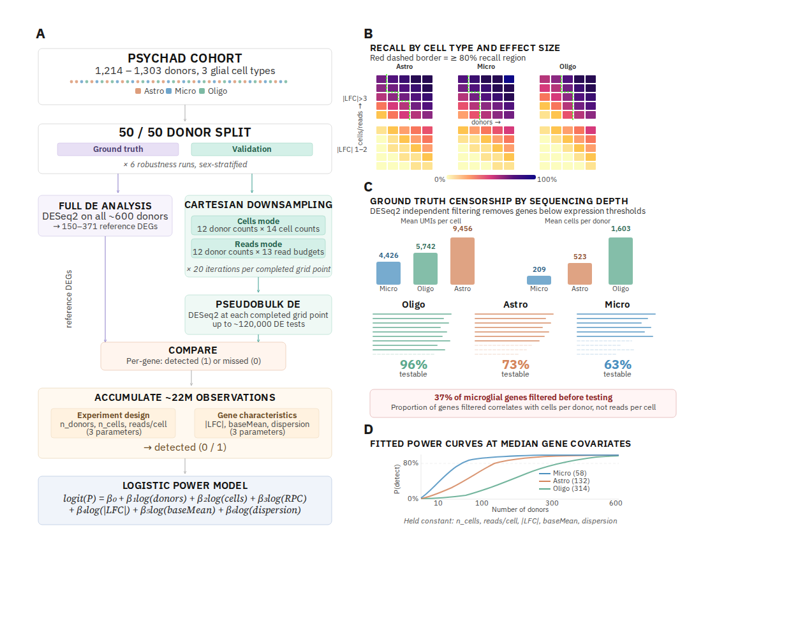
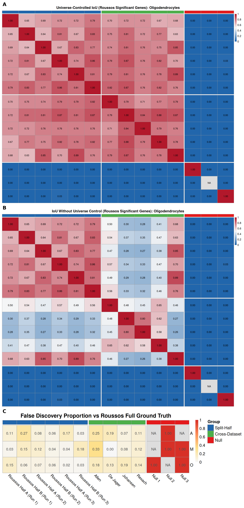
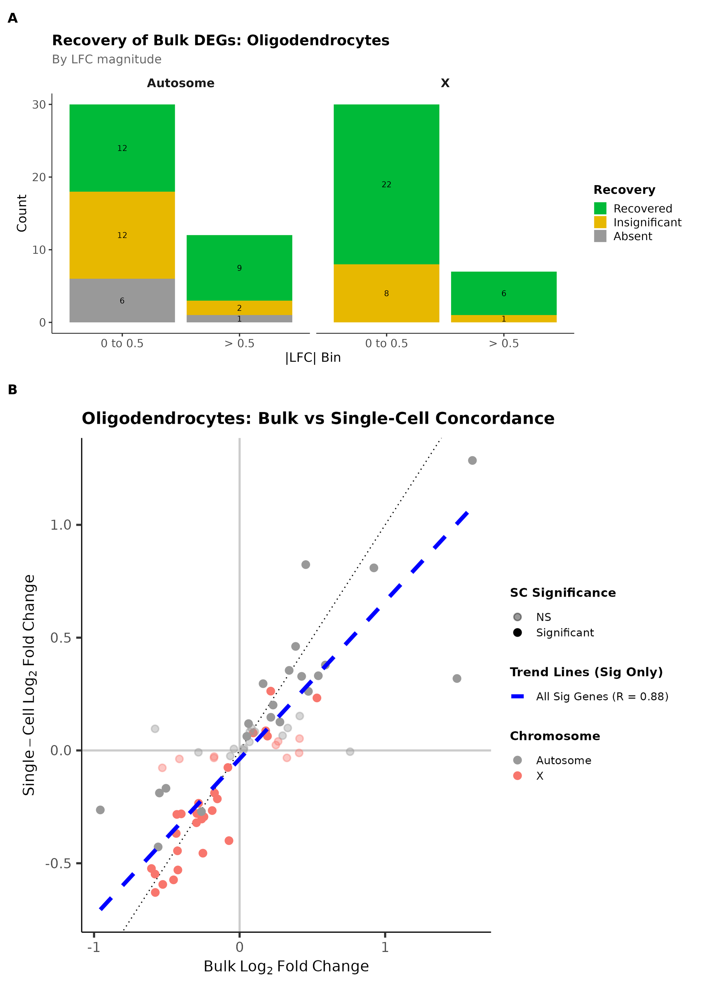
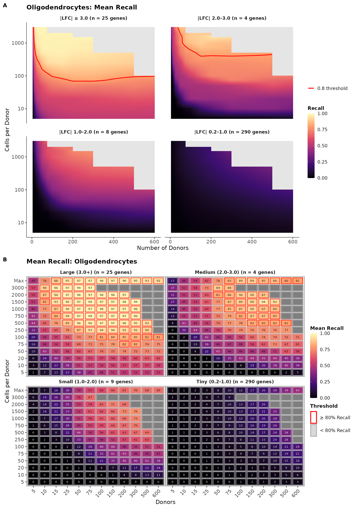
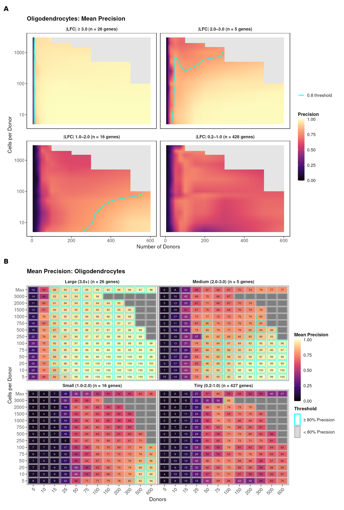

# Affiliations

1.  UK Dementia Research Institute at Imperial College London, London, UK
2.  Department of Brain Sciences, Imperial College London, London, UK

Chris Crampton^1,2^, Salman Fawad^1,2^, Hiru Dash^1,2^, Nathan Skene^1,2^

**Corresponding author.** Correspondence to Nathan Skene (n.skene@imperial.ac.uk).

**ORCIDs.** Chris Crampton 0009-0002-5542-0566; Hiru Dash 0009-0005-5514-505X; Nathan Skene 0000-0002-6807-3180; Salman Fawad [TODO: add Salman Fawad ORCID before submission].

------------------------------------------------------------------------

# Abstract

Differential expression analysis in single-cell RNA-sequencing is typically planned without empirical benchmarks: the few available power calculators extrapolate from small pilot datasets through parametric simulation, with no large-scale real-data validation. Here we show that current study designs are systematically underpowered for the effect sizes biological discovery actually targets. We constructed an empirical reference of over 22 million per-gene detection outcomes by split-half downsampling up to 1,303 PsychAD donors across donor count, cells-per-donor, and sequencing-depth grids in three glial cell types, validated against six independent cohorts. Genes with |LFC| 0.2–2 failed to reach 80% recall anywhere in the observable design space, while only larger effect genes (|LFC| > 2) were reliably recovered at realistic cohort sizes. We release the outcome-dataset, diagnostic visualisations and models, and the open-source framework, enabling researchers to refit with arbitrary covariates, extend the design space, or adapt to other case-control variables.

------------------------------------------------------------------------

# Introduction

Single-cell and single-nucleus RNA-seq (sc/snRNA-seq) have become standard tools for characterising cell type–specific gene expression. When performing differential expression analysis, pseudobulk aggregation, that is, summing counts across all cells per donor and testing at the donor level, has emerged as the recommended approach because it controls pseudoreplication and dramatically reduces false positives [@squair2021; @murphy2023; @zimmerman2021pseudoreplication]. However, single-cell studies typically rely on modest cohort sizes of 10–100 donors (Supp. Table 1) with variable sequencing depths, raising fundamental questions about statistical power: How many donors are needed to reliably detect genes of a given effect size? How many cells per donor? How deeply should they be sequenced?

Existing power calculators [@zimmerman2021hierarchicell; @schmid2021; @vieth2017] rely on parametric simulations fitted to pilot data. These approaches inherit the noise and estimation errors of small pilots and lack empirical validation against large real datasets. In neuroimaging, large-scale empirical studies have demonstrated that small samples systematically overstate effect sizes and inflate false positives [@Marek2022; @liu2023], underscoring the need for empirical power benchmarks in high-dimensional omics.

Here we address this gap with a comprehensive empirical power analysis of the PsychAD cohort [@fullard2025] (filtered from 1,491 donors), the largest available human brain snRNA-seq dataset. We use sex-biased expression as the case-control contrast because cohorts split near 50:50, sex-biased DEGs are well-documented and reproducible across cohorts, and small-effect sex-biased DEGs are predominantly autosomal, supporting extrapolation to other contrasts.

Our analysis focuses on three major glial cell types (astrocytes, microglia, oligodendrocytes). We first validate that sex-biased DE is reproducible across five independent cohorts and a bulk RNA-seq reference, then systematically downsample across two 2D grids (donors × cells, donors × UMIs) to map recall and precision across experimental designs, accumulating over 22 million per-gene detection outcomes as an empirical reference for pseudobulk power. Alongside this dataset we release a caveated logistic planning heuristic, diagnostic recall and precision surfaces, and the open-source pipeline, enabling researchers to refit with arbitrary covariates, extend the design space, or apply the framework to any case-control variable.

The reference reveals that smaller-effect genes (|LFC| < 2) remain systematically underdetected across the observable design space, and that an apparent cell-type power hierarchy is an artefact of ground-truth censorship by sequencing depth rather than an intrinsic cell-type property. We primarily report oligodendrocyte results, referencing astrocytes and microglia where relevant, because oligodendrocytes have the largest testable gene universe and highest UMIs per donor, making them the most robust reference.

------------------------------------------------------------------------

# Results
```{r FigOverview, echo=FALSE, eval=TRUE, out.width="99%", fig.cap="Overview of the empirical power analysis framework. (A) Analytical workflow: the PsychAD cohort (1,216–1,303 donors across three glial cell types) is split 50/50 into ground truth and validation sets across six robustness runs, with the validation set systematically downsampled across Cartesian grids in both cells-based and reads-based modes. Over 22 million per-gene detection outcomes are accumulated and fitted with logistic regression models. (B) Stylised recall heatmaps for large-effect (|LFC| > 3, top) and small-effect (|LFC| 1–2, bottom) genes across the three cell types. Red dashed borders indicate the region achieving ≥80% recall. Large-effect genes are readily detected; small-effect genes remain elusive even at the largest sample sizes. (C) Ground truth censorship by sequencing depth: DESeq2 independent filtering removes a larger proportion of genes from shallowly sequenced cell types (63% testable in microglia versus 96% in oligodendrocytes), creating an illusion of higher power. (D) Fitted power curves at median gene covariates, illustrating the qualitative shape of the donors–power relationship across cell types."}

```

## Dataset Characteristics and Filtering Rationale

We analysed five independent single-cell/single-nucleus RNA-seq datasets of human brain tissue, totalling over 4.2 million cells from up to 1,912 donors (Supplementary Data 1). The primary analysis used the PsychAD (Roussos) dataset comprising 1,486/1,480/1,491 donors (astro/micro/oligo) before filtering. The remaining four datasets (Allen/SEA-AD, DeJager/ROSMAP, Rexach, Johansen) ranged from 19 to 449 donors post-filtering and served for cross-dataset framework validation.

Principal component analysis on the unfiltered Roussos dataset revealed that principal component 1 (PC1) was dominated by per-donor cell count across all three cell types, with donors below 30 cells showing progressively larger deviations consistent with gene dropout artefacts (Supplementary Fig. 8). PC2 showed a trend with donor age and clear clustering in the case of microglia for donors younger than 40. These observations motivated the filtering criteria: a minimum of 30 cells per donor and age $\geq$ 40 years to stabilise the age covariate with minimal loss of donors. The filtered analysis cohort comprised 1,293 astrocyte donors (mean 523 cells), 1,216 microglia donors (mean 209 cells), and 1,303 oligodendrocyte donors (mean 1,603 cells).

Per-cell library sizes varied substantially: astrocytes exhibited the most UMIs (mean 9,456 UMIs per cell), followed by oligodendrocytes (5,742 UMIs) and microglia (4,426 UMIs). The difference in mean number of UMIs per donor between microglia and oligodendrocytes is ten-fold (~0.9 million UMIs per donor for microglia versus 9.2 million for oligodendrocytes). This technical heterogeneity creates differential statistical power for ground truth estimation, which we explicitly attempt to account for in the downsampling framework. This hierarchy of cell types in terms of UMIs per cell and number of cells per donor is consistent across all five datasets (Supplementary Data 1).

## Framework Validation: Sex-Biased Expression is Reproducible Across Independent Cohorts

Before using sex-biased DE for power analysis, we validated that it serves as a reproducible case-control variable across independent cohorts. Differential expression analysis using DESeq2 with dataset-specific covariates revealed strong cross-dataset agreement on genes with $|LFC| \geq 1$. We quantified gene set reproducibility using universe-controlled Intersection over Union (IoU, equivalent to the Jaccard index restricted to genes present in both datasets' count matrices): $\text{IoU}(A,B) = |A \cap B| / |A \cup B|$. This approach normalised results to account for the fact that a few datasets such as ROSMAP and Johansen had ~10,000 fewer long non-coding RNA genes than the rest (Supplementary Data 1) which would have presented as poorer agreement than was warranted. Without this gene-universe control the IoU values dropped by over half for these datasets (Fig. \@ref(fig:FigRepro), panel B).

Universe-controlled IoU values between the PsychAD cohort and four external datasets ranged from 0.60 to 0.92 across all cell types (Fig. \@ref(fig:FigRepro), panel A; Supplementary Data 2; Supplementary Fig. 17). Within-dataset split-half comparisons (three independent 50/50 Roussos partitions) provided an empirical ceiling of 0.65–0.87, while null label-flip permutations yielded IoU values of 0–0.03, confirming that the permutation procedure successfully breaks sex associations. Cross-dataset values reached, and in some cases exceeded, the split-half ceiling, confirming highly reproducible sex-biased DE when gene universe differences are accounted for. Even the smallest dataset (Johansen, 19–33 donors post-filtering) achieved IoU values of 0.76–0.87 with Roussos. These results support the use of sex-biased DE as a robust framework validation variable.

```{r FigRepro, echo=FALSE, eval=TRUE, out.width="99%", fig.cap="Cross-cohort reproducibility of sex-biased DE. (A) Universe-controlled Intersection over Union (IoU) matrices for oligodendrocytes (astrocytes and microglia in Supplementary Fig. 17). Each cell shows the Jaccard index between two datasets restricted to the genes present in both count matrices; cross-dataset values (0.60–0.92) approach the split-half empirical ceiling (0.65–0.87) and far exceed the label-flip null (0.00–0.03). (B) Raw (uncontrolled) IoU matrices for the same comparisons, where failing to restrict to shared genes inflates apparent disagreement for cohorts with smaller gene universes (notably ROSMAP and Johansen). (C) False discovery proportion (FDP) heatmap: for each query cohort, the fraction of its significant genes that the Roussos ground truth deemed insignificant. Cross-dataset FDP (0.00–0.33, mean 0.15) is comparable to the split-half baseline (0.02–0.27, mean 0.09). All three cell types are shown: astrocytes (A), microglia (M), and oligodendrocytes (O)."}

```

A notable technical finding was the depth-dependent testability gap: DESeq2's independent filtering mechanism excluded approximately 37% of genes in microglia, versus 4% in oligodendrocytes and 27% in astrocytes. This creates differential gene universe coverage that must be accounted for when comparing power across cell types. Low-count pre-filtering removed an additional 0.1%, 1.8%, and <0.01% of genes for astrocytes, microglia and oligodendrocytes respectively. Eight significant DEGs with $|LFC| \geq 1$ found in astrocytes and oligodendrocytes were untestable in microglia, though all microglial DEGs were testable in the other two cell types.

To further anchor the PsychAD ground truth against an orthogonal modality, we compared it with a bulk RNA-seq reference of 79 sex-biased genes that were significant (LFSR < 0.05) in at least 90% of 44 GTEx v8 tissues (Supplementary Fig. 5). Of the 79 reference genes, 72 were present in the Roussos single-cell gene universe, with the remaining 7 absent in every cell type for technical reasons (Fig. \@ref(fig:FigBulk), panel A). Among the 72 testable genes, astrocytes recovered 72% (52/72), oligodendrocytes 68% (49/72), and microglia 54% (39/72), with sex-chromosome genes recovered at consistently higher rates than autosomal genes (Astro 79% vs 65%; Oligo 76% vs 59%; Micro 66% vs 41%; Fig. \@ref(fig:FigBulk), panel A). This asymmetry is expected: sex-chromosome sex-biased expression is driven by cell-intrinsic dosage mechanisms that should produce consistent fold changes across cell types, whereas autosomal sex-biased expression is typically mediated by downstream hormonal or transcription-factor pathways that vary across cell types and are diluted in whole-tissue homogenates. For genes significant in both modalities, bulk and single-cell LFCs were strongly concordant after excluding XIST (Pearson R = 0.91 astrocytes, 0.93 microglia, 0.88 oligodendrocytes; Fig. \@ref(fig:FigBulk), panel B; Supplementary Fig. 6 for astro/micro), and the non-recovered genes clustered near zero on the single-cell axis despite non-zero bulk LFCs, consistent with genuine cell-type-specific absence of sex bias rather than insufficient power. Conversely, the single-cell analysis also detected strong Y-linked signals (UTY, DDX3Y, EIF1AY, TTTY14) that are structurally excluded from the MASH-based bulk reference owing to undefined male-versus-female fold changes, demonstrating that cell-type-resolved pseudobulk captures sex-biased biology beyond what tissue-level averaging can validate.

```{r FigBulk, echo=FALSE, eval=TRUE, out.width="99%", fig.cap="Bulk RNA-seq concordance for oligodendrocytes. (A) Recovery of the 79-gene GTEx bulk sex-biased reference by the Roussos oligodendrocyte ground truth, stratified by chromosome type (autosomal vs sex-chromosome) and significance status. (B) Per-gene log2 fold-change correlation between GTEx bulk and Roussos oligodendrocyte pseudobulk for genes significant in GTEx bulk, after excluding XIST as a leverage-dominating outlier (Pearson R = 0.88). Astrocyte and microglial equivalents, and the XIST-inclusive correlations, are provided in Supplementary Figs. 6-7."}

```

## Empirical Power Analysis Across Experimental Designs

To empirically quantify detection power, we developed a Cartesian downsampling framework. The filtered Roussos cohort was randomly partitioned 50/50 into ground truth (GT) and validation sets, repeated for six independent robustness runs with different random seeds. The validation half was systematically downsampled across a grid spanning 12 donor counts (5–600) and 14 cell counts per donor (5–3,000), with 20 iterations per grid point, yielding a maximum of 20,160 independent DE analyses per cell type. In practice, the full grid search space was not tested owing to insufficient donor counts and sampling depth. We characterise four classes of effect size through out the analysis: tiny (|LFC| 0.2–1), small (|LFC| 1-2), medium (|LFC| 2-3), and large (|LFC| > 3).

The oligodendrocyte ground truth sets contained an average of 328 significant genes per run at |LFC| > 0.2 (range 157-371), of which approximately 90% fell in the tiny-effect bin . Genes with |LFC| > 1 averaged ~38 per run and were predominantly sex-chromosome genes whose sex-exclusive expression produces large, consistent fold changes with minimal dispersion. There was a consistent power hierarchy across the cell types which saw power for equivalent experimental setups following: microglia > astrocytes > oligodendrocytes, consistently across the landscape. For example in the tiny-effect bin for 300 donors and 100 cells each: microglia was 20% recall, astrocytes 15%, and oligodendrocytes 14%. Full astrocyte and microglial results are provided in Supplementary Figs. 1 and 2.

The continuous recall surface for oligodendrocytes (Figure \@ref(fig:FigRecall), panel A) reveals the power landscape across the full experimental design space, interpolated from the discrete measured grid points (Figure \@ref(fig:FigRecall), panel B). Large-effect genes achieved 80% recall with as few as 10 donors when at least 1,500 cells each were available. At 50 donors with 250 cells, oligodendrocyte large-LFC recall was 87%, increasing to over 94% at 100 donors.
Genes with moderate effect sizes first crossed the 80% recall threshold at approximately 75 donors with 500 cells.

Small-effect genes never exceeded 80% recall across the entire experimental space, even at the maximum configuration of 600 donors with all available cells. This pattern was consistent across all three cell types tested (Supplementary Fig. 1). The systematic underdetection of this effect class suggests that current study designs are systematically underpowered for the types of effects most studies target. In the tiny effect bin, the recall never exceeded 42%, and didn't rise above 10% until there were at least 75 donors present, regardless of the number of cells, and even then it only went up to 21% with 200 donors. This is the opposite of the larger effect size bins, where there seems to be a strong benefit from more donors early on, but after around 200, the benefits of more donors plateau. This indicates an interplay between target |LFC| and resource distribution: seeking more subtle effects requires more donors, larger and more obvious effects can be detected with sufficient power from fewer, more deeply sequenced donors.

```{r FigRecall, echo=FALSE, eval=TRUE, out.width="99%", fig.cap="Recall landscape for oligodendrocyte sex-biased DE. (A) Continuous recall surface (y-axis log-transformed) across donor count and cells per donor, faceted by |LFC| bin: tiny (0.2–1.0), small (1.0–2.0), medium (2.0–3.0) and large (>3.0). Surfaces are bilinear interpolations of the measured grid. (B) Discrete recall heatmap for the same design space; red borders mark configurations achieving ≥80% recall. Large-effect genes reach 80% recall at 10 donors when ≥1,500 cells per donor are available, whereas small- and tiny-effect genes remain below 80% across the entire explored space. Astrocyte and microglial recall surfaces are in Supplementary Fig. 1."}

```

Precision patterns were qualitatively consistent across cell types but depended sharply on effect-size bin (Figure 5; Supplementary Fig. 4). For large-effect genes precision exceeded 90% across nearly the entire grid in all three cell types, with breakdown confined to the 5-donor column. Medium-effect genes showed an intermediate pattern, with precision climbing above 80% only at roughly 15-25 donors and above, though estimates were noisy owing to very small truth sets (n = 2-4 genes/run). Small-effect genes revealed a qualitatively different regime: precision was poor for small donor counts regardless, and only improved beyond the 80% threshold in regions with many donors (100+) and few cells (<100), with more cells proving detrimental in most cases. Tiny-effect genes, despite having by far the lowest recall, showed markedly higher precision than the small bin in all three cell types, but only for one central region of the grid (25 - 200 donors with fewer than 1000 cells). A common pattern across all bins and cell types was that precision fell as cells per donor rose, the mirror image of the recall trend (discussed below), and precision collapsed at 5-10 donors regardless of sequencing depth, reflecting insufficient replicates to stabilise per-gene count estimates.

```{r FigPrecision, echo=FALSE, eval=TRUE, out.width="99%", fig.cap="Precision patterns were qualitatively consistent across cell types but depended sharply on effect-size bin (Figure 5; Supplementary Fig. 4). For large-effect genes (|LFC| > 3) precision exceeded 90% across nearly the entire grid in all three cell types, with breakdown confined to the 5-donor column. Medium-effect genes (|LFC| 2-3) showed an intermediate pattern, with precision climbing above 80% only at roughly 15-25 donors and above, though estimates were noisy owing to very small truth sets (n = 2-4 genes/run). Small-effect genes (|LFC| 1-2) precision was poor for small donor counts regardless, and only improved beyond the 80% threshold in regions with many donors (100+) and few cells (<100). Tiny-effect genes (|LFC| 0.2-1.0),  showed markedly higher precision than the small bin, but only for one central region of the grid (25 - 200 donors with fewer than 1000 cells). In all cases, an increase in cells proved detrimental."}

```

We performed a parallel analysis using reads-based downsampling, where grid axes were donor count and total UMI budget per donor rather than cells per donor (Supplementary Fig. 1). Reads-based recall patterns were qualitatively identical to cells-based results, providing an alternative sampling approach that would mitigate the bias in cells-based downsampling towards cell types whose cells contained more UMIs natively. In practice this showed a similar hierarchy as with cells-based downsampling, but with oligodendrocytes and astrocytes outperforming each other interchangeably.

## Power Curve Fitting and Predictor Decomposition

To examine the relative contributions of gene-level characteristics and experimental design, we fitted logistic regression models to the binary per-iteration detection outcomes. The fitting dataset combined cells-based and reads-based downsampling modes across all six robustness runs, yielding over 22 million observations (Supplementary Data 5). The fitted model formula was:

$$\text{logit}(P(\text{detected})) = \beta_0 + \beta_1 \log(N_{\text{donors}}) + \beta_2 \log(N_{\text{cells}}) + \beta_3 \log(\text{RPC}) + \beta_4 \log(|\text{LFC}|) + \beta_5 \log(\text{baseMean}) + \beta_6 \log(\text{dispersion})$$
where RPC denotes reads per cell. The per-cell type models achieved McFadden's pseudo-$R^2$ values of 0.666 (astrocytes), 0.733 (microglia), and 0.655 (oligodendrocytes), indicating that the six predictors capture approximately two-thirds of the deviance in detection outcomes. 

Among the design covariates, donor count had the largest positive coefficients (1.50–1.69), followed by cells per donor (0.93–1.43), confirming that biological replication is the primary power driver in experimental setup. Reads per cell showed variable directionality across cell types (coefficients –0.87 to +0.10), with negative coefficients for astrocytes and oligodendrocytes indicating that, after accounting for cells per donor, additional per-cell sequencing depth provides negligible or even counterproductive returns at the expression levels of truth set genes. This is most likely a technical artefact of the fitting data which we address in the discussion.

Among gene covariates, absolute log-fold change was by far the strongest predictor (coefficients 2.59–3.11), followed by base mean expression (positive, 0.70–1.06) and dispersion (negative, –0.98 to –1.11). The dominance of |LFC|, with coefficients roughly double those of any design parameter, confirms that effect size is the primary gene-level determinant of detectability, but that mean expression and dispersion are still considerable factors.

A likelihood ratio test comparing the combined model (no cell type term; pseudo-$R^2$ = 0.653) to the additive model (with a cell type intercept; pseudo-$R^2$ = 0.667) was overwhelmingly significant ($\chi^2 = 212{,}014$, $p < 10^{-300}$). The cell type ordering in model fit (microglia \> astrocytes \> oligodendrocytes) appears paradoxical when viewed through conventional technical metrics. Microglia have the lowest base mean expression, lowest mean signal to noise ratio, and shallowest sequencing depth (Supplementary Data 7), yet they achieve the highest apparent detection power. The initially apparent biological explanation proved artefactual: cell type was confounded by cells-per-donor and UMIs-per-cell in the ground-truth sets, as the depth-equalisation experiments show.

### Depth Equalisation and Ground Truth Power Sensitivity Analysis

To determine whether these cell type differences were innate or confounded by ground truth sequencing characteristics, we generated two depth-equalised astrocyte sets and performed the cartesian downsampling procedure with identical sampling. One set was created by multinomially downsampling each cell in every donor to match microglial UMI-count distributions. This was duplicated and the donors in the ground truth set for each run had cells randomly removed to match microglia cell-count distributions. Microglia have the shallowest sampling (mean 209 cells per donor, 4,426 reads per cell), so DESeq2's independent filtering removes the largest fraction of low-expression genes from their ground truth. Because these are precisely the genes that are hardest to detect at small donor or cell counts, their exclusion inflates microglial recall. Astrocytes (523 cells per donor, 9,456 reads per cell) and oligodendrocytes (1,603 cells per donor, 5,742 reads per cell) retain more of these hard-to-detect genes in their truth sets, so their recall appears lower than microglia's even though per-gene detectability is unchanged.

When astrocyte sequencing depth and cell count were downsampled to match microglial characteristics, the ground truth shrank from a mean of 371 DEGs to 262 (depth-equalised) and 172 (depth- and cell count-equalised), a loss of approximately 29% and 54% of genuinely significant genes respectively. The initial experiment equalising reads per cell while holding cells per donor at native levels only partially closed the gap between cell types in the power curve fitting. However, the additional downsampling of cells per donor revealed a substantial further impact, and on this depth+cell-equalised set the power ordering reversed: astrocytes achieved higher recall than microglia, confirming that the apparent hierarchy (microglia \> astrocytes \> oligodendrocytes) was driven by ground truth censorship rather than intrinsic cell type properties. Oligodendrocyte DEGs appeared hardest to detect only because their deeper per-donor sampling yielded a more complete, and therefore more demanding, truth set. Once depth was equalised, microglial truth genes' characteristics, including lower LFC, higher dispersion, and lower signal-to-noise ratio (Fig. \@ref(fig:FigPower); Supplementary Data 7), manifested as genuinely poorer aggregate power.

### Practical Power Predictions and Framework Application

The median gene in the truth set has |LFC| = 0.3, a tiny effect size. At these median covariates (|LFC| = 0.3, baseMean = 15, dispersion = 0.34), 80% detection power is unachievable within the explored experimental space for all cell types. Even at 600 donors with 75 cells each, predicted power is below 10% for oligodendrocytes and astrocytes (Figure \@ref(fig:FigPower)). This underscores that the majority of genes with detectable sex-biased expression have effect sizes too small for reliable detection at any feasible cohort size. For genes with moderate effect sizes (|LFC| = 1.5, baseMean = 50, dispersion = 0.5, 250 cells per donor), oligodendrocytes require approximately 289 donors for 80% power; astrocytes require 125 and microglia 59 (Supplementary Data 8). For large-effect genes (|LFC| = 3.0, baseMean = 100), the requirements drop to 82, 38, and 16 donors respectively. The fitted models enable practical experimental planning (Fig. \@ref(fig:FigPower); Supplementary Data 9). We recommend oligodendrocyte power curves for approximate experimental design, as they provide the most robust ground truth, however, if researchers wish for a more precise and reliable estimate, we recommend fitting models with larger capacity to the generated dataset.

```{r FigPower, echo=FALSE, eval=TRUE, out.width="99%", fig.show='hold', fig.cap="Practical power predictions for experimental design across all five cell type models: native astrocytes (red), depth-equalised astrocytes (orange), depth+cell-equalised astrocytes (purple), microglia (blue), and oligodendrocytes (green). (Top) Power curves at median gene covariates from the expanded truth set (|LFC| = 0.3, baseMean = 15, dispersion = 0.34, n_cells = 75, RPC = 5,827): predicted detection probability never approaches 80% within the explored experimental space, demonstrating that the typical gene with detectable sex-biased expression is effectively undetectable at any feasible cohort size. (Bottom) Power curves at a practical reference point (|LFC| = 1.5, baseMean = 50, dispersion = 0.5, 250 cells per donor) showing predicted detection probability as a function of donor count for all five cell type models. The power hierarchy reversal from depth equalisation confirms that apparent cell type differences reflect ground truth censorship. Oligodendrocytes require the largest sample sizes but provide the most robust ground truth."}
img1 <- "Datalink/Composed_Figures/figure_powercurve.png"

knitr::include_graphics(c(img1))
```


------------------------------------------------------------------------

# Discussion

By systematically downsampling from 1,216-1,303 donors from the PsychAD cohort across two-dimensional grids of donor count, cell count, and sequencing depth, we directly measured detection probability for pseudobulk differential expression across over 22 million per-gene outcomes. This empirical approach, analogous to the large-scale studies that reshaped sample size expectations in neuroimaging [@Marek2022; @liu2023], bypasses the distributional assumptions and pilot-derived parameter estimates that limit existing power calculators, and reveals several findings with immediate implications for experimental design in single-cell genomics.

The most consequential finding is the systematic underdetection of small-effect genes. As shown in the recall surfaces (Figure \@ref(fig:FigRecall)), genes with |LFC| 0.2–2 never reached 80% recall across the entire experimental space, implying that many published single-cell studies, which typically employ 10–100 donors, have limited sensitivity for the subtle regulatory differences they seek to detect, especially those with |LFC| < 1. Closing this gap will likely require either substantially larger cohorts (exceeding 1,000 donors with adequate cells per-donor) or meta-analytic aggregation across studies. By contrast, large-effect genes are readily detected with modest sample sizes (10–50 donors), confirming that current designs are adequate when the targets of interest have large, consistent fold changes.

Across all configurations, precision fell as cells per donor rose, reversing the recall trend. This likely reflects a statistical artefact: higher cell counts pull marginal, low-expression genes into the testable universe, where unstable dispersion estimates in the noisy tail accumulate false discoveries. A parallel effect in the tiny-effect bin showed that adding donors at fixed total cells also degraded precision: more biological replicates raise power, but shallower per-sample depth destabilises count estimates. For experimental design, recovering small-effect genes therefore requires tolerating a higher false discovery rate, unless stricter significance or expression thresholds are imposed at the cost of recall. At cell counts an order of magnitude beyond our grid, per-gene stability may recover precision as these genes would have more stable counts.

Alternatively, some may be genuine DEGs that low-depth donors fail to capture, diluting the aggregate ground truth signal but not the validation experiments, which enforce a minimum cell count per donor. A consistent pattern in the empirical grid supports this: including every available cell from every donor (the "Max" configuration) often underperformed configurations with a minimum cells-per-donor threshold. In oligodendrocytes, for example, recall on small-effect genes with 750-1000 cells or greater always outperformed their respective "Max" configurations, and the same pattern held under reads-based downsampling with 5,000,000 reads. The effect was frequent but not uniform, so we interpret it cautiously; if its true, it implies that stretching a fixed budget across poorly sequenced donors is more harmful than retaining fewer, more deeply sequenced ones.

Our depth-equalisation experiments establish a point that goes beyond the standard caveat that low-expression genes are harder to detect: insufficient per-donor depth removes real, case-control-relevant DEGs from the testable universe entirely. This reduction reflects both genes excluded by DESeq2's independent filtering before they could be tested and genes that lost statistical significance at the shallower depth. These filtered genes are not false negatives in the conventional sense; they are genes the experiment was structurally unable to evaluate. The practical consequence is a fundamental trade-off for experimental planners: deeper per-donor sequencing brings otherwise inaccessible DEG candidates into the testable universe but reduces the number of donors a fixed budget can support, whereas spreading reads across more donors increases statistical power but shrinks the set of genes that can feasibly be tested.

The cross-dataset analysis revealed that gene universe size is a stronger determinant of DEG count than donor count: DeJager (445-449 donors) consistently detected fewer DEGs than Allen (78-81 donors) because its gene universe was substantially smaller. What can be tested determines what can be found, and preprocessing decisions that discard genes mechanically constrain discovery. This has two implications. When comparing results across studies, auditing gene universe composition should precede any biological interpretation of discordant DEG counts, and when planning experiments, researchers should favour pipelines that maximise the set of testable genes where feasible. The cost of incomplete coverage is also partly hidden by our reporting: the universe-controlled IoU metric appropriately accounts for annotation differences across datasets, but the approximately 15,000 genes (primarily lncRNA) absent from ROSMAP and Johansen represent real transcripts that would go undetected in those experiments, and their exclusion from the denominator inflates apparent reproducibility relative to what an investigator would experience in practice.

To contextualise our findings, we surveyed the most recent 30 primary human tissue sc/snRNA-seq studies published between 2022 and 2026 (Supplementary Table 1) that performed differential expression analysis in brain cell types across neurodegenerative and neuropsychiatric conditions. We emphasise that this survey serves as a rough calibration of study sizes and target effect sizes, not a methodological audit; each study operates within its own biological and technical context, and analytical diversity in the field reflects genuine differences in design, research question, and cell-type granularity. Across studies with extractable donor counts, the median number of biological replicates was ~50, with a range from 3 to over 1,400 donors. Where LFC values were extractable, the majority of highlighted genes had |LFC| between 0.5 and 2.0, with many studies applying effect-size thresholds as low as |LFC| of 0.1 to 0.25. Our power analysis offers a framework for interpreting these ranges: at 50 donors with 250 cells per donor, a design at or above the current median, we observed 87% recall for genes with |LFC| > 3, 56% for |LFC| between 2 and 3, 33% for |LFC| between 1 and 2, and 4% for |LFC| between 0.2 and 1.0. This last category encompasses the effect-size range targeted by many published thresholds, and aligns with benchmarking results showing poor performance across all tested DE methods at fold changes of 1.2 or below [@gagnon2022]. The implication is not that these studies have failed to detect real biology, as many have been validated by orthogonal approaches including spatial transcriptomics and proteomics, but that detection probability for smaller-effects is substantially lower than might be assumed from statistical significance alone. Many real DEGs could have been missed, and false discovery rates for the smaller studies could be much higher than expected (or perhaps harder to reproduce).

Our empirical approach contrasts with simulation-based power tools such as hierarchicell [@zimmerman2021hierarchicell], powsimR [@vieth2017], and muscat [@schmid2021], which fit parametric models to pilot data whose adequacy at scale is difficult to verify. By downsampling directly from a large reference cohort, we sidestep the parametric assumptions that govern simulation output and instead observe how detection probability behaves under real biological and technical variability. This reveals that detection probability shifts substantially with gene-level characteristics: mean expression, dispersion, and fold-change magnitude interact with donor count, cells per donor, and sequencing depth in ways that are difficult to anticipate from first principles and that a parametric simulator would need to capture explicitly to reproduce. The Cartesian downsampling framework and logistic fitting procedure are not specific to sex-biased DE in glia; the same approach extends to any case-control contrast for which a sufficiently large reference cohort exists, offering a route to empirical power characterisation wherever parametric assumptions are suspect. Nevertheless, several important limitations constrain the interpretation of these results.

We justify DESeq2 over alternatives in detail in Methods. In brief, we prioritised its conservative behaviour and peripheral features (independent filtering, LFC shrinkage, outlier handling) for robustness in low-power settings, with only a marginal recall cost in well-powered ones. edgeR performs comparably overall and slightly better at large sample sizes, so the estimates here may carry a mild conservative bias relative to a package-agnostic ceiling. We held the method constant across conditions to keep comparisons clean, and repeating the analysis with edgeR would be a useful extension for gauging package sensitivity. We also use independent filtering as an indicator of gene testability. It is a well-grounded signal, tied directly to the statistics DESeq2 uses to allocate its multiple-testing budget, and designed to track closely with whether a gene can realistically be detected under a given design. It remains a derived quantity rather than an intrinsic gene property, so testable/untestable labels should be read as operational, but within that scope it is a genuinely informative metric.

The medium and small bins contain only 2–4 and 6–9 truth-set genes per run respectively across cell types, so precision and recall estimates in these bins carry substantial sampling uncertainty and should be interpreted as indicative rather than definitive. Where recall or precision for medium- and small-effect genes is cited, researchers should treat the bin boundary effects and per-gene variance as appreciably larger than for the large (22–29 genes) or tiny (120–340 genes) bins. The downstream conclusions we draw from them (donor–depth trade-off, failure to reach 80% recall, detrimental inclusion of poorly sequenced donors) rest on patterns that are qualitatively robust across runs rather than on any specific numerical estimate and as such, the specific recall and precision values in these bins should not be over-read.

A reasonable concern about sex-biased expression as a case-control variable is that its strongest signals (Y-linked and X-linked escape genes) are atypical of the subtler effects typical of most disease contrasts. Splitting the recall surfaces by chromosome type (Supplementary Fig. 3) confirms this at face value: in the tiny-effect bin, sex-chromosome genes achieve satisfactory recall while autosomal counterparts perform substantially worse than the aggregated report. The per-gene characteristics explain why: autosomal genes in this bin have median dispersion roughly four to eight fold higher (Astro 0.46 vs 0.10; Micro 0.59 vs 0.07; Oligo 0.51 vs 0.14) and median expression five to six fold lower (Astro 9.7 vs 62.4; Micro 5.1 vs 27.9; Oligo 8.1 vs 44.7), placing them in a much harder region of the power surface. Because our logistic model conditions on baseMean, dispersion, and |LFC|, these differences are absorbed as predictors rather than confounders. The implication is nuanced: sex-chromosome genes alone are a poor generalisable benchmark, but sex-biased DE as a whole remains defensible once gene characteristics are accounted for, with the fitted data accounting for any autosomal gene of given expression, dispersion, and effect size. If anything, the autosomal-only surfaces sharpen our central conclusion: realistic sample sizes for detecting typical autosomal genes with modest effects are larger still, reinforcing that current study sizes are materially underpowered.

The 50:50 ground truth split (half of the donors for establishing truth, half for downsampling) was chosen to maximise the spread of experimental setups that could be tested, but has not been subjected to sensitivity analysis; alternative splits (e.g., 70:30 or 80:20) might yield more robust power estimates in exchange for fewer experimental conditions tested. These modelling choices do not affect the qualitative conclusions: the power ordering, depth censorship effects, and donor-versus-cell trade-offs emerge directly from the empirical grid. Researchers planning experiments without access to 600 donors may wish to shift the split ratio in favour of the ground truth, aiming for more robust predictions in their feasible experimental space, but should be cautioned that precision estimates appeared to deteriorate as donor count increased for the tiny-effect size bin, perhaps indicating that a ground truth with more donors but no deeper sequencing, may strengthen noisy false positives, instead of producing more robust findings.

The logistic regression model warrants qualification, because its role is easy to misread. The paper's principal output is the empirical dataset itself: approximately 22 million per-gene detection outcomes spanning donor, cells, reads, cell-type, and per-gene expression and dispersion space. The qualitative findings (cell-type power ordering, microglial depth censorship, donor-versus-cells trade-off, small-effect failure at 600 donors) derive directly from that dataset. The LFC-binned recall and precision surfaces are one lens on it, crude because binning by |LFC| alone collapses over baseMean and dispersion. The fitted logistic model is a second lens, trading fidelity for interpretability through its smooth, additive, log-odds-linear form. The clearest symptom of this trade-off is the negative reads-per-cell coefficient for astrocytes and oligodendrocytes: under our fixed-UMI-budget grid, higher reads per cell mechanically forces fewer cells per donor, and because cells carry the larger marginal effect, the residual load falls on reads as a spurious negative term rather than reflecting biology. The practical reading is that these cell types already sit near depth saturation, so marginal budget is better spent on additional cells at PsychAD-comparable UMI depth. We treat the model as a diagnostic summary and planning heuristic; users needing finer predictions should refit the released dataset with alternatives, such as generalised additive models, random forests, or gradient-boosted trees. The dataset and its interpretations, not the model coefficients, are the durable contribution.

---------------------------------------------------------

# Methods

## Datasets and Cohort Assembly

The analysis used five independent single-cell and single-nucleus RNA-seq datasets of human brain tissue. The primary cohort was PsychAD (Roussos; dorsolateral prefrontal cortex; approximately 1,216-1,303 donors after filtering) [@fullard2025]. Four external cohorts were used for validation: SEA-AD (Allen; middle temporal gyrus; 78-81) [@gabitto2023], ROSMAP (DeJager; dorsolateral prefrontal cortex, Brodmann area 9; 445-449 donors) [@green2024], Rexach (insular cortex; 38-42 donors) [@rexach2024], and Johansen (cerebral cortex; 19-33 donors) [@johansen2023]. Raw data from heterogeneous source formats (h5ad, h5Seurat, qs, and raw tar archives) were converted to standardised donor-level shards. Each shard consisted of a single `SingleCellExperiment` object per donor, partitioned by cell type and dataset, and serialised using the `qs` binary format. Gene identifiers were harmonised to Ensembl IDs using a shared mapping table derived from the union of all source annotations.

Donor-level sharding was adopted because it enables deterministic donor-stratified subsampling without reloading whole-dataset objects into memory. The alternative of working with dataset-level combined objects would have required loading more than 100 GB into memory for each subsampling iteration, and would have provided no mechanism for parallelising across donors without custom chunking logic. The `qs` format was chosen in preference to RDS or HDF5 because of its substantially faster read and write performance on small objects, which is relevant given that each iteration of the downsampling grid reads a varying subset of donor shards. Ensembl harmonisation was necessary because source datasets used a mixture of gene symbols, Ensembl IDs, and legacy identifiers, and the downstream universe-controlled Intersection over Union computations require exact gene ID equality across datasets.

Three glial cell types were analysed: astrocytes, microglia, and oligodendrocytes. These were selected for their consistent presence across datasets, lower subtype heterogeneity than neurons, and their relevance to neurodegenerative conditions. The framework developed is flexible and could comfortably be applied to alternative cell types of interest.

### Donor and cell filtering

Donors with age below 40 years, or with fewer than 30 cells in a given cell type, were excluded from that cell type's analysis. Filtering was applied  per donor, per cell type. Filtering thresholds were derived empirically from principal component analysis of the unfiltered Roussos cohort (Supplementary Fig. 8). The first principal component was dominated by per-donor cell count, with donors below approximately 30 cells forming an elongated tail consistent with gene dropout artefacts. This threshold is conservative relative to the point at which the tail becomes visible (around 20 cells), leaving a margin for cell-type-specific dropout variation. The second principal component exhibited age-dependent structure, with distinct clustering in microglia for younger donors, consistent with published literature on age-dependent microglial state transitions. The 40-year threshold was chosen to stabilise the age covariate with minimal donor loss in the primary Roussos cohort, while ensuring that downstream models were not dominated by developmental or early-adult biology. The same thresholds were applied to all external datasets for consistency. Johansen lost the largest proportion of donors (from 75 to 19-33 per cell type) on account of its younger-donor bias, a limitation that is acknowledged when interpreting its cross-dataset Intersection over Union values.

## Differential Expression Analysis

Pseudobulk aggregation summed raw UMI counts across all cells from each donor within the target cell type, producing one count vector per donor per cell type. Pseudobulk aggregation was selected in preference to cell-level differential expression methods (such as MAST, the Wilcoxon test applied to cells, and mixed-effects models on single cells) for three reasons. First, pseudobulk treats the biological replicate (the donor) as the statistical unit, thereby modelling the hierarchical structure of the data, in which cells are not independent observations. Cell-level methods, by contrast, systematically inflate the effective sample size by treating each cell as independent, producing anticonservative $p$-values and inflated type I error. Second, pseudobulk counts preserve count-based statistics (negative binomial distribution and dispersion estimation), allowing the use of mature count-based differential expression frameworks that have been validated on bulk RNA-seq. Third, pseudobulk aggregation is computationally tractable for the up to 20,160 differential expression analyses performed across the grid, whereas cell-level methods with random-effects structures would have been prohibitive at this scale. The cost is reduced sensitivity to within-donor heterogeneity, which is acceptable given that the biological question concerns population-level sex differences.

### DESeq2 with apeglm shrinkage

DESeq2 (v1.40) [@Love2014] was used with the design formula `~ covariates + age_scaled + sex`. Log fold-change estimates were shrunk using apeglm [@zhu2019]. Genes were declared significant at Benjamini and Hochberg adjusted $p < 0.05$.

edgeR is the more common pseudobulk tool in the brain snRNA-seq literature we surveyed, and edgeR with a likelihood-ratio test has been reported to give the strongest overall performance across benchmarked differential expression algorithms [@squair2021]. Our choice reflects the fact that the primary focus of this paper is not the well-powered regime in which such benchmarks are typically evaluated, but the underpowered regime in which real pseudobulk experiments operate. In this regime, the conservative biases that make DESeq2 somewhat less sensitive than edgeR at large sample sizes become advantages. Three properties are particularly relevant. First, DESeq2 applies an automatic Cook's distance-based outlier detection step that either excludes genes with outlier counts or imputes mean values in their place when donor counts are sufficient. Second, DESeq2 performs independent filtering [@Love2014; @Bourgon2010]: genes with mean normalised expression below a data-adaptive threshold are excluded from the multiple-testing correction in order to maximise the number of discoveries among adequately expressed genes. The threshold is optimised per analysis and varies with pseudobulk sequencing depth, so that deeper libraries yield lower thresholds and a larger testable gene universe. Third, DESeq2's median-of-ratios size factor estimation is robust to compositional shifts that can bias the trimmed mean of M-values (TMM) normalisation used by edgeR when a small number of genes dominate total counts, as is the case for XIST and Y-linked transcripts in sex-biased analyses. The marginal gain from edgeR at large subsamples was judged to be outweighed by this package of conservative safeguards at small subsamples, and using a single tool throughout the grid avoids introducing tool-switching as a covariate of the power curve.

apeglm shrinkage was selected in preference to the default `normal` and `ashr` priors because apeglm provides approximately unbiased log fold-change estimates for genes with strong signal, while shrinking noisy estimates toward zero. This property is particularly important when fitting logistic regression models downstream, where large log fold-change estimates with poor confidence can disproportionately influence the fit.

The $|\text{LFC}| > 1$ threshold for significance was chosen for cross-dataset analysis because below this level log fold-change estimates are prone to estimation noise rather than reproducible signal, thus providing a more robust benchmark for reproducibility. A lower threshold of $|\text{LFC}| > 0.2$ was retained for the expanded truth set used in Cartesian downsampling results reporting and the power curve fitting, in order to ensure that the models could be calibrated across a wider range and attempt to model the real effect sizes that differential analysis studies report.

### Covariate selection

Dataset-specific covariates were included in the design matrix only if they satisfied five criteria: they were present in the dataset metadata; they exhibited more than one unique level within the donor sample (zero-variance covariates were excluded); they were not perfectly collinear with sex, as assessed by cross-tabulation of the covariate against sex within the donor set; they did not cause rank deficiency in the model matrix for any of the three cell types; and they had a plausible biological effect on gene expression. The first two criteria are enforced automatically at runtime, with failing covariates silently dropped. The remaining criteria were resolved per dataset during pipeline development. For Roussos this yielded `source`, `ethnicity`, and `disease`; for other datasets, analogous covariates were added where available (Supplementary Data 1). Age was used in all datasets as a numerical variable, not split into categorical bins. However, in cases where age bins were reported, the mean age was imputed.

The overall philosophy was to include as many plausible covariates as the dataset could support, in order to remove cohort-specific confounds and maximise cross-dataset reproducibility, while accepting that a larger covariate set inflates standard errors. We did not adopt an automated stepwise covariate selection procedure for two reasons. First, it would have introduced cohort-specific model-selection uncertainty that is difficult to propagate into the power analysis. Second, the set of plausible covariates is small enough that manual inspection remained tractable.

## Cartesian Downsampling Framework

### Ground truth and validation split

The filtered Roussos cohort was randomly partitioned 50/50 into ground truth and validation sets using sex-stratified sampling, which preserves the global sex ratio in each half. This partition was repeated for six independent robustness runs with different random seeds. Ground truth differential expression was performed on all donors in each GT half in order to establish the reference set of differentially expressed genes. Validating power against a held-out truth set guards against the circularity of measuring recall on the same donors used to define truth, also known as data leakage. Fully downsampling the entire dataset would always converge at 100% recall and precision, regardless of dataset size, yielding unreliable power estimates.

The 50/50 split ratio represents a direct trade-off between ground truth precision (more ground truth donors yield a more reliable truth set) and the dynamic range of testable experimental setups (more validation donors yield a higher maximum donor count in the grid). A 50/50 split maximises the grid range on the validation side (up to 600 donors) while still providing 600 donors of ground truth, which we considered to be sufficient for the ground truth gene count to stabilise in split-half comparisons. Alternative ratios such as 70:30 or 80:20 might yield a more robust ground truth but would limit the validation grid. Alternatively, sequencing depth or cells per donor may be the bottleneck, in which case increasing the number of ground-truth donors would shrink the experimental grid without improving ground-truth reliability. We favoured grid range because the primary goal is to characterise power as a function of design parameters, and we used the six independent robustness runs to bound the truth-set noise introduced by the 50% ground truth allocation.

Sex-stratified sampling was adopted because, without stratification, random splits in small-denominator cell types would occasionally produce sex-imbalanced halves that distort the truth set. Stratifying by the target case-control variable (here, sex) is standard practice in case-control power analyses and eliminates this source of iteration noise.

### Grid design

The validation set was downsampled across a Cartesian grid of 12 donor counts by 14 cell counts per donor, with 20 iterations per grid point. The donor counts were 5, 10, 15, 25, 50, 75, 100, 150, 200, 300, 500, and 600. The cell counts per donor were 5, 10, 20, 50, 75, 100, 250, 500, 750, 1,000, 1,500, 2,000, 3,000, and a "Max" level representing the all-available-cells configuration. Iteration seeds were derived deterministically from the robustness run, number of donors, number of cells (or read budget), and iteration index. This enables precise debugging and guarantees reproducibility.

Both axes are spaced approximately logarithmically in order to concentrate resolution where detection probability is changing most rapidly (at low donor and cell counts) and to cover multiple orders of magnitude efficiently. The upper cell bound of 3,000 exceeds the per-donor cell count available for most donors, so the "Max" point captures the all-available-cells configuration. Cells were sampled without replacement, and donors were excluded if they had insufficient cells to match the grid point's count requirements. Grid points that had insufficient donors with enough cells were not performed and are represented in grey in results to indicate an untested region of the search space. With 6 robustness runs, 12 donor points, 14 cell points, and 20 iterations, the design yields 20,160 maximum subsamples per cell type, each requiring a full pseudobulk differential expression analysis, yielding a substantial compute cost.

### Reads-based mode

A parallel reads-based downsampling mode replaced the cells-per-donor axis with a total-UMI-per-donor budget axis, spanning 25,000 to 15,000,000 UMIs across 13 levels including a "Max" level, yielding 156 grid points (12 donor counts by 13 read counts). For each donor at each read budget, cells were drawn sequentially and accumulated until the running UMI total exceeded the target; the final "overflow" cell was subjected to multinomial downsampling so as to bring the total exactly to the target, while stochastically preserving representative gene-level count proportions.

The cells-based mode answers the question "for a given number of cells per donor, what power is achieved?", while the reads-based mode answers the complementary and arguably more common planning question "for a given sequencing budget per donor, what power is achieved?". These are not equivalent questions, because cells vary widely in UMI yield (astrocyte cells carry approximately twice the UMIs of microglia cells), and a fixed cells-per-donor number therefore implies different total read budgets across cell types. For experimental planning at a fixed monetary or flow-cell budget, the reads-based parameterisation is the more appropriate decision axis. The overflow multinomial downsampling is necessary because UMI budgets never land exactly on a cell boundary; stochastic multinomial downsampling of the overflow cell preserves expected gene-level proportions while delivering the exact target budget.

## Power Curve Fitting

### Binary per-iteration outcomes

For each grid subsample and each gene in the ground truth gene set, a binary outcome was recorded: 1 if the gene reached $p_{\text{adj}} < 0.05$ in that subsample's differential expression analysis, and 0 otherwise. These binary outcomes formed the response variable for the logistic regression. Across all three cell types, grid points, iterations, and robustness runs, the combined cells-based and reads-based dataset contained more than 22 million per-gene detection observations.

Fitting to per-iteration binary outcomes, rather than to per-grid-point recall rates, preserves the information that some genes are near-universally detected while others are near-universally missed due to their individual characteristics, such as higher dropout rate. Aggregating to rates before fitting would lose this gene-level heterogeneity and force the use of rate-scale regressions (such as beta regression and quasi-binomial generalised linear models). Per-iteration fitting also naturally accommodates missing observations (for example, grid points with fewer available donors than the target) without requiring inverse-variance weighting.

### Model specification

Logistic regression models were fitted using R's `glm()` with `family = binomial(link = "logit")`:

$$\text{logit}(\text{P(detected))} = \beta_0 + \beta_1 \log N_{\text{donors}} + \beta_2 \log N_{\text{cells}} + \beta_3 \log \text{RPC} + \beta_4 \log|\text{LFC}| + \beta_5 \log\text{baseMean} + \beta_6 \log\text{dispersion}$$

where RPC denotes reads per cell. Three primary model variants were fitted. The first was a set of per-cell-type models, with one model per cell type (astrocytes, microglia, oligodendrocytes) and no cell type term. The second was a combined model, fitted across all cell types and including no cell type term. The third was an additive model that included a cell type dummy variable adjusting only the intercept.

Log transformation of all predictors was adopted both to stabilise values across orders of magnitude, and because detection probability responds multiplicatively rather than additively to each covariate: doubling the number of donors has a similar logit effect whether applied at 50 or 500 donors, and this behaviour is well captured by the log transformation. Without it, the model would over-emphasise absolute differences at high values and would fit poorly at the low end of the grid.

The six predictors cover the two categories of determinant: design parameters ($N_{\text{donors}}$, $N_{\text{cells}}$, and RPC) that the researcher controls, and gene characteristics ($|\text{LFC}|$, baseMean, and dispersion) that vary by gene. Together they span the empirically observed axes of variation in detection probability.

Logistic regression was preferred over several alternatives. Earlier pilot fits using beta regression on per-grid-point rate responses performed worse: collapsing the binary outcomes to bounded rates on $[0,1]$ lost information and required ad hoc boundary transformations (shrinking values away from 0 and 1) that distorted the fit. Generalised additive models, random forests, and gradient-boosted trees would likely improve fit, but would sacrifice the closed-form prediction function that makes the logistic model useful as a standalone planning tool. Similarly, for interpreting model behaviour, the coefficients are directly comparable and mutually interpretable in a way that is diminished or lost in higher-capacity models. The logistic model is accordingly framed in the Discussion as an interpolation convenience, not as the paper's primary contribution.

Fitting per cell type yields the most flexible cell-type-specific predictions but cannot be compared directly across cell types. The combined and additive models enable formal likelihood-ratio tests of whether cell type identity adds explanatory power beyond design and gene covariates. All three are reported so that the relative contribution of cell type can be quantified and an appropriate model selected for different use cases.

### Model evaluation

Model fit was assessed using McFadden's pseudo-$R^2$, which ranged from 0.655 to 0.733 across the per-cell-type fits. Likelihood ratio tests were used to compare nested model variants. McFadden's pseudo-$R^2$ was selected in preference to the Cox and Snell or the Nagelkerke variants because it is most directly interpretable as the fraction of log-likelihood improvement over the null model, and because it is widely reported alongside logistic regression results in the biostatistics literature. Values in the 0.65 to 0.73 range are substantial for binary-outcome models; for reference, values above 0.2 are considered good for logistic regression. These values confirm that the six predictors capture the bulk of the observed variation in detection outcomes. The remaining approximately 30% of deviance unexplained by the model is attributable to the absence of interactions between predictors, to gene-level factors not captured by the three gene covariates, to model capacity, and to inherent per-iteration sampling noise.

## Depth Equalisation

In order to test whether apparent cell type differences in power were driven by per-cell-type differences in ground truth sequencing characteristics, astrocyte cells were multinomially downsampled to match microglial sequencing characteristics. Three astrocyte truth set variants were generated. The "Native Astro" variant used the original astrocyte cells, with no downsampling. The "Astro (Depth-Equalised)" variant applied multinomial downsampling to each astrocyte cell's UMI vector so as to match the microglia mean of approximately 4,426 UMIs per cell, using a downsampling factor of 0.4681 (the ratio of microglia mean UMIs to astrocyte mean UMIs). The "Astro (Depth+Cell-Equalised)" variant was depth-equalised as above, and additionally had per-donor cell counts randomly removed from the ground truth sets so as to match the microglia per-donor cell count distribution in their ground truths. Removing cells only from the ground truth set allowed for copying the exact downsampling iteration jobs as the full astrocyte set for a fair comparison, but still testing if ground truth depth is the problem.

Multinomial downsampling of UMIs was adopted in preference to random per-cell dropout because it preserves the expected gene-level count proportions within each cell while reducing the total count, producing cells that are statistically equivalent to shallowly sequenced versions of the originals. Alternative approaches such as proportionally reducing all UMI counts per gene or whole-cell removal would introduce biases that do not correspond to the technical phenomenon being simulated (namely, differential sequencing depth per cell).

The full Cartesian downsampling and power curve fitting pipelines were rerun on these two new variants, using the same ground truth and validation partitions as the primary analysis on astrocytes. Using identical donor assignments between the native and equalised analyses ensures that differences in recall reflect the depth manipulation rather than sampling variation in the partition itself. This constitutes a tighter comparison than independent repartitioning would allow.

## Cross-Dataset Validation

### Universe-controlled Intersection over Union

Gene set reproducibility was quantified using universe-controlled Intersection over Union:

$$\text{IoU}(A,B) = \frac{|A \cap B|}{|A \cup B|}$$

where $A$ and $B$ are the sets of significant genes ($p_{\text{adj}} < 0.05$, $|\text{LFC}| > 1$) in two datasets, and the comparison is restricted to the intersection of the two datasets' count matrix gene universes. That is, the comparison considers only those genes that were present and measurable in both datasets' raw count matrices, whether or not they subsequently survived DESeq2's independent filtering.

A naive Intersection over Union computed on the union of all gene annotations would penalise datasets for the absence of genes that they never had the opportunity to measure (for example, long non-coding RNAs absent from the ROSMAP count matrix), thereby deflating the statistic for reasons unrelated to differential expression reproducibility. Crucially, genes that a dataset did have in its raw count matrix but failed to surface as significant (owing to low depth, low expression, or independent filtering) are correctly counted as non-matches, thereby penalising technical limitations, rather than excluded from the denominator, which would over-credit shallow datasets.

### Empirical reproducibility bounds

An upper bound was obtained by computing within-dataset split-half Intersection over Union on three independent 50/50 partitions of the Roussos cohort, yielding values of 0.65 to 0.87 across cell types. This bounds the maximum reproducibility achievable when the two compared halves are drawn from an identical population.

A lower bound was obtained by generating null label-flip permutations. Sex labels were permuted within each dataset while minimising the mutual information between the permuted and true labels, and the full differential expression pipeline was then run on the permuted data. Mutual-information-minimised permutation was used in preference to simple random permutation because random permutations can accidentally retain correlation with the true labels, producing an inflated null. Minimising the mutual information between permuted and true labels enforces a conservative null that rules out this form of leakage, while maximally destroying any true signal associated with sex labels. These permutations yielded Intersection over Union values of 0 to 0.03, confirming that the observed agreement is not a trivial consequence of gene frequency distributions.

The absolute Intersection over Union value has no prior interpretation in the absence of a reference scale. Reporting it alongside an empirical upper bound (representing what perfect reproducibility looks like in this dataset, given finite donor count) and a lower bound (representing what chance looks like) makes the result interpretable. Cross-dataset values approaching the split-half ceiling therefore constitute evidence of highly reproducible signal.

### Bulk RNA-seq validation

To assess whether the Roussos single-cell pseudobulk analysis captures genuine sex-biased biology rather than pipeline artefacts, we benchmarked its output against a bulk tissue reference derived from the GTEx v8 sex-biased expression resource. Bulk and single-cell results were integrated under a shared gene annotation: Ensembl IDs were resolved through biomaRt [@durinck2009] against Ensembl v109 on assembly GRCh38, selected as the most recent release where the fewest reference identifiers (two) had been deprecated (five identifiers were retired in v115). Each gene was annotated to its chromosome of origin so that downstream comparisons could be stratified by autosomes, X and Y. The bulk reference reports log fold changes as female-over-male, whereas our pseudobulk analysis reports male-over-female, so all bulk LFCs were sign-inverted prior to comparison. To isolate ubiquitous, body-wide sex effects likely to persist within any cell type, bulk genes were retained only if they reached local false sign rate (lfsr) $< 0.05$ in at least 90% of the 44 GTEx tissues examined, and the mean LFC across those significant tissues was taken as the reference effect size. This tissue-consistency filter yielded 79 reference genes. Y-linked genes were absent from the bulk reference because the MASH framework cannot estimate a fold change when one sex has no expression, so the male-exclusive Y genes detected in our single-cell analysis are reported separately. Concordance with the Roussos pseudobulk result was quantified in two ways. First, for genes significant in both analyses, Pearson correlations between bulk and single-cell LFCs were computed on the full shared gene set, and separately on autosomal-only and sex-chromosome-only subsets, with reporting converted from Ensembl IDs to HGNC symbols. Second, each of the 79 reference genes was classified, per cell type, into one of four recovery states: Recovered (FDR $< 0.05$ in the single-cell analysis with concordant LFC sign), Insignificant (present in the single-cell gene universe but not significant or discordant in sign), NA-Filtered (removed by DESeq2's independent filtering or Cook's outlier step), or Absent (not present in the single-cell count matrix). Recovery was then stratified by chromosome type (autosome vs allosome), by $|\text{LFC}|$ bin and by pseudobulk mean expression quintile (DESeq2 baseMean), to test whether any non-recovery was explained by chromosomal origin, effect size or expression level rather than by a genuine cell-type-specific difference from the tissue-level signal.

## Reproducibility and Computational Environment

All analyses are deterministic given a fixed random seed at each level of the hierarchy (partition, iteration, and subsample). Analysis pipelines are organised by functional step (`sharding/`, `full_ground_truth/`, `Cartesian_downsampling/`, `power_curve_fitting/`, `de_diagnostics/`, `depth_equalization/`,`bulk_deg_processing/`, `eda_roussos/`, `figure_data_generation/`, `glial_characteristics/` ) and are publicly available (see the Code and Data Availability section). Fitted power equation coefficients and the standalone `predict_power.R` function are provided as Supplementary Software, enabling researchers to estimate detection probability for arbitrary combinations of design parameters and gene characteristics without rerunning the pipeline.

Splitting the code by functional step, rather than by dataset or cell type, enables partial reruns when a single step is updated, independent testing of each stage on toy data, and reuse of individual pipelines (in particular Cartesian downsampling and power curve fitting) for case-control variables other than sex, or alternative statistical methodologies.

## Statistics and reproducibility

No statistical method was used to predetermine sample size; the analysis uses the maximum donor counts available in each source cohort after pre-registered QC filtering (minimum 30 cells per donor; donor age $\geq$ 40 years). No data were excluded from the analyses other than by these pre-specified QC criteria and by DESeq2 independent filtering applied uniformly within each DE run. The experiments were not randomised in the conventional biological sense because the study reanalyses existing human cohorts; within the Cartesian downsampling framework, donor-to-partition assignment and iteration subsampling were randomised with fixed seeds to ensure determinism and reproducibility across six independent robustness runs. The investigators were not blinded to sample identity during analysis, as the analyses are fully automated and blinding is not meaningful for deterministic computational pipelines. All statistical tests on DE results (Wald tests within DESeq2) are two-sided; multiple-testing correction was applied per cell type within each DE run using the Benjamini-Hochberg procedure, with significance declared at $p_{\mathrm{adj}} < 0.05$. Likelihood-ratio tests between nested logistic-regression power models are one-sided in the chi-squared sense (larger statistics indicating improved fit). Pearson correlations are two-sided. Exact sample sizes (donor counts, cell counts, iteration counts, number of observations) are reported in the relevant Results and Methods subsections and in the figure captions. Reproducibility of the main findings is supported by (i) six independent robustness runs of the full Cartesian downsampling pipeline with distinct random seeds with 20 sampling iterations per grid point, (ii) cross-dataset validation of the underlying DE signal across four independent cohorts plus a bulk RNA-seq reference, and (iii) the public release of all analysis code and source data.

## Reporting summary

Further information on research design is available in the Nature Portfolio Reporting Summary linked to this article.

------------------------------------------------------------------------

# Code and Data Availability

This study reuses previously published data; no new primary data were generated. Accession identifiers, licences, and primary citations for every source dataset are summarised in Supplementary Data 1 and recapitulated here.

Processed snRNA-seq count matrices are available from CELLxGENE Discover for PsychAD (collection `84ce6837-548d-4a1f-919f-0bc0d9a3952f`; [@fullard2025], https://doi.org/10.1038/s41597-025-04687-5), SEA-AD (collection `1ca90a2d-2943-483d-b678-b809bf464c30`; [@gabitto2023], https://doi.org/10.1038/s41593-024-01774-5), and Rexach et al. (collection `c53573b2-eff4-4c5e-9ad0-b24d422dfd9b`; [@rexach2024], https://doi.org/10.1016/j.cell.2024.08.019), all under a CC-BY 4.0 licence. Processed snRNA-seq data from Johansen et al. [@johansen2023] (https://doi.org/10.1126/science.adf2359) are available from the NIH BRAIN Initiative NeMO Archive (accession `nemo:dat-p3eei0g`) under its publicly accessible processed-data release. ROSMAP dorsolateral prefrontal cortex snRNA-seq data [@green2024] (https://doi.org/10.1038/s41586-024-07871-6) are available from Synapse (accession `syn31512863`) subject to a Data Use Certificate granted through the AD Knowledge Portal (https://adknowledgeportal.org). GTEx v8 bulk RNA-seq derived sex-biased expression summaries were obtained from the GTEx Portal (https://gtexportal.org) in December 2025; the corresponding dbGaP accession is `phs000424.v8.p2`. GTEx v8 summary-level data are openly released under the NIH Genomic Data Sharing Policy.

Source data for all main and supplementary figures are provided in Supplementary Data 2 onwards. The processed, integrated power-analysis dataset comprising approximately 22 million per-gene detection observations across the Cartesian grid, together with fitted model coefficients, lookup tables, and the standalone `predict_power.R` prediction function, will be deposited at Zenodo prior to publication [TODO: insert Zenodo DOI once the integrated 22-million-observation dataset and code archive have been deposited]. Analysis code is available at [TODO: make repo public once dockerised https://github.com/neurogenomics/Empirical_Power_Analysis].

All analysis pipelines are publicly available to enable generation of cell type–specific or dataset-specific power curves for any case-control comparison. Researchers can substitute their own case-control variable (disease status, treatment condition, genetic variant) using the same empirical downsampling framework. The sex-biased analysis presented here serves as a template for the general approach.


# References

::: {#refs}
:::

