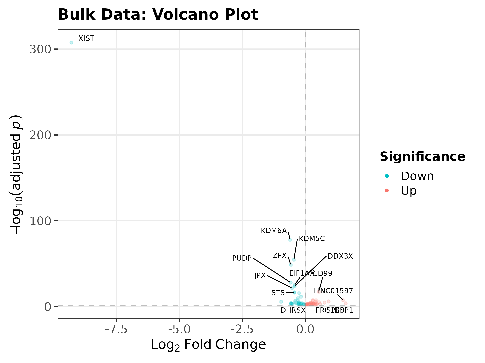

```{r setup, include=FALSE}
knitr::opts_chunk$set(echo = FALSE, message = FALSE, warning = FALSE, fig.align = "center")
library(knitr)
# Shared supplementary-figure index: SF("key") resolves to the current figure
# number. Single source of truth for numbering across this document and the
# main manuscript. To reorder/add/drop a figure, edit supp_fig_keys in the file.
source("_supp_fig_index.R")
# Same for supplementary tables: ST("key") resolves to the current table number.
source("_supp_table_index.R")
# Shared numeric-reference registry: val("key") resolves a data-derived
# statistic to its current value, read live from the source CSV at knit time
# (the number-analogue of SF()). Single source of truth for quoted numbers.
source("_paper_values.R")
```

<!--
Supplementary Information for the Nature Communications submission.

Ordering convention (Nature Comms):
  1. Supplementary Figures  (Supplementary Fig. 1 ... N)
  2. Supplementary Tables   (Supplementary Table 1 ... N)
  3. Supplementary Notes    (optional; none used here)
  4. Supplementary References (inherited from main bibliography)

All large tabular data is exported as separate `Supplementary Data N` files
(listed at the end of this document). Source data per main figure is
packaged into separate Excel workbooks per Nature Comms requirements.

Cross-references from the main manuscript should read "Supplementary Fig. N",
"Supplementary Table N", or "Supplementary Data N" (flat-numbered, not nested
under main-figure numbers).
-->

# Supplementary Figures

## Supplementary Fig. `r SF("pca_gallery")`. PCA gallery for unfiltered and filtered PsychAD cohorts

Principal component analysis (PCA) of pseudobulked donors showing the effect of filtering. Rows (top to bottom): log~2~ cell count, sex, age, brain bank source, disease status, and self-reported ethnicity. Columns: astrocytes (left), microglia (centre), and oligodendrocytes (right).

```{r SuppFig8a-PCA-Unfiltered, out.width="32%", fig.show='hold', fig.cap=paste0("Complete PCA gallery for the unfiltered PsychAD dataset (N = ", val("n_donors_prefilter_astro", big = TRUE), "/", val("n_donors_prefilter_micro", big = TRUE), "/", val("n_donors_prefilter_oligo", big = TRUE), " donors for Astro/Micro/Oligo). Each row shows one metadata covariate; columns show astrocytes (left), microglia (centre), and oligodendrocytes (right). Top to bottom: log~2~ cell count, sex, age, brain bank source, disease status, and self-reported ethnicity.")}
# Row 1: Log2 Cells
knitr::include_graphics(c(
  "Datalink/Exploratory_Analysis/Astro/Roussos_Full/PCA/PCA_FullCohort_Log2_Cells_scaled.png",
  "Datalink/Exploratory_Analysis/Micro/Roussos_Full/PCA/PCA_FullCohort_Log2_Cells_scaled.png",
  "Datalink/Exploratory_Analysis/Oligo/Roussos_Full/PCA/PCA_FullCohort_Log2_Cells_scaled.png"
))
# Row 2: Sex
knitr::include_graphics(c(
  "Datalink/Exploratory_Analysis/Astro/Roussos_Full/PCA/PCA_FullCohort_sex_scaled.png",
  "Datalink/Exploratory_Analysis/Micro/Roussos_Full/PCA/PCA_FullCohort_sex_scaled.png",
  "Datalink/Exploratory_Analysis/Oligo/Roussos_Full/PCA/PCA_FullCohort_sex_scaled.png"
))
# Row 3: Age
knitr::include_graphics(c(
  "Datalink/Exploratory_Analysis/Astro/Roussos_Full/PCA/PCA_FullCohort_Age_Years_scaled.png",
  "Datalink/Exploratory_Analysis/Micro/Roussos_Full/PCA/PCA_FullCohort_Age_Years_scaled.png",
  "Datalink/Exploratory_Analysis/Oligo/Roussos_Full/PCA/PCA_FullCohort_Age_Years_scaled.png"
))
# Row 4: Source
knitr::include_graphics(c(
  "Datalink/Exploratory_Analysis/Astro/Roussos_Full/PCA/PCA_FullCohort_Source_scaled.png",
  "Datalink/Exploratory_Analysis/Micro/Roussos_Full/PCA/PCA_FullCohort_Source_scaled.png",
  "Datalink/Exploratory_Analysis/Oligo/Roussos_Full/PCA/PCA_FullCohort_Source_scaled.png"
))
# Row 5: Disease
knitr::include_graphics(c(
  "Datalink/Exploratory_Analysis/Astro/Roussos_Full/PCA/PCA_FullCohort_disease_scaled.png",
  "Datalink/Exploratory_Analysis/Micro/Roussos_Full/PCA/PCA_FullCohort_disease_scaled.png",
  "Datalink/Exploratory_Analysis/Oligo/Roussos_Full/PCA/PCA_FullCohort_disease_scaled.png"
))
# Row 6: Ethnicity
knitr::include_graphics(c(
  "Datalink/Exploratory_Analysis/Astro/Roussos_Full/PCA/PCA_FullCohort_self_reported_ethnicity_scaled.png",
  "Datalink/Exploratory_Analysis/Micro/Roussos_Full/PCA/PCA_FullCohort_self_reported_ethnicity_scaled.png",
  "Datalink/Exploratory_Analysis/Oligo/Roussos_Full/PCA/PCA_FullCohort_self_reported_ethnicity_scaled.png"
))
```

```{r SuppFig8b-PCA-Filtered, out.width="32%", fig.show="hold", fig.cap=paste0("Complete PCA gallery for the filtered PsychAD analysis cohort (age $\\geq$ 40, $\\geq$ 30 cells; N = ", val("n_donors_astro", big = TRUE), "/", val("n_donors_micro", big = TRUE), "/", val("n_donors_oligo", big = TRUE), " donors for Astro/Micro/Oligo). Layout identical to the unfiltered gallery above. Compared with the unfiltered gallery, the cell-count gradient is attenuated, the outlier cluster in oligodendrocytes is absent, and the overall point cloud is more compact.")}
# Row 1: Log2 Cells
knitr::include_graphics(c(
  "Datalink/Exploratory_Analysis/Astro/Roussos/PCA/PCA_FilteredCohort_Log2_Cells_scaled.png",
  "Datalink/Exploratory_Analysis/Micro/Roussos/PCA/PCA_FilteredCohort_Log2_Cells_scaled.png",
  "Datalink/Exploratory_Analysis/Oligo/Roussos/PCA/PCA_FilteredCohort_Log2_Cells_scaled.png"
))
# Row 2: Sex
knitr::include_graphics(c(
  "Datalink/Exploratory_Analysis/Astro/Roussos/PCA/PCA_FilteredCohort_sex_scaled.png",
  "Datalink/Exploratory_Analysis/Micro/Roussos/PCA/PCA_FilteredCohort_sex_scaled.png",
  "Datalink/Exploratory_Analysis/Oligo/Roussos/PCA/PCA_FilteredCohort_sex_scaled.png"
))
# Row 3: Age
knitr::include_graphics(c(
  "Datalink/Exploratory_Analysis/Astro/Roussos/PCA/PCA_FilteredCohort_Age_Years_scaled.png",
  "Datalink/Exploratory_Analysis/Micro/Roussos/PCA/PCA_FilteredCohort_Age_Years_scaled.png",
  "Datalink/Exploratory_Analysis/Oligo/Roussos/PCA/PCA_FilteredCohort_Age_Years_scaled.png"
))
# Row 4: Source
knitr::include_graphics(c(
  "Datalink/Exploratory_Analysis/Astro/Roussos/PCA/PCA_FilteredCohort_Source_scaled.png",
  "Datalink/Exploratory_Analysis/Micro/Roussos/PCA/PCA_FilteredCohort_Source_scaled.png",
  "Datalink/Exploratory_Analysis/Oligo/Roussos/PCA/PCA_FilteredCohort_Source_scaled.png"
))
# Row 5: Disease
knitr::include_graphics(c(
  "Datalink/Exploratory_Analysis/Astro/Roussos/PCA/PCA_FilteredCohort_disease_scaled.png",
  "Datalink/Exploratory_Analysis/Micro/Roussos/PCA/PCA_FilteredCohort_disease_scaled.png",
  "Datalink/Exploratory_Analysis/Oligo/Roussos/PCA/PCA_FilteredCohort_disease_scaled.png"
))
# Row 6: Ethnicity
knitr::include_graphics(c(
  "Datalink/Exploratory_Analysis/Astro/Roussos/PCA/PCA_FilteredCohort_self_reported_ethnicity_scaled.png",
  "Datalink/Exploratory_Analysis/Micro/Roussos/PCA/PCA_FilteredCohort_self_reported_ethnicity_scaled.png",
  "Datalink/Exploratory_Analysis/Oligo/Roussos/PCA/PCA_FilteredCohort_self_reported_ethnicity_scaled.png"
))
```

# Supplementary Figures: cross-method downsampling grids

## Supplementary Fig. `r SF("crossmethod_recall_cells")`. Cross-method recall grids (cells-based mode)

For each cell type, rows represent the DE method used to define ground-truth genes and columns represent the DE method used in the downsampled detection step. Each cell in the 3×3 grid shows recall within four LFC-magnitude bins (|LFC| 0.2–1, 1–2, 2–3, >3). High off-diagonal values indicate concordant power behaviour across methods; large between-row differences indicate that the choice of truth-definition method affects observed recall. Cells-based sampling mode.

```{r SuppFig18-CrossRecall-cells, out.width="90%", fig.show="hold", fig.cap="Cross-method recall grids (cells-based mode) for astrocytes (left), microglia (centre), and oligodendrocytes (right). Rows are the truth-defining DE method; columns are the downsampling DE method; panels show recall by LFC bin."}
knitr::include_graphics(c(
  "Datalink/Composed_Figures/Cross_Score/crossscore_recall_mega_Astro_cells_discrete_raw.png",
  "Datalink/Composed_Figures/Cross_Score/crossscore_recall_mega_Micro_cells_discrete_raw.png",
  "Datalink/Composed_Figures/Cross_Score/crossscore_recall_mega_Oligo_cells_discrete_raw.png"
))
```

## Supplementary Fig. `r SF("crossmethod_recall_reads")`. Cross-method recall grids (UMI-budget mode)

Same layout as Supplementary Fig. `r SF("crossmethod_recall_cells")`, with UMIs per cell on the x-axis instead of cells per donor. UMI-budget sampling mode.

```{r SuppFig19-CrossRecall-reads, out.width="90%", fig.show="hold", fig.cap="Cross-method recall grids (UMI-budget mode) for astrocytes (left), microglia (centre), and oligodendrocytes (right)."}
knitr::include_graphics(c(
  "Datalink/Composed_Figures/Cross_Score/crossscore_recall_mega_Astro_reads_discrete_raw.png",
  "Datalink/Composed_Figures/Cross_Score/crossscore_recall_mega_Micro_reads_discrete_raw.png",
  "Datalink/Composed_Figures/Cross_Score/crossscore_recall_mega_Oligo_reads_discrete_raw.png"
))
```

## Supplementary Fig. `r SF("crossmethod_precision_cells")`. Cross-method precision grids (cells-based mode)

Same 3×3 layout as Supplementary Fig. `r SF("crossmethod_recall_cells")`, showing precision rather than recall. Cells-based sampling mode.

```{r SuppFig20-CrossPrecision-cells, out.width="90%", fig.show="hold", fig.cap="Cross-method precision grids (cells-based mode) for astrocytes (left), microglia (centre), and oligodendrocytes (right). Rows are the truth-defining DE method; columns are the downsampling DE method; panels show precision by LFC bin."}
knitr::include_graphics(c(
  "Datalink/Composed_Figures/Cross_Score/crossscore_precision_mega_Astro_cells_discrete_raw.png",
  "Datalink/Composed_Figures/Cross_Score/crossscore_precision_mega_Micro_cells_discrete_raw.png",
  "Datalink/Composed_Figures/Cross_Score/crossscore_precision_mega_Oligo_cells_discrete_raw.png"
))
```

## Supplementary Fig. `r SF("crossmethod_precision_reads")`. Cross-method precision grids (UMI-budget mode)

Same layout as Supplementary Fig. `r SF("crossmethod_precision_cells")`, UMI-budget sampling mode.

```{r SuppFig21-CrossPrecision-reads, out.width="90%", fig.show="hold", fig.cap="Cross-method precision grids (UMI-budget mode) for astrocytes (left), microglia (centre), and oligodendrocytes (right)."}
knitr::include_graphics(c(
  "Datalink/Composed_Figures/Cross_Score/crossscore_precision_mega_Astro_reads_discrete_raw.png",
  "Datalink/Composed_Figures/Cross_Score/crossscore_precision_mega_Micro_reads_discrete_raw.png",
  "Datalink/Composed_Figures/Cross_Score/crossscore_precision_mega_Oligo_reads_discrete_raw.png"
))
```

------------------------------------------------------------------------

# Supplementary Figures: per-method downsampling grids

The following figures decompose the method-pooled Cartesian downsampling results (Supplementary Figs. `r SF("recall_continuous_surfaces")`-`r SF("recall_discrete_heatmaps")`) by the three differential-expression methods, showing DESeq2, edgeR, limma-voom, and the pooled all-methods result side by side (2×2 panel per figure) for a single cell type. They complement the cross-method comparison grids (Supplementary Figs. `r SF("crossmethod_recall_cells")`-`r SF("crossmethod_precision_reads")`), which instead cross each method's truth set against each method's detection step. For every figure the cells-based sampling mode is shown on top and the UMI-budget mode below. Three views are provided per cell type and metric: the continuous semi-log surface across the full donor grid, and the recall/precision-versus-gene-count curves within the tiny (|LFC| 0.2-1.0) and small (|LFC| 1.0-2.0) effect-size bins that the paper identifies as the underpowered regime.

## Supplementary Fig. `r SF("bymethod_astro_recall_surface")`. Astrocytes: recall surface across the downsampling grid, by DE method

```{r SuppFig27-AstroRecallSurface-bymethod, out.width="99%", fig.show='hold', fig.cap="Astrocyte continuous recall surfaces (semi-log scale) split by DE method (DESeq2, edgeR, limma-voom, all-methods pooled). Cells-based sampling mode (top) and UMI-budget sampling mode (bottom). Each panel tiles the four methods in a 2×2 grid."}
knitr::include_graphics(c(
  "Datalink/Composed_Figures/Supplementary/supp_astro_recall_surface_bymethod_cells.png",
  "Datalink/Composed_Figures/Supplementary/supp_astro_recall_surface_bymethod_reads.png"
))
```

## Supplementary Fig. `r SF("bymethod_astro_precision_surface")`. Astrocytes: precision surface across the downsampling grid, by DE method

```{r SuppFig28-AstroPrecisionSurface-bymethod, out.width="99%", fig.show='hold', fig.cap="Astrocyte continuous precision surfaces (semi-log scale) split by DE method. Cells-based sampling mode (top) and UMI-budget sampling mode (bottom)."}
knitr::include_graphics(c(
  "Datalink/Composed_Figures/Supplementary/supp_astro_precision_surface_bymethod_cells.png",
  "Datalink/Composed_Figures/Supplementary/supp_astro_precision_surface_bymethod_reads.png"
))
```

## Supplementary Fig. `r SF("bymethod_astro_recall_tiny")`. Astrocytes: tiny-effect (|LFC| 0.2-1.0) recall versus gene counts, by DE method

```{r SuppFig29-AstroRecallTiny-bymethod, out.width="99%", fig.show='hold', fig.cap="Astrocyte recall across gene counts within the tiny effect-size bin (|LFC| 0.2-1.0), split by DE method. Cells-based sampling mode (top) and UMI-budget sampling mode (bottom)."}
knitr::include_graphics(c(
  "Datalink/Composed_Figures/Supplementary/supp_astro_recall_tiny_bymethod_cells.png",
  "Datalink/Composed_Figures/Supplementary/supp_astro_recall_tiny_bymethod_reads.png"
))
```

## Supplementary Fig. `r SF("bymethod_astro_precision_tiny")`. Astrocytes: tiny-effect (|LFC| 0.2-1.0) precision versus gene counts, by DE method

```{r SuppFig30-AstroPrecisionTiny-bymethod, out.width="99%", fig.show='hold', fig.cap="Astrocyte precision across gene counts within the tiny effect-size bin (|LFC| 0.2-1.0), split by DE method. Cells-based sampling mode (top) and UMI-budget sampling mode (bottom)."}
knitr::include_graphics(c(
  "Datalink/Composed_Figures/Supplementary/supp_astro_precision_tiny_bymethod_cells.png",
  "Datalink/Composed_Figures/Supplementary/supp_astro_precision_tiny_bymethod_reads.png"
))
```

## Supplementary Fig. `r SF("bymethod_astro_recall_small")`. Astrocytes: small-effect (|LFC| 1.0-2.0) recall versus gene counts, by DE method

```{r SuppFig31-AstroRecallSmall-bymethod, out.width="99%", fig.show='hold', fig.cap="Astrocyte recall across gene counts within the small effect-size bin (|LFC| 1.0-2.0), split by DE method. Cells-based sampling mode (top) and UMI-budget sampling mode (bottom)."}
knitr::include_graphics(c(
  "Datalink/Composed_Figures/Supplementary/supp_astro_recall_small_bymethod_cells.png",
  "Datalink/Composed_Figures/Supplementary/supp_astro_recall_small_bymethod_reads.png"
))
```

## Supplementary Fig. `r SF("bymethod_astro_precision_small")`. Astrocytes: small-effect (|LFC| 1.0-2.0) precision versus gene counts, by DE method

```{r SuppFig32-AstroPrecisionSmall-bymethod, out.width="99%", fig.show='hold', fig.cap="Astrocyte precision across gene counts within the small effect-size bin (|LFC| 1.0-2.0), split by DE method. Cells-based sampling mode (top) and UMI-budget sampling mode (bottom)."}
knitr::include_graphics(c(
  "Datalink/Composed_Figures/Supplementary/supp_astro_precision_small_bymethod_cells.png",
  "Datalink/Composed_Figures/Supplementary/supp_astro_precision_small_bymethod_reads.png"
))
```

## Supplementary Fig. `r SF("bymethod_micro_recall_surface")`. Microglia: recall surface across the downsampling grid, by DE method

```{r SuppFig33-MicroRecallSurface-bymethod, out.width="99%", fig.show='hold', fig.cap="Microglia continuous recall surfaces (semi-log scale) split by DE method. Cells-based sampling mode (top) and UMI-budget sampling mode (bottom)."}
knitr::include_graphics(c(
  "Datalink/Composed_Figures/Supplementary/supp_micro_recall_surface_bymethod_cells.png",
  "Datalink/Composed_Figures/Supplementary/supp_micro_recall_surface_bymethod_reads.png"
))
```

## Supplementary Fig. `r SF("bymethod_micro_precision_surface")`. Microglia: precision surface across the downsampling grid, by DE method

```{r SuppFig34-MicroPrecisionSurface-bymethod, out.width="99%", fig.show='hold', fig.cap="Microglia continuous precision surfaces (semi-log scale) split by DE method. Cells-based sampling mode (top) and UMI-budget sampling mode (bottom)."}
knitr::include_graphics(c(
  "Datalink/Composed_Figures/Supplementary/supp_micro_precision_surface_bymethod_cells.png",
  "Datalink/Composed_Figures/Supplementary/supp_micro_precision_surface_bymethod_reads.png"
))
```

## Supplementary Fig. `r SF("bymethod_micro_recall_tiny")`. Microglia: tiny-effect (|LFC| 0.2-1.0) recall versus gene counts, by DE method

```{r SuppFig35-MicroRecallTiny-bymethod, out.width="99%", fig.show='hold', fig.cap="Microglia recall across gene counts within the tiny effect-size bin (|LFC| 0.2-1.0), split by DE method. Cells-based sampling mode (top) and UMI-budget sampling mode (bottom)."}
knitr::include_graphics(c(
  "Datalink/Composed_Figures/Supplementary/supp_micro_recall_tiny_bymethod_cells.png",
  "Datalink/Composed_Figures/Supplementary/supp_micro_recall_tiny_bymethod_reads.png"
))
```

## Supplementary Fig. `r SF("bymethod_micro_precision_tiny")`. Microglia: tiny-effect (|LFC| 0.2-1.0) precision versus gene counts, by DE method

```{r SuppFig36-MicroPrecisionTiny-bymethod, out.width="99%", fig.show='hold', fig.cap="Microglia precision across gene counts within the tiny effect-size bin (|LFC| 0.2-1.0), split by DE method. Cells-based sampling mode (top) and UMI-budget sampling mode (bottom)."}
knitr::include_graphics(c(
  "Datalink/Composed_Figures/Supplementary/supp_micro_precision_tiny_bymethod_cells.png",
  "Datalink/Composed_Figures/Supplementary/supp_micro_precision_tiny_bymethod_reads.png"
))
```

## Supplementary Fig. `r SF("bymethod_micro_recall_small")`. Microglia: small-effect (|LFC| 1.0-2.0) recall versus gene counts, by DE method

```{r SuppFig37-MicroRecallSmall-bymethod, out.width="99%", fig.show='hold', fig.cap="Microglia recall across gene counts within the small effect-size bin (|LFC| 1.0-2.0), split by DE method. Cells-based sampling mode (top) and UMI-budget sampling mode (bottom)."}
knitr::include_graphics(c(
  "Datalink/Composed_Figures/Supplementary/supp_micro_recall_small_bymethod_cells.png",
  "Datalink/Composed_Figures/Supplementary/supp_micro_recall_small_bymethod_reads.png"
))
```

## Supplementary Fig. `r SF("bymethod_micro_precision_small")`. Microglia: small-effect (|LFC| 1.0-2.0) precision versus gene counts, by DE method

```{r SuppFig38-MicroPrecisionSmall-bymethod, out.width="99%", fig.show='hold', fig.cap="Microglia precision across gene counts within the small effect-size bin (|LFC| 1.0-2.0), split by DE method. Cells-based sampling mode (top) and UMI-budget sampling mode (bottom)."}
knitr::include_graphics(c(
  "Datalink/Composed_Figures/Supplementary/supp_micro_precision_small_bymethod_cells.png",
  "Datalink/Composed_Figures/Supplementary/supp_micro_precision_small_bymethod_reads.png"
))
```

## Supplementary Fig. `r SF("bymethod_oligo_recall_surface")`. Oligodendrocytes: recall surface across the downsampling grid, by DE method

```{r SuppFig39-OligoRecallSurface-bymethod, out.width="99%", fig.show='hold', fig.cap="Oligodendrocyte continuous recall surfaces (semi-log scale) split by DE method. Cells-based sampling mode (top) and UMI-budget sampling mode (bottom)."}
knitr::include_graphics(c(
  "Datalink/Composed_Figures/Supplementary/supp_oligo_recall_surface_bymethod_cells.png",
  "Datalink/Composed_Figures/Supplementary/supp_oligo_recall_surface_bymethod_reads.png"
))
```

## Supplementary Fig. `r SF("bymethod_oligo_precision_surface")`. Oligodendrocytes: precision surface across the downsampling grid, by DE method

```{r SuppFig40-OligoPrecisionSurface-bymethod, out.width="99%", fig.show='hold', fig.cap="Oligodendrocyte continuous precision surfaces (semi-log scale) split by DE method. Cells-based sampling mode (top) and UMI-budget sampling mode (bottom)."}
knitr::include_graphics(c(
  "Datalink/Composed_Figures/Supplementary/supp_oligo_precision_surface_bymethod_cells.png",
  "Datalink/Composed_Figures/Supplementary/supp_oligo_precision_surface_bymethod_reads.png"
))
```

## Supplementary Fig. `r SF("bymethod_oligo_recall_tiny")`. Oligodendrocytes: tiny-effect (|LFC| 0.2-1.0) recall versus gene counts, by DE method

```{r SuppFig41-OligoRecallTiny-bymethod, out.width="99%", fig.show='hold', fig.cap="Oligodendrocyte recall across gene counts within the tiny effect-size bin (|LFC| 0.2-1.0), split by DE method. Cells-based sampling mode (top) and UMI-budget sampling mode (bottom)."}
knitr::include_graphics(c(
  "Datalink/Composed_Figures/Supplementary/supp_oligo_recall_tiny_bymethod_cells.png",
  "Datalink/Composed_Figures/Supplementary/supp_oligo_recall_tiny_bymethod_reads.png"
))
```

## Supplementary Fig. `r SF("bymethod_oligo_precision_tiny")`. Oligodendrocytes: tiny-effect (|LFC| 0.2-1.0) precision versus gene counts, by DE method

```{r SuppFig42-OligoPrecisionTiny-bymethod, out.width="99%", fig.show='hold', fig.cap="Oligodendrocyte precision across gene counts within the tiny effect-size bin (|LFC| 0.2-1.0), split by DE method. Cells-based sampling mode (top) and UMI-budget sampling mode (bottom)."}
knitr::include_graphics(c(
  "Datalink/Composed_Figures/Supplementary/supp_oligo_precision_tiny_bymethod_cells.png",
  "Datalink/Composed_Figures/Supplementary/supp_oligo_precision_tiny_bymethod_reads.png"
))
```

## Supplementary Fig. `r SF("bymethod_oligo_recall_small")`. Oligodendrocytes: small-effect (|LFC| 1.0-2.0) recall versus gene counts, by DE method

```{r SuppFig43-OligoRecallSmall-bymethod, out.width="99%", fig.show='hold', fig.cap="Oligodendrocyte recall across gene counts within the small effect-size bin (|LFC| 1.0-2.0), split by DE method. Cells-based sampling mode (top) and UMI-budget sampling mode (bottom)."}
knitr::include_graphics(c(
  "Datalink/Composed_Figures/Supplementary/supp_oligo_recall_small_bymethod_cells.png",
  "Datalink/Composed_Figures/Supplementary/supp_oligo_recall_small_bymethod_reads.png"
))
```

## Supplementary Fig. `r SF("bymethod_oligo_precision_small")`. Oligodendrocytes: small-effect (|LFC| 1.0-2.0) precision versus gene counts, by DE method

```{r SuppFig44-OligoPrecisionSmall-bymethod, out.width="99%", fig.show='hold', fig.cap="Oligodendrocyte precision across gene counts within the small effect-size bin (|LFC| 1.0-2.0), split by DE method. Cells-based sampling mode (top) and UMI-budget sampling mode (bottom)."}
knitr::include_graphics(c(
  "Datalink/Composed_Figures/Supplementary/supp_oligo_precision_small_bymethod_cells.png",
  "Datalink/Composed_Figures/Supplementary/supp_oligo_precision_small_bymethod_reads.png"
))
```

# Supplementary Figures: method-pooled downsampling surfaces

## Supplementary Fig. `r SF("recall_continuous_surfaces")`. Continuous recall surfaces (cells-based and UMI-budget modes)

Continuous recall surfaces for astrocytes, microglia, and oligodendrocytes under both cells-based sampling, and UMI-budget sampling. The same qualitative patterns are observed across all three cell types: large-effect genes are readily detected at modest sample sizes, while small-effect genes remain below 80% recall across the entire experimental space. The apparent power ordering (microglia > astrocytes > oligodendrocytes) is an artefact of ground-truth censorship, as explained in the main text.

```{r SuppFig1a-AstroMicro-cells, out.width="99%", fig.show='hold', fig.cap="Continuous recall surfaces (semi-log scale, cells-based mode) for astrocytes (top), microglia (middle), and oligodendrocytes (bottom)."}
knitr::include_graphics(c(
  "Datalink/Cartesian_Downsampling/Astro/Roussos/cells/all_methods/Continuous_Viz_Log/Mean_Recall_Total_Continuous_SemiLog.png",
  "Datalink/Cartesian_Downsampling/Micro/Roussos/cells/all_methods/Continuous_Viz_Log/Mean_Recall_Total_Continuous_SemiLog.png",
  "Datalink/Cartesian_Downsampling/Oligo/Roussos/cells/all_methods/Continuous_Viz_Log/Mean_Recall_Total_Continuous_SemiLog.png"
))
```

```{r SuppFig1b-AstroMicro-reads, out.width="99%", fig.show='hold', fig.cap="Continuous recall surfaces (semi-log scale, UMI-budget mode) for astrocytes (top), microglia (middle), and oligodendrocytes (bottom). Same layout as cells-based version above, with UMIs per cell on the x-axis."}
knitr::include_graphics(c(
  "Datalink/Cartesian_Downsampling/Astro/Roussos/reads/all_methods/Continuous_Viz_Log/Mean_Recall_Total_Continuous_SemiLog.png",
  "Datalink/Cartesian_Downsampling/Micro/Roussos/reads/all_methods/Continuous_Viz_Log/Mean_Recall_Total_Continuous_SemiLog.png",
  "Datalink/Cartesian_Downsampling/Oligo/Roussos/reads/all_methods/Continuous_Viz_Log/Mean_Recall_Total_Continuous_SemiLog.png"
))
```

## Supplementary Fig. `r SF("precision_heatmaps")`. Precision heatmaps (cells-based and UMI-budget modes)

Astrocyte, microglial, and oligodendrocyte precision heatmaps.

```{r SuppFig4a-Precision-cells, out.width="99%", fig.show="hold", fig.cap="Precision heatmaps for cells-based downsampling, astrocytes (top), microglia (middle), and oligodendrocytes (bottom). Large-effect precision remains >0.90 across most configurations; small-effect precision degrades at higher cell counts, reflecting the precision-recall trade-off."}
knitr::include_graphics(c(
  "Datalink/Cartesian_Downsampling/Astro/Roussos/cells/all_methods/Plots/Mean_Precision_Total.png",
  "Datalink/Cartesian_Downsampling/Micro/Roussos/cells/all_methods/Plots/Mean_Precision_Total.png",
  "Datalink/Cartesian_Downsampling/Oligo/Roussos/cells/all_methods/Plots/Mean_Precision_Total.png"
))
```

```{r SuppFig4b-Precision-reads, out.width="99%", fig.show="hold", fig.cap="Precision heatmaps for UMI-budget downsampling, astrocytes (top), microglia (middle), and oligodendrocytes (bottom). Layout identical to cells-based mode, but columns represent UMIs per cell rather than cells per donor."}
knitr::include_graphics(c(
  "Datalink/Cartesian_Downsampling/Astro/Roussos/reads/all_methods/Plots/Mean_Precision_Total.png",
  "Datalink/Cartesian_Downsampling/Micro/Roussos/reads/all_methods/Plots/Mean_Precision_Total.png",
  "Datalink/Cartesian_Downsampling/Oligo/Roussos/reads/all_methods/Plots/Mean_Precision_Total.png"
))
```

## Supplementary Fig. `r SF("recall_discrete_heatmaps")`. Discrete recall heatmaps (cells-based and UMI-budget modes)

Discrete recall grids for astrocytes, microglia, and oligodendrocytes under both cells-based sampling, and UMI-budget sampling. The same qualitative patterns are observed across all three cell types: large-effect genes are readily detected at modest sample sizes, while small-effect genes remain below 80% recall across the entire experimental space. The apparent power ordering (microglia > astrocytes > oligodendrocytes) is an artefact of ground-truth censorship, as explained in the main text.

```{r SuppFig2a-Discrete-cells, out.width="99%", fig.show='hold', fig.cap="Discrete recall heatmaps from Cartesian downsampling (cells-based mode) for astrocytes (top), microglia (middle), and oligodendrocytes (bottom)."}
knitr::include_graphics(c(
  "Datalink/Cartesian_Downsampling/Astro/Roussos/cells/all_methods/Plots/Mean_Recall_Total.png",
  "Datalink/Cartesian_Downsampling/Micro/Roussos/cells/all_methods/Plots/Mean_Recall_Total.png",
  "Datalink/Cartesian_Downsampling/Oligo/Roussos/cells/all_methods/Plots/Mean_Recall_Total.png"
))
```

```{r SuppFig2b-Discrete-reads, out.width="99%", fig.show="hold", fig.cap="Discrete recall heatmaps from Cartesian downsampling (UMI-budget mode) for astrocytes (top), microglia (middle), and oligodendrocytes (bottom)."}
knitr::include_graphics(c(
  "Datalink/Cartesian_Downsampling/Astro/Roussos/reads/all_methods/Plots/Mean_Recall_Total.png",
  "Datalink/Cartesian_Downsampling/Micro/Roussos/reads/all_methods/Plots/Mean_Recall_Total.png",
  "Datalink/Cartesian_Downsampling/Oligo/Roussos/reads/all_methods/Plots/Mean_Recall_Total.png"
))
```

# Supplementary Figures: Alzheimer's disease versus control

## Supplementary Fig. `r SF("ad_detection_trends")`. Detection of Alzheimer's disease effects follows the same trends as sex

In oligodendrocytes, detection of tiny Alzheimer's disease effects follows the same trends as for sex: recall rises with the number of donors, and the genes recovered are those with the most extreme ground-truth adjusted p-values and the highest counts. (A) Recall (left) and precision (right) of tiny-effect AD genes (|LFC| 0.2-1) across donors (x-axis) and cells per donor (y-axis; "Max" uses every available cell); the number in each tile is the value as a percentage. (B) Recall split into quartiles of the genes' ground-truth adjusted p-value, from the most significant quartile (Q1) to the least (Q4). (C) Recall split by gene counts (median raw pseudobulk count across ground-truth donors): high (200 or more), medium (50-200), low (10-50) and very low (under 10). Grey tiles are designs the data cannot supply, either because the validation half has too few donors (about 320, so 500 and 600 donors are not possible) or too few donors with that many cells.

The split-half downsampling of the main analysis was repeated with AD status in place of sex (Methods). In each of ten random splits, half the donors formed the ground truth, stratified by diagnosis and sex, and subsamples were drawn from the other half with equal numbers of males and females within each diagnosis group where enough donors were available. Each package's ground-truth genes are those with adjusted p-value below 0.05 and absolute log2 fold change above 0.2 in the ground-truth half; recall and precision are pooled over the three packages and the ten splits. The medium and large effect bins are not shown because they hold fewer than two ground-truth genes on average. Values are not comparable with the sex contrast: the AD ground truth comes from about half as many donors and the effects are of a different kind.

```{r SuppFig-AD-Panels, out.width="99%", fig.cap="Recall and precision of tiny-effect AD versus control genes in oligodendrocytes across the donor and cells-per-donor grid (A), recall by ground-truth adjusted p-value quartile (B) and by gene counts (C)."}
knitr::include_graphics("Datalink/AD_vs_Control/Composed_Figures/figure_ad_panels_oligo_cells.png")
```

<!-- COMMENTED OUT 2026-09-04: GTEx bulk RNA-seq validation removed from the paper.
## Supplementary Fig. GTEx bulk RNA-seq reference volcano plot
# ```{r SuppFig5-Bulk-Volcano, eval=FALSE, include=FALSE, out.width="99%", fig.cap="Volcano plot of the 79 tissue-consistent sex-biased DEGs from the GTEx v8 bulk RNA-seq analysis (voom-limma + MASH framework, 838 donors across 44 tissues). Each point represents a gene significant (LFSR < 0.05) in at least 90% of tissues; log~2~ fold change and significance values are averaged across significant tissues. XIST dominates the plot with a bulk LFC of -9.29. The top 10 most significant genes are labelled. Genes shared with the single-cell analysis are shown as translucent. Y-linked genes are absent from the bulk reference because the MASH framework cannot estimate fold change when one sex has no expression."}

# ```

## Supplementary Fig. Bulk-single-cell LFC concordance

Bulk-single-cell concordance plots shown for astrocytes(top), microglia (middle), and oligodendrocytes (bottom), both with Xist included (left), and without (right).

# ```{r SuppFig6-Bulk-SC-Correlation, eval=FALSE, include=FALSE, out.width="48%", fig.show="hold", fig.cap="Bulk-anchored LFC concordance between GTEx and PsychAD single-cell pseudobulk for genes significant in both modalities. Pearson correlations (excluding XIST): R = 0.91 (astrocytes, top), R = 0.93 (microglia, middle) and R = 0.88 (oligodendrocytes, right). Pearson correlations (including XIST): R = 0.97 (astrocytes, top), R = 0.97 (microglia, middle) and R = 0.97 (oligodendrocytes, right). Autosomal genes shown in grey, X-chromosome in pink; translucent points indicate genes not significant in single-cell. The black dashed line follows y = x."}
knitr::include_graphics(c(
  "Datalink/Bulk_Analysis/Astro/Compare_Correlation_BulkAnchored.png",
  "Datalink/Bulk_Analysis/Astro/Compare_Correlation_BulkAnchored_NoXIST.png",
  "Datalink/Bulk_Analysis/Micro/Compare_Correlation_BulkAnchored.png",
  "Datalink/Bulk_Analysis/Micro/Compare_Correlation_BulkAnchored_NoXIST.png",
  "Datalink/Bulk_Analysis/Oligo/Compare_Correlation_BulkAnchored.png",
  "Datalink/Bulk_Analysis/Oligo/Compare_Correlation_BulkAnchored_NoXIST.png"
))
# ```

## Supplementary Fig. Recovery of bulk reference genes

Of the 79 GTEx tissue-consistent reference genes, 72 were present in the PsychAD single-cell gene universe. The same 7 reference genes were absent in every cell type, implying technical rather than biological reasons: retired Ensembl identifiers, CellRanger PAR1 masking, oligo-dT invisibility of a non-polyadenylated long non-coding RNA, and pseudogene exclusion. Of the 72 testable genes, astrocytes recovered 72% (52/72), microglia 54% (39/72), and oligodendrocytes 68% (49/72). Recovery rates were consistently higher for sex-chromosome genes than for autosomal genes (Astro 79% vs 65%; Oligo 76% vs 59%; Micro 66% vs 41%). This asymmetry is expected: the sex-chromosome subset is enriched for X-inactivation escapees (e.g. KDM6A, KDM5C, DDX3X, ZFX) whose cell-intrinsic dosage mechanism should produce consistent fold changes in every cell type, whereas autosomal sex-biased expression is typically mediated by downstream hormonal or transcription-factor pathways that vary across cell types and are diluted in whole-tissue homogenates.

# ```{r SuppFig7-Recovery-Stats, eval=FALSE, include=FALSE, out.width="98%", fig.show="hold", fig.cap="Recovery of the 79 tissue-consistent bulk DEGs by the PsychAD single-cell pseudobulk analysis, stratified by chromosome type (Autosome vs Sex chromosome) and bulk log~2~ fold change magnitude. Genes are classified as Recovered (FDR < 0.05 with matching LFC direction; green), Insignificant (tested but not significant or discordant direction; yellow), NA-Filtered (removed by DESeq2 independent filtering; salmon), or Absent (not in single-cell gene set; grey). Results shown for astrocytes (top), microglia (middle), and oligodendrocytes (bottom)."}
knitr::include_graphics(c(
  "Datalink/Bulk_Analysis/Astro/Recovery_Stats_Stratified.png",
  "Datalink/Bulk_Analysis/Micro/Recovery_Stats_Stratified.png",
  "Datalink/Bulk_Analysis/Oligo/Recovery_Stats_Stratified.png"
))
# ```
-->

<!-- COMMENTED OUT 2026-09-04: cross-dataset ground-truth agreement removed from the paper.
## Supplementary Fig. Sign agreement matrices

# ```{r SuppFig9-Sign-Agreement, eval=FALSE, include=FALSE, out.width="32%", fig.show="hold", fig.cap="Sign agreement matrices for astrocytes (left), microglia (centre), and oligodendrocytes (right). Values represent the proportion of PsychAD significant genes (padj < 0.05, |LFC| > 1) where the direction of the sex effect is identical in both datasets. High values (>0.95, green) indicate consistent effect direction; values near 0.5 (red) would indicate random disagreement. Grey cells indicate no shared significant genes."}
knitr::include_graphics(c(
  "Datalink/Full_Ground_Truth/Astro/Diagnostic_Results/Sign_Agreement_Matrix_Roussos_Sig_Genes.png",
  "Datalink/Full_Ground_Truth/Micro/Diagnostic_Results/Sign_Agreement_Matrix_Roussos_Sig_Genes.png",
  "Datalink/Full_Ground_Truth/Oligo/Diagnostic_Results/Sign_Agreement_Matrix_Roussos_Sig_Genes.png"
))
# ```

## Supplementary Fig. LFC agreement matrices

# ```{r SuppFig10-LFC-Agreement, eval=FALSE, include=FALSE, out.width="32%", fig.show="hold", fig.cap="LFC agreement matrices for astrocytes (left), microglia (centre), and oligodendrocytes (right). Each cell shows Pearson correlation of LFC values between dataset pairs, restricted to PsychAD significant genes (padj < 0.05, |LFC| > 1). High correlations (>0.8, blue-green) confirm consistent effect sizes across datasets. Cross-dataset correlations (mean r = 0.82) approach the split-half ceiling (mean r = 0.92)."}
knitr::include_graphics(c(
  "Datalink/Full_Ground_Truth/Astro/Diagnostic_Results/LFC_Agreement_Matrix_Roussos_Sig_Genes.png",
  "Datalink/Full_Ground_Truth/Micro/Diagnostic_Results/LFC_Agreement_Matrix_Roussos_Sig_Genes.png",
  "Datalink/Full_Ground_Truth/Oligo/Diagnostic_Results/LFC_Agreement_Matrix_Roussos_Sig_Genes.png"
))
# ```
-->

<!-- COMMENTED OUT 2026-09-04: cross-dataset reproducibility panel removed from the paper.
## Supplementary Fig. Cross-dataset reproducibility panel (astrocytes and microglia)

Universe-controlled and raw IoU matrices summarising cross-dataset DEG overlap for astrocytes (top row) and microglia (bottom row). (A) Astrocytes, universe-controlled IoU. (B) Astrocytes, raw IoU (no universe control). (C) Microglia, universe-controlled IoU. (D) Microglia, raw IoU. Universe control restricts each pairwise comparison to genes tested in both datasets, removing the confound that differences in gene universe size otherwise inflate apparent discordance.

# ```{r Figure1-Supp16-Astro-Micro-Repro, eval=FALSE, include=FALSE, echo=FALSE, out.width="99%", fig.width=12, fig.height=8}
library(patchwork)
library(png)
library(grid)

read_png_grob <- function(path) {
  rasterGrob(readPNG(path), interpolate = TRUE)
}

astro_root <- "~/data/Power_Analysis_Paper/Datalink/Full_Ground_Truth/Astro/Diagnostic_Results"
micro_root <- "~/data/Power_Analysis_Paper/Datalink/Full_Ground_Truth/Micro/Diagnostic_Results"

pA <- wrap_elements(full = read_png_grob(file.path(astro_root, "Expanded_IoU_Matrix_Universe_Controlled.png")))
pB <- wrap_elements(full = read_png_grob(file.path(astro_root, "Expanded_IoU_Matrix.png")))
pC <- wrap_elements(full = read_png_grob(file.path(micro_root, "Expanded_IoU_Matrix_Universe_Controlled.png")))
pD <- wrap_elements(full = read_png_grob(file.path(micro_root, "Expanded_IoU_Matrix.png")))

((pA | pB) / (pC | pD)) + plot_annotation(tag_levels = "A")
# ```
-->

------------------------------------------------------------------------

# Supplementary Tables

## Supplementary Table `r ST("study_survey")`. Human brain sc/snRNA-seq DE studies surveyed (2022-2026) {#supp-table-study-survey}

```{r supptable-study-survey, message=FALSE}
library(knitr)

supp_tab2 <- tibble::tribble(
  ~`#`, ~Study,                                                          ~Year,  ~Donors, ~`LFC threshold`,
  1,  "Soreq et al. [@soreq2023singlecellrnasequencing]",                  2023,  "4",     "FC > 1.2",
  2,  "Puvogel et al. [@puvogel2024singlenucleusrnaseqcharacterizes]",     2024,  "8",     "0.1 / 0.25",
  3,  "Bøstrand et al. [@bøstrand2024mappingtheglial]",                    2024,  "12",    "0.25 / 0.8",
  4,  "Belchikov et al. [@belchikov2025asinglecelllongread]",              2025,  "12",    "0.1",
  5,  "Chia et al. [@chia2025singlenucleustranscriptomicsreveals]",        2025,  "20",    "1.0 / none",
  6,  "Christodoulou et al. [@christodoulou2023unravelingthetranscriptomic]", 2023, "23",  "1.0",
  7,  "Gamache et al. [@gamache2023integrativesinglenucleusmultiomics]",   2023,  "24",    "0.2",
  8,  "Almeida et al. [@almeida2024singlenucleusrnasequencing]",           2024,  "27",    "none / 0.25",
  9,  "Martirosyan et al. [@martirosyan2024unravellingcelltypespecific]",  2024,  "29",    "0.3",
  10, "DeCasien et al. [@decasien2026]",                                   2026,  "30",    "not stated",
  11, "Li et al. [@li2025singlenucleusrnasequencing]",                     2025,  "31",    "0.25",
  12, "Nishioka et al. [@nishioka2026disturbancesofparaventricular]",      2026,  "41",    "0.14-0.26",
  13, "Sayed et al. [@sayed2021]",                                         2021,  "46",    "0.5",
  14, "Murphy et al. [@murphy2023avoidingfalsediscoveries]",               2023,  "48",    "none",
  15, "Mathys et al. [@mathys2019]",                                       2019,  "48",    "0.5",
  16, "Yu et al. [@yu2024diseaseassociatedneurotoxicastrocyte]",           2024,  "53",    "0.25",
  17, "Soelter et al. [@soelter2024alteredglianeuroncommunication]",       2024,  "56",    "0.2 / 0.5",
  18, "Barba-Reyes et al. [@barbareyes2025oligodendrogliavulnerabilityin]", 2025, "63",    "0.5 (ln)",
  19, "Maitra et al. [@maitra2023celltypespecific]",                       2023,  "71",    "0.137",
  20, "Johansen et al. [@johansen2023]",                                   2023,  "~75",   "not found",
  21, "Miyoshi et al. [@miyoshi2024spatialandsinglenucleus]",              2024,  "~75",   "0.25",
  22, "Arbabi et al. [@arbabi2025transcriptomicpathologyof]",              2025,  "76",    "not found",
  23, "Clarence et al. [@clarence2025atranscriptomicroadmap]",             2025,  "97",    "0.2",
  24, "Ruzicka et al. [@ruzicka2024]",                                     2024,  "140",   "0.1",
  25, "Hoffman et al. [@hoffman2024efficientdifferentialexpression]",      2024,  "299",   "not found",
  26, "Green et al. [@green2024]",                                         2024,  "424",   "not found",
  27, "Mathys et al. [@mathys2024]",                                       2024,  "427",   "not found",
  28, "Sun et al. [@sun2023]",                                             2023,  "443",   "0.58",
  29, "Tang et al. [@tang2025nvuatlasacomprehensive]",                     2025,  "748",   "0.2",
  30, "Lee et al. [@lee2024singlecellatlasof]",                            2024,  "1,494", "not found"
)

kable(
  supp_tab2,
  caption = "Human brain sc/snRNA-seq differential expression studies surveyed (2019-2026). Ordered by donor count (ascending). LFC thresholds are |log~2~FC| unless otherwise noted. 'FC' denotes untransformed fold change; 'ln' denotes natural-log fold change; 'coeff' denotes a MAST regression coefficient.",
  align = c("r", "l", "c", "r", "l"),
  booktabs = TRUE
)
```

<!-- COMMENTED OUT 2026-09-04: cross-dataset IoU table removed from the paper.
## Supplementary Table 2. Raw versus universe-controlled IoU across dataset pairs

Comparison of raw and universe-controlled IoU values. Universe-controlled IoU restricts comparisons to genes present in both datasets' count matrices, penalising datasets for genes they possessed but failed to detect due to insufficient sequencing depth, while not penalising them for genes absent from their count matrix entirely. Raw IoU values (0.31-0.52) are substantially lower than universe-controlled values (0.60-0.92), with the largest improvements in comparisons involving datasets with smaller gene universes (e.g. ROSMAP-PsychAD microglia: raw 0.39, controlled 0.92).

| Cell Type        | Dataset Pair       | Raw IoU | Universe-Controlled IoU | Improvement |
|------------------|--------------------|---------|-------------------------|-------------|
| Astrocytes       | ROSMAP-PsychAD     | 0.34    | 0.81                    | +138%       |
| Astrocytes       | SEA-AD-PsychAD     | 0.48    | 0.72                    | +50%        |
| Astrocytes       | Johansen-PsychAD   | 0.35    | 0.87                    | +149%       |
| Astrocytes       | Rexach-PsychAD     | 0.43    | 0.80                    | +86%        |
| Microglia        | ROSMAP-PsychAD     | 0.39    | 0.92                    | +136%       |
| Microglia        | SEA-AD-PsychAD     | 0.43    | 0.60                    | +40%        |
| Microglia        | Johansen-PsychAD   | 0.38    | 0.86                    | +126%       |
| Microglia        | Rexach-PsychAD     | 0.47    | 0.88                    | +87%        |
| Oligodendrocytes | ROSMAP-PsychAD     | 0.39    | 0.87                    | +123%       |
| Oligodendrocytes | SEA-AD-PsychAD     | 0.52    | 0.79                    | +52%        |
| Oligodendrocytes | Johansen-PsychAD   | 0.35    | 0.76                    | +117%       |
| Oligodendrocytes | Rexach-PsychAD     | 0.38    | 0.78                    | +105%       |
-->

## Supplementary Table `r ST("deg_loss_equalisation")`. DEG loss under depth and cell-count equalisation, across DE methods and |LFC| thresholds {#supp-table-deg-loss}

Mean number of ground-truth sex-biased DEGs recovered in the PsychAD astrocyte and oligodendrocyte truth sets under a 2x2 grid of sequencing-depth and cell-count equalisation to microglia, computed independently for each cell type, each of the three DE methods and two effect-size thresholds. Each cell reports the mean DEG count over 10 robustness runs (50% donor split) with, in parentheses, that count as a percentage of the native (full depth, full cells) count for the same cell type, method and threshold. "Depth-equalised" multinomially downsamples every cell to microglia-equivalent UMIs per cell (factor `r val("depth_eq_factor_astro", digits = 4)` for astrocytes and `r val("depth_eq_factor_oligo", digits = 4)` for oligodendrocytes); "Cell-count-equalised" randomly subsamples each donor's cells to microglia-equivalent cell counts at native depth; "Depth + cell equalised" applies both. At the strict |LFC| > 1 threshold all three methods behave consistently in both cell types, losing DEGs as cells and depth are reduced, and losing the most when both are reduced. At the permissive |LFC| > 0.2 threshold DESeq2 and edgeR remain well behaved, losing `r val("deg_loss_pct_full_eq_deseq2", digits = 0)`% and `r val("deg_loss_pct_full_eq_edger", digits = 0)`% of astrocyte DEGs and `r val("deg_loss_pct_full_eq_deseq2_oligo", digits = 0)`% and `r val("deg_loss_pct_full_eq_edger_oligo", digits = 0)`% of oligodendrocyte DEGs under full equalisation, but limma-voom becomes numerically unstable. In astrocytes it inflates its DEG count under cell downsampling (`r val("deg_limma_pct_native_cell_eq", digits = 0)`% of native, and `r val("deg_limma_pct_native_full_eq", digits = 0)`% with depth equalisation as well); in oligodendrocytes it inflates under depth equalisation alone (`r val("deg_limma_pct_native_depth_eq_oligo", digits = 0)`%) but shrinks under cell downsampling (`r val("deg_limma_pct_native_cell_eq_oligo", digits = 0)`%, and `r val("deg_limma_pct_native_full_eq_oligo", digits = 0)`% with both). The contrast between the two thresholds is the reason limma-voom is excluded from the permissive-threshold analysis.

```{r supptable3-deg-loss, echo=FALSE}
deg_loss_table <- read.csv(
  here::here("Datalink", "Depth_Eq_DEG_Loss", "deg_loss_table.csv"),
  stringsAsFactors = FALSE, check.names = FALSE
)

knitr::kable(deg_loss_table,
             caption = "Mean ground-truth DEG count (percentage of native count) under depth and cell-count equalisation to microglia, by cell type, DE method and |LFC| threshold. limma-voom is numerically unstable at |LFC| > 0.2.",
             row.names = FALSE,
             align = c("l", "l", rep("r", 6)))
```

## Supplementary Table `r ST("de_package_agreement")`. Agreement between DE packages on full-cohort sex-biased DEGs {#supp-table-de-package-agreement}

DESeq2, edgeR and limma-voom called different sets of sex-biased genes from the same donors but agreed on the direction of almost every effect. Each package was run on the full filtered PsychAD cohort for each cell type with the same genes tested, and a gene was called when its BH-adjusted p-value was below 0.05 and its |log2 fold change| above 0.2 (the truth-set rule used throughout). "Called by any" and "Called by all three" are the union and intersection of the three packages' calls; "All three / any" is their ratio. "Same direction in all three" is the percentage of genes in the union whose log2 fold change has the same sign in all three packages, whether or not each package called the gene.

```{r supptable-de-package-agreement, echo=FALSE}
de_package_agreement <- read.csv(
  here::here("Datalink", "Paper_Source_Data", "de_package_agreement.csv"),
  stringsAsFactors = FALSE, check.names = FALSE
)

knitr::kable(de_package_agreement,
             caption = "Full-cohort sex-biased DEGs (padj < 0.05, |LFC| > 0.2) per DE package, their overlap, and agreement in effect direction.",
             row.names = FALSE,
             align = c("l", rep("r", 7)))
```

## Supplementary Table `r ST("sex_label_validation")`. Sex label validation by chromosomal marker expression {#supp-table-sex-validation}

Sex labels for all donors were validated by comparing annotated sex against pseudobulk expression of *XIST* (X-inactivation transcript, expected in females) and two Y-chromosome markers (*DDX3Y*, *KDM5D*) using logistic regression on library-size-normalised expression (counts per million, CPM). Expression was aggregated to the donor level before modelling to avoid single-cell noise [@kover2026pituitary]. In total, `r val("n_sex_discordant_donors")` donors (`r val("pct_sex_discordant_donors", digits = 1)`% of the cohort) showed strong discordance between their assigned sex and chromosomal marker expression; their statistics are shown below. All flagged donors were retained in the main analyses, as the ambiguity speaks to population-level variability, not a labeling error.

```{r supptable4-sex-validation, echo=FALSE}
sex_flag <- read.csv(
  here::here("Datalink", "Sex_Validation", "sex_exclusion_combined.csv"),
  stringsAsFactors = FALSE
)

sex_flag_display <- sex_flag[, c(
  "donor_id", "cell_type", "sex_label", "flag",
  "XIST_cpm", "P_female_XIST", "Y_combined_cpm", "P_male_Y",
  "n_cells"
)]

flag_labels <- c(
  "XIST_present_in_male"  = "XIST in labelled male",
  "Y_present_in_female"   = "Y gene in labelled female",
  "Y_absent_in_male"      = "Y gene absent in labelled male"
)
sex_flag_display$flag <- ifelse(
  sex_flag_display$flag %in% names(flag_labels),
  flag_labels[sex_flag_display$flag],
  sex_flag_display$flag
)

knitr::kable(
  sex_flag_display,
  caption = paste0(
    "Donors with discordant sex labels identified by pseudobulk chromosomal marker analysis. ",
    "XIST CPM = library-size-normalised expression of XIST (ENSG00000229807); ",
    "Y-gene CPM = combined normalised expression of DDX3Y (ENSG00000067048) and KDM5D (ENSG00000012817). ",
    "P(female|XIST) and P(male|Y) are logistic regression probabilities fitted on all donors in each cell type. ",
    "n_cells = number of nuclei for that donor in that cell type."
  ),
  col.names = c(
    "Donor ID", "Cell Type", "Labelled Sex", "Discordance Flag",
    "XIST CPM", "P(female|XIST)", "Y-gene CPM", "P(male|Y)",
    "N Cells"
  ),
  row.names = FALSE,
  digits = c(0, 0, 0, 0, 1, 3, 1, 3, 0),
  escape = FALSE
)
```

## Supplementary Table `r ST("autosomal_vs_sexchr")`. Autosomal versus sex-chromosome truth-gene characteristics {#supp-table-autosomal-vs-sexchr}
<!-- Not cited from the main text since the chromosome-stratified recall figure was dropped (2026-11-09). Cite it (e.g. from the sex-biased gene characteristics paragraph) or delete it. -->


```{r supptable-autosomal-vs-sexchr, message=FALSE}
autosomal_vs_sexchr <- read.csv(
  here::here("Datalink", "_scratch_autosomal_vs_sexchr_summary.csv")
)

autosomal_vs_sexchr <- autosomal_vs_sexchr[
  autosomal_vs_sexchr$n >= 5,
  c("cell_type", "bin", "chr_group", "n",
    "baseMean_median", "dispersion_median", "absLFC_median")
]
autosomal_vs_sexchr$chr_group <- gsub("_", " ", autosomal_vs_sexchr$chr_group)
autosomal_vs_sexchr <- autosomal_vs_sexchr[
  order(autosomal_vs_sexchr$cell_type,
        autosomal_vs_sexchr$bin,
        autosomal_vs_sexchr$chr_group), ]

knitr::kable(autosomal_vs_sexchr,
             caption = "Autosomal versus sex-chromosome gene properties in the PsychAD truth set, stratified by cell type and |LFC| bin. Within each bin, sex-chromosome genes show systematically higher gene counts and lower dispersion than autosomal genes, placing them in a favourable region of the power surface at equivalent fold change. Rows with n < 5 are suppressed.",
             col.names = c("Cell Type", "|LFC| Bin", "Group", "N",
                           "Median gene counts", "Median Dispersion", "Median |LFC|"),
             row.names = FALSE,
             escape = FALSE,
             digits = c(0, 0, 0, 0, 1, 3, 2))
```

------------------------------------------------------------------------

# Supplementary Data (external files)

Large tables are provided as separate files rather than in this document.

## Supplementary Data 1. PsychAD cohort characteristics and gene-universe composition

**File:** `Supplementary_Data_1_dataset_summary.xlsx` (two sheets).

*Dataset_Characteristics* gives, for each of the three cell types analysed (astrocytes, microglia and oligodendrocytes), the PsychAD cohort after filtering (donors aged 40 or over with at least 30 cells of that type): brain region (dorsolateral prefrontal cortex), number of donors, total number of cells, and the mean, standard deviation and median of cells per donor, UMIs per cell and genes detected per cell. The data are public on CELLxGENE Discover (collection `84ce6837-548d-4a1f-919f-0bc0d9a3952f`) [@fullard2025].

*Gene_Universe_Composition* breaks down the full set of genes in the PsychAD count matrices (before any expression filtering) for each cell type: total genes, genes on the X chromosome, the Y chromosome, the autosomes, the mitochondrial genome and the pseudoautosomal regions, and the number of protein-coding genes, pseudogenes, long non-coding RNAs and genes with no biotype annotation. "Roussos" in the Dataset column is the internal name for the PsychAD cohort.

## Supplementary Data 4. Performance of every XGBoost power-model configuration

**File:** `Supplementary_Data_4_xgboost_hyperparameters.csv`

Cross-validated performance of all `r val("xgb_n_configs")` XGBoost configurations tested for the power model, trained on designs with at least 100 cells per donor. Configurations are every combination of the loss-reweighting exponent $\alpha \in \{0, 0.5, 1\}$, maximum tree depth (3, 4, 6 or 10), learning rate (0.01, 0.03 or 0.1) and minimum child weight (1, 10 or 25); row and column subsampling were fixed at 0.8. Each training row (one gene at one design) is weighted by its number of pseudo-experiments, multiplied by $(1/p_B)^{\alpha}$, where $p_B$ is the fraction of rows whose observed detection rate falls in the same tenth of the 0 to 1 range; $\alpha = 0$ is no reweighting. Rows are ordered from best to worst by bin-balanced mean absolute error (MAE): predictions are grouped into ten equal-width bins of predicted detection rate, the mean absolute difference between predicted and observed detection rate is taken within each bin, and these are averaged across bins, so the many designs with detection near 0 or 1 do not dominate. The first row is the selected model. Columns: configuration index, $\alpha$, maximum depth, learning rate, minimum child weight, row and column subsample fractions, number of boosting rounds chosen by early stopping, cross-validated log loss, bin-balanced MAE, the bin-balanced 90th percentile of the absolute error, and the standard deviation of bin-balanced MAE across cross-validation folds.

------------------------------------------------------------------------

# References

::: {#refs}
:::
