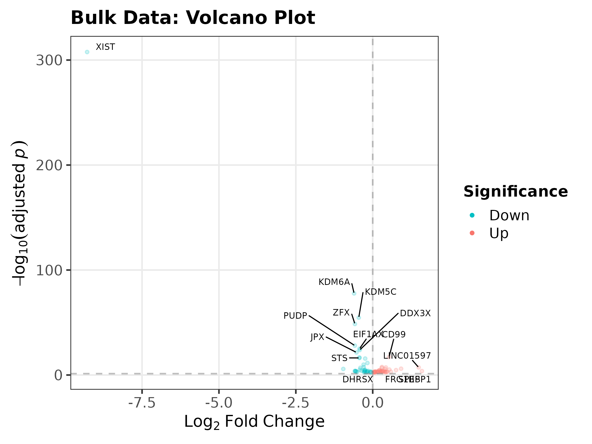
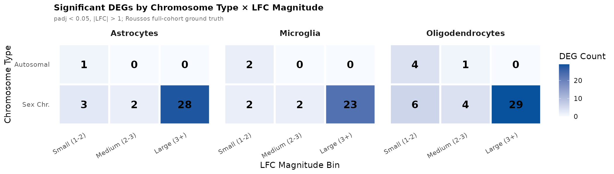
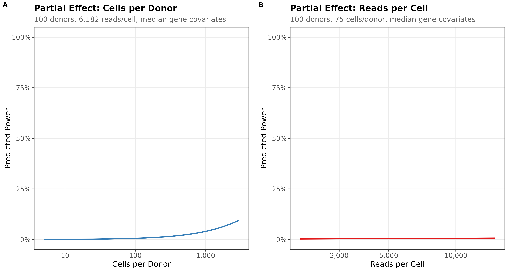
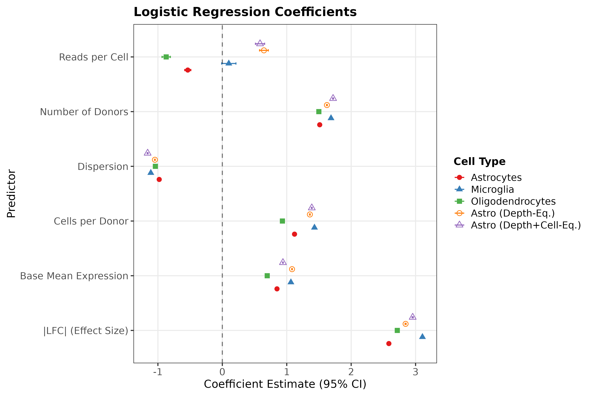
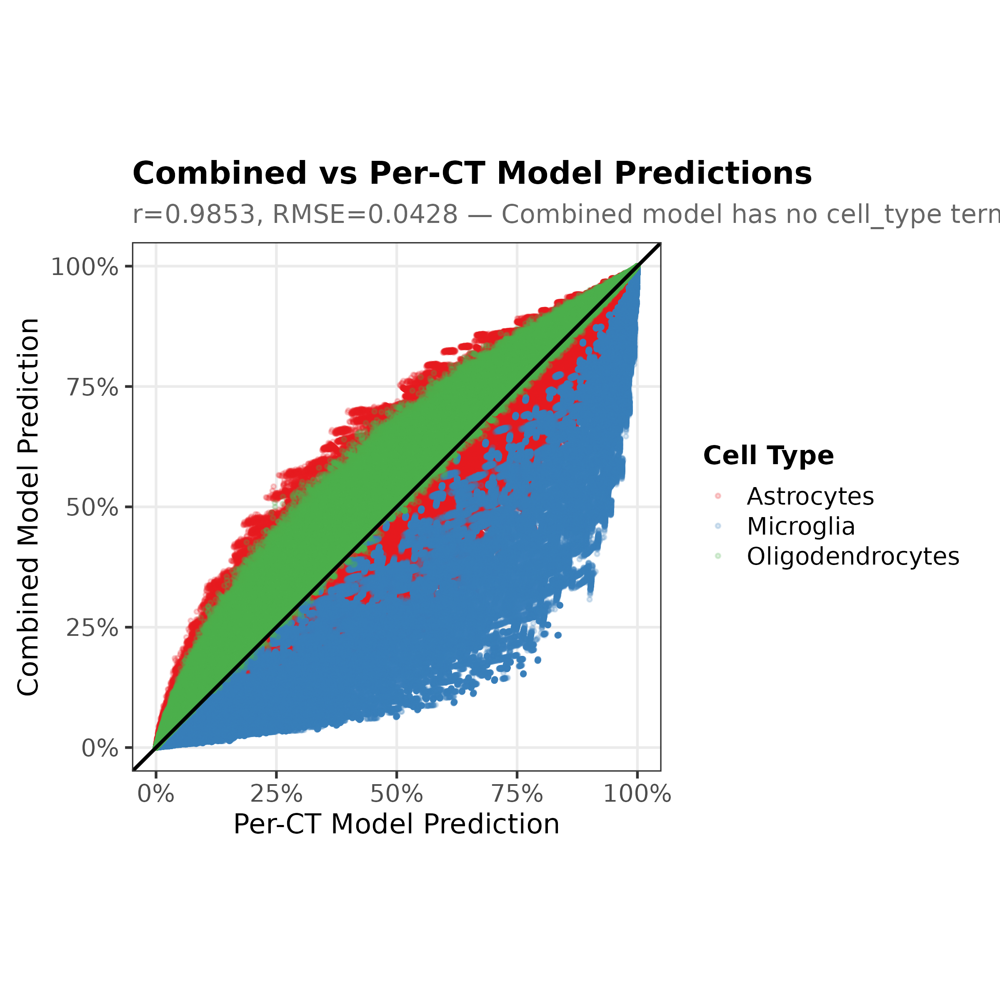
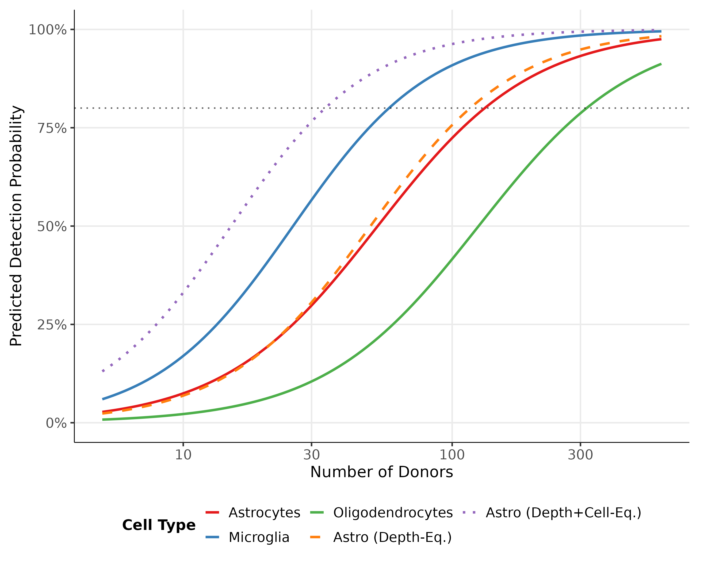

```{r setup, include=FALSE}
knitr::opts_chunk$set(echo = FALSE, message = FALSE, warning = FALSE, fig.align = "center")
library(knitr)
```

<!--
Supplementary Information for the Nature Communications submission.

Ordering convention (Nature Comms):
  1. Supplementary Figures  (Supplementary Fig. 1 ... N)
  2. Supplementary Tables   (Supplementary Table 1 ... N)
  3. Supplementary Notes    (optional; none used here)
  4. Supplementary References (inherited from main bibliography)

All large tabular data is exported as separate `Supplementary Data N` files
(listed at the end of this document). Source data per main figure is
packaged into separate Excel workbooks per Nature Comms requirements.

Cross-references from the main manuscript should read "Supplementary Fig. N",
"Supplementary Table N", or "Supplementary Data N" (flat-numbered, not nested
under main-figure numbers).
-->

# Supplementary Figures

## Supplementary Fig. 1. Continuous recall surfaces (cells-based and reads-based modes)

Continuous recall surfaces for astrocytes, microglia, and oligodendrocytes under both cells-based sampling, and reads-based sampling. The same qualitative patterns are observed across all three cell types: large-effect genes are readily detected at modest sample sizes, while small-effect genes remain below 80% recall across the entire experimental space. The apparent power ordering (microglia > astrocytes > oligodendrocytes) is an artefact of ground-truth censorship, as explained in the main text.

```{r SuppFig1a-AstroMicro-cells, out.width="99%", fig.show='hold', fig.cap="Continuous recall surfaces (semi-log scale, cells-based mode) for astrocytes (top) and microglia (middle), and oligodendrocytes (bottom)."}
knitr::include_graphics(c(
  "Datalink/Cartesian_Downsampling/Astro/Roussos/cells/Continuous_Viz_Log/Mean_Recall_Total_Continuous_SemiLog.png",
  "Datalink/Cartesian_Downsampling/Micro/Roussos/cells/Continuous_Viz_Log/Mean_Recall_Total_Continuous_SemiLog.png",
  "Datalink/Cartesian_Downsampling/Oligo/Roussos/cells/Continuous_Viz_Log/Mean_Recall_Total_Continuous_SemiLog.png"
))
```

```{r SuppFig1b-AstroMicro-reads, out.width="99%", fig.show='hold', fig.cap="Continuous recall surfaces (semi-log scale, reads-based mode) for astrocytes (top) and microglia (middle), and oligodendrocytes (bottom). Same layout as cells-based version above, with reads per cell on the x-axis."}
knitr::include_graphics(c(
  "Datalink/Cartesian_Downsampling/Astro/Roussos/reads/Continuous_Viz_Log/Mean_Recall_Total_Continuous_SemiLog.png",
  "Datalink/Cartesian_Downsampling/Micro/Roussos/reads/Continuous_Viz_Log/Mean_Recall_Total_Continuous_SemiLog.png",
  "Datalink/Cartesian_Downsampling/Oligo/Roussos/reads/Continuous_Viz_Log/Mean_Recall_Total_Continuous_SemiLog.png"
))
```

## Supplementary Fig. 2. Discrete recall heatmaps (cells-based and reads-based modes)

Discrete recall grids for astrocytes, microglia, and oligodendrocytes under both cells-based sampling, and reads-based sampling. The same qualitative patterns are observed across all three cell types: large-effect genes are readily detected at modest sample sizes, while small-effect genes remain below 80% recall across the entire experimental space. The apparent power ordering (microglia > astrocytes > oligodendrocytes) is an artefact of ground-truth censorship, as explained in the main text.

```{r SuppFig2a-Discrete-cells, out.width="99%", fig.show='hold', fig.cap="Discrete recall heatmaps from Cartesian downsampling (cells-based mode) for astrocytes (top) and microglia (middle), and oligodendrocytes (bottom)."}
knitr::include_graphics(c(
  "Datalink/Cartesian_Downsampling/Astro/Roussos/cells/Plots/Mean_Recall_Total.png",
  "Datalink/Cartesian_Downsampling/Micro/Roussos/cells/Plots/Mean_Recall_Total.png",
  "Datalink/Cartesian_Downsampling/Oligo/Roussos/cells/Plots/Mean_Recall_Total.png"
))
```

```{r SuppFig2b-Discrete-reads, out.width="99%", fig.show="hold", fig.cap="Discrete recall heatmaps from Cartesian downsampling (reads-based mode) for astrocytes (top) and microglia (middle), and oligodendrocytes (bottom)."}
knitr::include_graphics(c(
  "Datalink/Cartesian_Downsampling/Astro/Roussos/reads/Plots/Mean_Recall_Total.png",
  "Datalink/Cartesian_Downsampling/Micro/Roussos/reads/Plots/Mean_Recall_Total.png",
  "Datalink/Cartesian_Downsampling/Oligo/Roussos/reads/Plots/Mean_Recall_Total.png"
))
```

## Supplementary Fig. 3. Chromosome-stratified recall heatmaps

Recall heatmaps stratified by chromosome type and LFC magnitude bin. Rows are cell types (astrocytes, microglia, oligodendrocytes); columns are sex-chromosome genes (left) and autosomal genes (right). Autosomal genes show substantially lower recall than sex-chromosome genes at matched effect sizes, reflecting both their rarity and smaller effect sizes. See Supplementary Table 3 for the per-gene characteristics that underlie this difference.

```{r SuppFig3-ChromStratified, out.width="48%", fig.show="hold", fig.cap="Chromosome-stratified recall heatmaps (cells-based mode). Rows are cell types (astrocytes, microglia, oligodendrocytes); columns are sex-chromosome genes (left) and autosomal genes (right). Sex-chromosome genes dominate the large-LFC bin and are detected with high recall at moderate sample sizes, driving the overall pattern in the total heatmaps. Autosomal sex-biased genes do not show large effect sizes but contribute the majority of tiny-effect genes, with substantially lower recall owing to larger per-gene dispersion and lower mean expression, as explained in the main text."}
knitr::include_graphics(c(
  # Astrocytes: SexChr, Autosomal
  "Datalink/Cartesian_Downsampling/Astro/Roussos/cells/Plots/Mean_Recall_SexChr.png",
  "Datalink/Cartesian_Downsampling/Astro/Roussos/cells/Plots/Mean_Recall_Autosomal.png",
  # Microglia: SexChr, Autosomal
  "Datalink/Cartesian_Downsampling/Micro/Roussos/cells/Plots/Mean_Recall_SexChr.png",
  "Datalink/Cartesian_Downsampling/Micro/Roussos/cells/Plots/Mean_Recall_Autosomal.png",
  # Oligodendrocytes: SexChr, Autosomal
  "Datalink/Cartesian_Downsampling/Oligo/Roussos/cells/Plots/Mean_Recall_SexChr.png",
  "Datalink/Cartesian_Downsampling/Oligo/Roussos/cells/Plots/Mean_Recall_Autosomal.png"
))
```

## Supplementary Fig. 4. Precision heatmaps (cells-based and reads-based modes)

Astrocyte, microglial, and oligodendrocyte precision heatmaps.

```{r SuppFig4a-Precision-cells, out.width="99%", fig.show="hold", fig.cap="Precision heatmaps for cells-based downsampling, astrocytes (top), microglia (middle), and oligodendrocytes (bottom). Large-effect precision remains >0.90 across most configurations; small-effect precision degrades at higher cell counts, reflecting the precision-recall trade-off."}
knitr::include_graphics(c(
  "Datalink/Cartesian_Downsampling/Astro/Roussos/cells/Plots/Mean_Precision_Total.png",
  "Datalink/Cartesian_Downsampling/Micro/Roussos/cells/Plots/Mean_Precision_Total.png",
  "Datalink/Cartesian_Downsampling/Oligo/Roussos/cells/Plots/Mean_Precision_Total.png"
))
```

```{r SuppFig4b-Precision-reads, out.width="99%", fig.show="hold", fig.cap="Precision heatmaps for reads-based downsampling, astrocytes (top), microglia (middle), and oligodendrocytes (bottom). Layout identical to cells-based mode, but columns represent reads per cell rather than cells per donor."}
knitr::include_graphics(c(
  "Datalink/Cartesian_Downsampling/Astro/Roussos/reads/Plots/Mean_Precision_Total.png",
  "Datalink/Cartesian_Downsampling/Micro/Roussos/reads/Plots/Mean_Precision_Total.png",
  "Datalink/Cartesian_Downsampling/Oligo/Roussos/reads/Plots/Mean_Precision_Total.png"
))
```

## Supplementary Fig. 5. GTEx bulk RNA-seq reference volcano plot

```{r SuppFig5-Bulk-Volcano, out.width="99%", fig.cap="Volcano plot of the 79 tissue-consistent sex-biased DEGs from the GTEx v8 bulk RNA-seq analysis (voom-limma + MASH framework, 838 donors across 44 tissues). Each point represents a gene significant (LFSR < 0.05) in at least 90% of tissues; log~2~ fold change and significance values are averaged across significant tissues. XIST dominates the plot with a bulk LFC of -9.29. The top 10 most significant genes are labelled. Genes shared with the single-cell analysis are shown as translucent. Y-linked genes are absent from the bulk reference because the MASH framework cannot estimate fold change when one sex has no expression."}

```

## Supplementary Fig. 6. Bulk-single-cell LFC concordance

Bulk-single-cell concordance plots shown for astrocytes(top), microglia (middle), and oligodendrocytes (bottom), both with Xist included (left), and without (right).

```{r SuppFig6-Bulk-SC-Correlation, out.width="48%", fig.show="hold", fig.cap="Bulk-anchored LFC concordance between GTEx and Roussos single-cell pseudobulk for genes significant in both modalities. Pearson correlations (excluding XIST): R = 0.91 (astrocytes, top), R = 0.93 (microglia, middle) and R = 0.88 (oligodendrocytes, right). Pearson correlations (including XIST): R = 0.97 (astrocytes, top), R = 0.97 (microglia, middle) and R = 0.97 (oligodendrocytes, right). Autosomal genes shown in grey, X-chromosome in pink; translucent points indicate genes not significant in single-cell. The black dashed line follows y = x."}
knitr::include_graphics(c(
  "Datalink/Bulk_Analysis/Astro/Compare_Correlation_BulkAnchored.png",
  "Datalink/Bulk_Analysis/Astro/Compare_Correlation_BulkAnchored_NoXIST.png",
  "Datalink/Bulk_Analysis/Micro/Compare_Correlation_BulkAnchored.png",
  "Datalink/Bulk_Analysis/Micro/Compare_Correlation_BulkAnchored_NoXIST.png",
  "Datalink/Bulk_Analysis/Oligo/Compare_Correlation_BulkAnchored.png",
  "Datalink/Bulk_Analysis/Oligo/Compare_Correlation_BulkAnchored_NoXIST.png"
))
```

## Supplementary Fig. 7. Recovery of bulk reference genes

Of the 79 GTEx tissue-consistent reference genes, 72 were present in the Roussos single-cell gene universe. The same 7 reference genes were absent in every cell type, implying technical rather than biological reasons: retired Ensembl identifiers, CellRanger PAR1 masking, oligo-dT invisibility of a non-polyadenylated long non-coding RNA, and pseudogene exclusion. Of the 72 testable genes, astrocytes recovered 72% (52/72), microglia 54% (39/72), and oligodendrocytes 68% (49/72). Recovery rates were consistently higher for sex-chromosome genes than for autosomal genes (Astro 79% vs 65%; Oligo 76% vs 59%; Micro 66% vs 41%). This asymmetry is expected: the sex-chromosome subset is enriched for X-inactivation escapees (e.g. KDM6A, KDM5C, DDX3X, ZFX) whose cell-intrinsic dosage mechanism should produce consistent fold changes in every cell type, whereas autosomal sex-biased expression is typically mediated by downstream hormonal or transcription-factor pathways that vary across cell types and are diluted in whole-tissue homogenates.

```{r SuppFig7-Recovery-Stats, out.width="98%", fig.show="hold", fig.cap="Recovery of the 79 tissue-consistent bulk DEGs by the Roussos single-cell pseudobulk analysis, stratified by chromosome type (Autosome vs Sex chromosome) and bulk log~2~ fold change magnitude. Genes are classified as Recovered (FDR < 0.05 with matching LFC direction; green), Insignificant (tested but not significant or discordant direction; yellow), NA-Filtered (removed by DESeq2 independent filtering; salmon), or Absent (not in single-cell gene set; grey). Results shown for astrocytes (top), microglia (middle), and oligodendrocytes (bottom)."}
knitr::include_graphics(c(
  "Datalink/Bulk_Analysis/Astro/Recovery_Stats_Stratified.png",
  "Datalink/Bulk_Analysis/Micro/Recovery_Stats_Stratified.png",
  "Datalink/Bulk_Analysis/Oligo/Recovery_Stats_Stratified.png"
))
```

## Supplementary Fig. 8. PCA gallery for unfiltered and filtered Roussos cohorts

Principal component analysis (PCA) of pseudobulked donors showing the effect of filtering. Rows (top to bottom): log~2~ cell count, sex, age, brain bank source, disease status, and self-reported ethnicity. Columns: astrocytes (left), microglia (centre), and oligodendrocytes (right).

```{r SuppFig8a-PCA-Unfiltered, out.width="32%", fig.show='hold', fig.cap="Complete PCA gallery for the unfiltered Roussos dataset (N = 1,486/1,480/1,491 donors for Astro/Micro/Oligo). Each row shows one metadata covariate; columns show astrocytes (left), microglia (centre), and oligodendrocytes (right). Top to bottom: log~2~ cell count, sex, age, brain bank source, disease status, and self-reported ethnicity."}
# Row 1: Log2 Cells
knitr::include_graphics(c(
  "Datalink/Exploratory_Analysis/Astro/Roussos_Full/PCA/PCA_FullCohort_Log2_Cells_scaled.png",
  "Datalink/Exploratory_Analysis/Micro/Roussos_Full/PCA/PCA_FullCohort_Log2_Cells_scaled.png",
  "Datalink/Exploratory_Analysis/Oligo/Roussos_Full/PCA/PCA_FullCohort_Log2_Cells_scaled.png"
))
# Row 2: Sex
knitr::include_graphics(c(
  "Datalink/Exploratory_Analysis/Astro/Roussos_Full/PCA/PCA_FullCohort_sex_scaled.png",
  "Datalink/Exploratory_Analysis/Micro/Roussos_Full/PCA/PCA_FullCohort_sex_scaled.png",
  "Datalink/Exploratory_Analysis/Oligo/Roussos_Full/PCA/PCA_FullCohort_sex_scaled.png"
))
# Row 3: Age
knitr::include_graphics(c(
  "Datalink/Exploratory_Analysis/Astro/Roussos_Full/PCA/PCA_FullCohort_Age_Years_scaled.png",
  "Datalink/Exploratory_Analysis/Micro/Roussos_Full/PCA/PCA_FullCohort_Age_Years_scaled.png",
  "Datalink/Exploratory_Analysis/Oligo/Roussos_Full/PCA/PCA_FullCohort_Age_Years_scaled.png"
))
# Row 4: Source
knitr::include_graphics(c(
  "Datalink/Exploratory_Analysis/Astro/Roussos_Full/PCA/PCA_FullCohort_Source_scaled.png",
  "Datalink/Exploratory_Analysis/Micro/Roussos_Full/PCA/PCA_FullCohort_Source_scaled.png",
  "Datalink/Exploratory_Analysis/Oligo/Roussos_Full/PCA/PCA_FullCohort_Source_scaled.png"
))
# Row 5: Disease
knitr::include_graphics(c(
  "Datalink/Exploratory_Analysis/Astro/Roussos_Full/PCA/PCA_FullCohort_disease_scaled.png",
  "Datalink/Exploratory_Analysis/Micro/Roussos_Full/PCA/PCA_FullCohort_disease_scaled.png",
  "Datalink/Exploratory_Analysis/Oligo/Roussos_Full/PCA/PCA_FullCohort_disease_scaled.png"
))
# Row 6: Ethnicity
knitr::include_graphics(c(
  "Datalink/Exploratory_Analysis/Astro/Roussos_Full/PCA/PCA_FullCohort_self_reported_ethnicity_scaled.png",
  "Datalink/Exploratory_Analysis/Micro/Roussos_Full/PCA/PCA_FullCohort_self_reported_ethnicity_scaled.png",
  "Datalink/Exploratory_Analysis/Oligo/Roussos_Full/PCA/PCA_FullCohort_self_reported_ethnicity_scaled.png"
))
```

```{r SuppFig8b-PCA-Filtered, out.width="32%", fig.show="hold", fig.cap="Complete PCA gallery for the filtered Roussos analysis cohort (age $\\geq$ 40, $\\geq$ 30 cells; N = 1,293/1,214/1,303 donors for Astro/Micro/Oligo). Layout identical to the unfiltered gallery above. Compared with the unfiltered gallery, the cell-count gradient is attenuated, the outlier cluster in oligodendrocytes is absent, and the overall point cloud is more compact."}
# Row 1: Log2 Cells
knitr::include_graphics(c(
  "Datalink/Exploratory_Analysis/Astro/Roussos/PCA/PCA_FilteredCohort_Log2_Cells_scaled.png",
  "Datalink/Exploratory_Analysis/Micro/Roussos/PCA/PCA_FilteredCohort_Log2_Cells_scaled.png",
  "Datalink/Exploratory_Analysis/Oligo/Roussos/PCA/PCA_FilteredCohort_Log2_Cells_scaled.png"
))
# Row 2: Sex
knitr::include_graphics(c(
  "Datalink/Exploratory_Analysis/Astro/Roussos/PCA/PCA_FilteredCohort_sex_scaled.png",
  "Datalink/Exploratory_Analysis/Micro/Roussos/PCA/PCA_FilteredCohort_sex_scaled.png",
  "Datalink/Exploratory_Analysis/Oligo/Roussos/PCA/PCA_FilteredCohort_sex_scaled.png"
))
# Row 3: Age
knitr::include_graphics(c(
  "Datalink/Exploratory_Analysis/Astro/Roussos/PCA/PCA_FilteredCohort_Age_Years_scaled.png",
  "Datalink/Exploratory_Analysis/Micro/Roussos/PCA/PCA_FilteredCohort_Age_Years_scaled.png",
  "Datalink/Exploratory_Analysis/Oligo/Roussos/PCA/PCA_FilteredCohort_Age_Years_scaled.png"
))
# Row 4: Source
knitr::include_graphics(c(
  "Datalink/Exploratory_Analysis/Astro/Roussos/PCA/PCA_FilteredCohort_Source_scaled.png",
  "Datalink/Exploratory_Analysis/Micro/Roussos/PCA/PCA_FilteredCohort_Source_scaled.png",
  "Datalink/Exploratory_Analysis/Oligo/Roussos/PCA/PCA_FilteredCohort_Source_scaled.png"
))
# Row 5: Disease
knitr::include_graphics(c(
  "Datalink/Exploratory_Analysis/Astro/Roussos/PCA/PCA_FilteredCohort_disease_scaled.png",
  "Datalink/Exploratory_Analysis/Micro/Roussos/PCA/PCA_FilteredCohort_disease_scaled.png",
  "Datalink/Exploratory_Analysis/Oligo/Roussos/PCA/PCA_FilteredCohort_disease_scaled.png"
))
# Row 6: Ethnicity
knitr::include_graphics(c(
  "Datalink/Exploratory_Analysis/Astro/Roussos/PCA/PCA_FilteredCohort_self_reported_ethnicity_scaled.png",
  "Datalink/Exploratory_Analysis/Micro/Roussos/PCA/PCA_FilteredCohort_self_reported_ethnicity_scaled.png",
  "Datalink/Exploratory_Analysis/Oligo/Roussos/PCA/PCA_FilteredCohort_self_reported_ethnicity_scaled.png"
))
```

## Supplementary Fig. 9. Sign agreement matrices

```{r SuppFig9-Sign-Agreement, out.width="32%", fig.show="hold", fig.cap="Sign agreement matrices for astrocytes (left), microglia (centre), and oligodendrocytes (right). Values represent the proportion of Roussos significant genes ($p_{adj}$ < 0.05, |LFC| > 1) where the direction of the sex effect is identical in both datasets. High values (>0.95, green) indicate consistent effect direction; values near 0.5 (red) would indicate random disagreement. Grey cells indicate no shared significant genes."}
knitr::include_graphics(c(
  "Datalink/Full_Ground_Truth/Astro/Diagnostic_Results/Sign_Agreement_Matrix_Roussos_Sig_Genes.png",
  "Datalink/Full_Ground_Truth/Micro/Diagnostic_Results/Sign_Agreement_Matrix_Roussos_Sig_Genes.png",
  "Datalink/Full_Ground_Truth/Oligo/Diagnostic_Results/Sign_Agreement_Matrix_Roussos_Sig_Genes.png"
))
```

## Supplementary Fig. 10. LFC agreement matrices

```{r SuppFig10-LFC-Agreement, out.width="32%", fig.show="hold", fig.cap="LFC agreement matrices for astrocytes (left), microglia (centre), and oligodendrocytes (right). Each cell shows Pearson correlation of LFC values between dataset pairs, restricted to Roussos significant genes ($p_{adj}$ < 0.05, |LFC| > 1). High correlations (>0.8, blue-green) confirm consistent effect sizes across datasets. Cross-dataset correlations (mean r = 0.82) approach the split-half ceiling (mean r = 0.92)."}
knitr::include_graphics(c(
  "Datalink/Full_Ground_Truth/Astro/Diagnostic_Results/LFC_Agreement_Matrix_Roussos_Sig_Genes.png",
  "Datalink/Full_Ground_Truth/Micro/Diagnostic_Results/LFC_Agreement_Matrix_Roussos_Sig_Genes.png",
  "Datalink/Full_Ground_Truth/Oligo/Diagnostic_Results/LFC_Agreement_Matrix_Roussos_Sig_Genes.png"
))
```

## Supplementary Fig. 11. DEG chromosome distribution

```{r SuppFig11-Chr-Distribution, out.width="99%", fig.cap="Chromosomal origin of sex-biased DEGs from the Roussos full ground truth, stratified by |LFC| magnitude and chromosome type (autosomal, X, Y). Top row: counts by chromosome type and LFC bin (1.0-2.0, 2.0-3.0, >3.0) for astrocytes (left), microglia (centre), and oligodendrocytes (right). Bottom row: corresponding proportions. At |LFC| > 3.0, DEGs are predominantly Y-linked; at moderate LFC, autosomal contribution increases."}

```

## Supplementary Fig. 12. Depth decomposition visualisations

```{r SuppFig12-Depth-Decomp, out.width="99%", fig.cap="Depth decomposition of detection power. Predicted detection rate as a function of cells per donor and reads per cell, with separate curves for different donor counts (25, 50, 100, 200, 400). The steeper response to cells per donor relative to reads per cell quantifies the diminishing returns of deeper sequencing versus broader cellular sampling."}

```

## Supplementary Fig. 13. Coefficient forest plots for all predictors

```{r SuppFig13-Forest, out.width="99%", fig.cap="Forest plots showing logistic regression coefficients for all six predictors across all five cell-type models (Astro = red circles, Micro = blue triangles, Oligo = green squares, Astro (Depth-Eq.) = orange open circles, Astro (Depth+Cell-Eq.) = purple open triangles). Non-overlapping 95% confidence intervals confirm significant differences between cell types and demonstrate that depth equalisation modifies coefficient magnitudes."}

```

## Supplementary Fig. 14. Cross-validation results

```{r SuppFig14-CV, out.width="99%", fig.cap="Cross-validation of per-cell-type logistic regression models. Scatter plots showing predicted versus observed detection outcomes for each mode subset (cells-based and reads-based). Pearson correlations range from 0.81-0.87 across cell types, confirming model generalisation across experimental paradigms."}

```

## Supplementary Fig. 15. Cell-type power comparison

```{r SuppFig15-Simplified, out.width="99%", fig.cap="Power curve comparison for all five cell-type models (Astro = red, Micro = blue, Oligo = green, Astro (Depth-Eq.) = orange, Astro (Depth+Cell-Eq.) = purple) with horizontal reference lines at 50%, 80%, and 90% power. Predictions are computed at practical reference values: |LFC| = 1.5, baseMean = 50, dispersion = 0.5, 250 cells per donor, and median reads per cell (~6,000). The power hierarchy reversal from depth equalisation confirms that apparent cell-type differences in power reflect ground-truth censorship rather than intrinsic biological properties."}

```

## Supplementary Fig. 16. Complete sensitivity grid across covariate range

```{r SuppFig16-SensGrid, out.width="99%", fig.cap="Complete sensitivity grid across the observed covariate range. Five rows (one per covariate: cells per donor, reads per cell, |LFC|, baseMean, dispersion) $\\times$ four columns (Min, 25%, 75%, Max of observed range) showing power curves for all five cell-type models (Astro = red, Micro = blue, Oligo = green, Astro (Depth-Eq.) = orange, Astro (Depth+Cell-Eq.) = purple). The power-hierarchy ordering is preserved across nearly all covariate combinations, demonstrating that relative power differences are robust to gene-level characteristics."}
knitr::include_graphics("Datalink/Power_Curve_Fitting/Plots/full_per_iteration/CellType_Sensitivity_Grid.png")
```

## Supplementary Fig. 17. Cross-dataset reproducibility panel (astrocytes and microglia)

Universe-controlled and raw IoU matrices summarising cross-dataset DEG overlap for astrocytes (top row) and microglia (bottom row). (A) Astrocytes, universe-controlled IoU. (B) Astrocytes, raw IoU (no universe control). (C) Microglia, universe-controlled IoU. (D) Microglia, raw IoU. Universe control restricts each pairwise comparison to genes tested in both datasets, removing the confound that differences in gene universe size otherwise inflate apparent discordance.

```{r Figure1-Supp16-Astro-Micro-Repro, echo=FALSE, out.width="99%", fig.width=12, fig.height=8}
library(patchwork)
library(png)
library(grid)

read_png_grob <- function(path) {
  rasterGrob(readPNG(path), interpolate = TRUE)
}

astro_root <- "~/data/Power_Analysis_Paper/Datalink/Full_Ground_Truth/Astro/Diagnostic_Results"
micro_root <- "~/data/Power_Analysis_Paper/Datalink/Full_Ground_Truth/Micro/Diagnostic_Results"

pA <- wrap_elements(full = read_png_grob(file.path(astro_root, "Expanded_IoU_Matrix_Universe_Controlled.png")))
pB <- wrap_elements(full = read_png_grob(file.path(astro_root, "Expanded_IoU_Matrix.png")))
pC <- wrap_elements(full = read_png_grob(file.path(micro_root, "Expanded_IoU_Matrix_Universe_Controlled.png")))
pD <- wrap_elements(full = read_png_grob(file.path(micro_root, "Expanded_IoU_Matrix.png")))

((pA | pB) / (pC | pD)) + plot_annotation(tag_levels = "A")
```

------------------------------------------------------------------------

# Supplementary Tables

## Supplementary Table 1. Human brain sc/snRNA-seq DE studies surveyed (2022-2026) {#supp-table-1}

```{r supp-table-1, message=FALSE}
library(knitr)

supp_tab2 <- tibble::tribble(
  ~`#`, ~Study,                                                          ~Year,  ~Donors, ~`LFC threshold`,
  1,  "Soreq et al. [@soreq2023singlecellrnasequencing]",                  2023,  "4",     "FC > 1.2",
  2,  "Puvogel et al. [@puvogel2024singlenucleusrnaseqcharacterizes]",     2024,  "8",     "0.1 / 0.25",
  3,  "Bøstrand et al. [@bøstrand2024mappingtheglial]",                    2024,  "12",    "0.25 / 0.8",
  4,  "Belchikov et al. [@belchikov2025asinglecelllongread]",              2025,  "12",    "0.1",
  5,  "Chia et al. [@chia2025singlenucleustranscriptomicsreveals]",        2025,  "20",    "1.0 / none",
  6,  "Christodoulou et al. [@christodoulou2023unravelingthetranscriptomic]", 2023, "23",  "1.0",
  7,  "Gamache et al. [@gamache2023integrativesinglenucleusmultiomics]",   2023,  "24",    "0.2",
  8,  "Almeida et al. [@almeida2024singlenucleusrnasequencing]",           2024,  "27",    "none / 0.25",
  9,  "Martirosyan et al. [@martirosyan2024unravellingcelltypespecific]",  2024,  "29",    "none",
  10, "Li et al. [@li2025singlenucleusrnasequencing]",                     2025,  "31",    "0.25",
  11, "Nishioka et al. [@nishioka2026disturbancesofparaventricular]",      2026,  "41",    "0.14-0.26",
  12, "Sayed et al. [@sayed2021]",                                         2021,  "46",    "not extracted",
  13, "Murphy et al. [@murphy2023avoidingfalsediscoveries]",               2023,  "48",    "none",
  14, "Mathys et al. [@mathys2019]",                                       2019,  "48",    "not extracted",
  15, "Yu et al. [@yu2024diseaseassociatedneurotoxicastrocyte]",           2024,  "53",    "0.25",
  16, "Soelter et al. [@soelter2024alteredglianeuroncommunication]",       2024,  "56",    "0.2 / 0.5",
  17, "Barba-Reyes et al. [@barbareyes2025oligodendrogliavulnerabilityin]", 2025, "63",    "0.5 (ln)",
  18, "Maitra et al. [@maitra2023celltypespecific]",                       2023,  "71",    "0.137",
  19, "Johansen et al. [@johansen2023]",                                   2023,  "~75",   "not extracted",
  20, "Miyoshi et al. [@miyoshi2024spatialandsinglenucleus]",              2024,  "~75",   "0.25",
  21, "Arbabi et al. [@arbabi2025transcriptomicpathologyof]",              2025,  "76",    "not stated",
  22, "Clarence et al. [@clarence2025atranscriptomicroadmap]",             2025,  "97",    "not stated",
  23, "Vidal et al. [@vidal2026celltypespecifictranscriptomicsignatures]", 2026,  "111",   "not stated",
  24, "Ruzicka et al. [@ruzicka2024]",                                     2024,  "140",   "0.1",
  25, "Hoffman et al. [@hoffman2024efficientdifferentialexpression]",      2024,  "299",   "not stated",
  26, "Green et al. [@green2024]",                                         2024,  "424",   "not extracted",
  27, "Mathys et al. [@mathys2024]",                                       2024,  "427",   "not extracted",
  28, "Sun et al. [@sun2023]",                                             2023,  "443",   "0.1 (coeff)",
  29, "Tang et al. [@tang2025nvuatlasacomprehensive]",                     2025,  "748",   "0.2",
  30, "Lee et al. [@lee2024singlecellatlasof]",                            2024,  "1,494", "not stated"
)

kable(
  supp_tab2,
  caption = "Human brain sc/snRNA-seq differential expression studies surveyed (2022-2026). Ordered by donor count (ascending). LFC thresholds are |log~2~FC| unless otherwise noted. 'FC' denotes untransformed fold change; 'ln' denotes natural-log fold change; 'coeff' denotes a MAST regression coefficient.",
  align = c("r", "l", "c", "r", "l"),
  booktabs = TRUE
)
```

## Supplementary Table 2. Raw versus universe-controlled IoU across dataset pairs

Comparison of raw and universe-controlled IoU values. Universe-controlled IoU restricts comparisons to genes present in both datasets' count matrices, penalising datasets for genes they possessed but failed to detect due to insufficient sequencing depth, while not penalising them for genes absent from their count matrix entirely. Raw IoU values (0.31-0.52) are substantially lower than universe-controlled values (0.60-0.92), with the largest improvements in comparisons involving datasets with smaller gene universes (e.g. DeJager-Roussos microglia: raw 0.39, controlled 0.92).

| Cell Type        | Dataset Pair       | Raw IoU | Universe-Controlled IoU | Improvement |
|------------------|--------------------|---------|-------------------------|-------------|
| Astrocytes       | DeJager-Roussos    | 0.34    | 0.81                    | +138%       |
| Astrocytes       | Allen-Roussos      | 0.48    | 0.72                    | +50%        |
| Astrocytes       | Johansen-Roussos   | 0.35    | 0.87                    | +149%       |
| Astrocytes       | Rexach-Roussos     | 0.43    | 0.80                    | +86%        |
| Microglia        | DeJager-Roussos    | 0.39    | 0.92                    | +136%       |
| Microglia        | Allen-Roussos      | 0.43    | 0.60                    | +40%        |
| Microglia        | Johansen-Roussos   | 0.38    | 0.86                    | +126%       |
| Microglia        | Rexach-Roussos     | 0.47    | 0.88                    | +87%        |
| Oligodendrocytes | DeJager-Roussos    | 0.39    | 0.87                    | +123%       |
| Oligodendrocytes | Allen-Roussos      | 0.52    | 0.79                    | +52%        |
| Oligodendrocytes | Johansen-Roussos   | 0.35    | 0.76                    | +117%       |
| Oligodendrocytes | Rexach-Roussos     | 0.38    | 0.78                    | +105%       |

## Supplementary Table 3. Autosomal versus sex-chromosome truth-gene characteristics

```{r supp-table-3, message=FALSE}
autosomal_vs_sexchr <- read.csv(
  here::here("Datalink", "_scratch_autosomal_vs_sexchr_summary.csv")
)

autosomal_vs_sexchr <- autosomal_vs_sexchr[
  autosomal_vs_sexchr$n >= 5,
  c("cell_type", "bin", "chr_group", "n",
    "baseMean_median", "dispersion_median", "absLFC_median")
]
autosomal_vs_sexchr$chr_group <- gsub("_", " ", autosomal_vs_sexchr$chr_group)
autosomal_vs_sexchr <- autosomal_vs_sexchr[
  order(autosomal_vs_sexchr$cell_type,
        autosomal_vs_sexchr$bin,
        autosomal_vs_sexchr$chr_group), ]

knitr::kable(autosomal_vs_sexchr,
             caption = "Autosomal versus sex-chromosome gene properties in the Roussos truth set, stratified by cell type and |LFC| bin. Within each bin, sex-chromosome genes show systematically higher baseMean and lower dispersion than autosomal genes, placing them in a favourable region of the power surface at equivalent fold change. Rows with n < 5 are suppressed.",
             col.names = c("Cell Type", "|LFC| Bin", "Group", "N",
                           "Median BaseMean", "Median Dispersion", "Median |LFC|"),
             row.names = FALSE,
             escape = FALSE,
             digits = c(0, 0, 0, 0, 1, 3, 2))
```

------------------------------------------------------------------------

# Supplementary Data (external files)

Per Nature Communications requirements, large tabular datasets are provided as separate files rather than embedded in this PDF. Each is listed below with its source path and descriptive caption.

## Supplementary Data 1. Dataset summary and gene-universe composition

**File:** `Supplementary_Data_1_dataset_summary.xlsx` (generated from `Datalink/Paper_Source_Data/dataset_statistics.csv` and `Datalink/Full_Ground_Truth/Gene_Audit_Full_Universe_Combined.csv`)

Two linked tables. (1) Dataset characteristics for all five single-cell datasets plus the GTEx bulk reference, including donor counts, cell counts, brain region, covariates, download URLs, and mean/median cells-per-donor, UMIs-per-cell, and genes-per-cell after filtering (age $\geq$ 40, $\geq$ 30 cells per donor). (2) Gene-composition audit for the full astrocyte gene universe across five datasets, showing total genes and the breakdown by biotype (protein-coding, lncRNA, pseudogene) and chromosome (X, Y, autosomal, PAR).

```{r suppdata1-preview}
source_data_1 <- read.csv(
  here::here("Datalink", "Paper_Source_Data", "dataset_statistics.csv"),
  stringsAsFactors = FALSE, check.names = FALSE
)
source_data_1 <- source_data_1[, c(
  "Dataset", "Brain_Region", "Cell_Type", "N_Donors", "N_Cells",
  "Mean_Cells_Per_Donor", "Median_Cells_Per_Donor",
  "Mean_UMIs_Per_Cell", "Median_UMIs_Per_Cell",
  "Mean_Genes_Per_Cell", "Median_Genes_Per_Cell"
)]

knitr::kable(
  source_data_1,
  col.names = c("Dataset", "Brain Region", "Cell Type", "N Donors", "N Cells",
                "Mean Cells/Donor", "Median Cells/Donor", "Mean UMIs/Cell",
                "Median UMIs/Cell", "Mean Genes/Cell", "Median Genes/Cell"),
  digits = c(0, 0, 0, 0, 0, 1, 0, 0, 0, 0, 0)
)

gene_audit <- read.csv(
  here::here("Datalink", "Full_Ground_Truth",
             "Gene_Audit_Full_Universe_Combined.csv"),
  stringsAsFactors = FALSE, check.names = FALSE
)

# Pivot to (CellType, Dataset) rows, key biotype/chromosome columns
gene_audit_display <- gene_audit[, c(
  "CellType", "Dataset", "Total",
  "protein_coding", "lncRNA", "pseudogene",
  "X_chr", "Y_chr", "autosomal", "PAR"
)]

knitr::kable(
  gene_audit_display,
  col.names = c("Cell Type", "Dataset", "Total genes",
                "Protein-coding", "lncRNA", "Pseudogene",
                "X", "Y", "Autosomal", "PAR"),
  digits = 0
)
```

## Supplementary Data 2. Universe-controlled IoU matrices

**Files:** Three matrices, one per cell type:
- `Datalink/Full_Ground_Truth/Astro/Diagnostic_Results/Expanded_IoU_Matrix_Universe_Controlled.csv`
- `Datalink/Full_Ground_Truth/Micro/Diagnostic_Results/Expanded_IoU_Matrix_Universe_Controlled.csv`
- `Datalink/Full_Ground_Truth/Oligo/Diagnostic_Results/Expanded_IoU_Matrix_Universe_Controlled.csv`

Pairwise universe-controlled IoU values for all dataset pairs (Roussos, Allen, DeJager, Johansen, Rexach, 3 Roussos split-halves, 3 null permutation runs; 15 $\times$ 15 matrix per cell type). IoU = |A $\cap$ B| / |A $\cup$ B| where A and B are sets of significant genes ($p_{adj}$ < 0.05, |LFC| > 1) restricted to genes present in both datasets' count matrices.

## Supplementary Data 3. False discovery proportion (FDP) summary

**File:** `Datalink/Full_Ground_Truth/FDP_Summary.csv`

FDP per query source relative to the full Roussos ground truth. Columns: `CellType`, `Source`, `Group` (Cross-Dataset / Split-Half / Null), `FDP`, `N_Sig` (significant genes in query), `N_In_Universe` (query significant genes in Roussos universe), `N_Disagreed` (deemed insignificant by Roussos). Cross-dataset FDP 0.00-0.33 (mean 0.15); split-half baseline 0.02-0.27 (mean 0.09).

```{r suppdata3-preview}
fdp_summary <- read.csv(
  here::here("Datalink", "Paper_Source_Data", "fdp_summary.csv"),
  stringsAsFactors = FALSE
)
fdp_display <- fdp_summary[, c("Cell_Type", "Source", "Group",
                               "FDP", "N_Sig", "N_Disagreed")]

knitr::kable(
  fdp_display,
  caption = "Preview: false discovery proportion by cell type and query source. Full data provided as Supplementary Data 3.",
  col.names = c("Cell Type", "Source", "Group", "FDP", "N Significant", "N Disagreed"),
  digits = c(0, 0, 0, 2, 0, 0)
)
```

## Supplementary Data 4. Cartesian downsampling results (per grid point)

**Files:**
- `Datalink/Cartesian_Downsampling/{Astro,Micro,Oligo}/Roussos/cells/Plots/Aggregated_Summary_Data.qs`
- `Datalink/Cartesian_Downsampling/{Astro,Micro,Oligo}/Roussos/reads/Plots/Aggregated_Summary_Data.qs`

Aggregated precision and recall for all 12 $\times$ 14 grid points across six robustness runs, stratified by LFC magnitude bin (Small 1.0-2.0, Medium 2.0-3.0, Large >3.0) and chromosome type. Serialized R objects (qs format). Load with `qs::qread()`. Columns: `n_donors`, `n_cells`, `run_id`, `iteration_id`, `mean_recall`, `mean_precision`, and stratified metrics by LFC bin and chromosome type.

## Supplementary Data 5. Logistic regression fitting data (per iteration, per gene)

**Files:** `Datalink/Power_Curve_Fitting/Fitting_Data/{Astro,Micro,Oligo,Astro (Depth-Eq.),Astro (Depth+Cell-Eq.)}/unified_fitting_data_per_iteration.qs`

Per-iteration binary detection outcomes and predictor values for all observations used in logistic regression fitting (|LFC| > 0.2 truth sets). Serialized R objects (qs format). Columns: `gene_id`, `n_donors`, `n_cells`, `reads_per_cell`, `abs_lfc`, `basemean`, `dispersion`, `cell_type`, `run_id`, `iteration_id`, `detected` (0/1), `padj`. Totals: 22,440,900 observations (native) / 32,121,400 including depth-equalised variants.

## Supplementary Data 6. Fitted model coefficients

**File:** `Datalink/Power_Curve_Fitting/Exports/power_equation_coefficients.csv`

Fitted logistic regression coefficients, standard errors, z-statistics, p-values, and McFadden's pseudo-$R^2$ for all six predictors across the five per-cell-type models, the combined model, and the additive model.

```{r suppdata6-preview}
mc_raw <- read.csv(
  here::here("Datalink", "Paper_Source_Data", "model_coefficients.csv"),
  stringsAsFactors = FALSE
)
mc_raw$Model <- ifelse(mc_raw$model_type == "combined", "Combined", mc_raw$cell_type)
model_coeffs <- mc_raw[, c(
  "Model", "intercept",
  "beta_log_donors", "beta_log_n_cells", "beta_log_reads_per_cell",
  "beta_log_lfc", "beta_log_basemean", "beta_log_dispersion",
  "pseudo_r2", "n_obs"
)]

knitr::kable(
  model_coeffs,
  caption = "Preview: logistic regression coefficients for power prediction models (|LFC| > 0.2 truth sets). Full data provided as Supplementary Data 6. McFadden's pseudo-R² values (0.655-0.733) indicate the six predictors capture approximately two-thirds of the deviance in detection outcomes. Note negative reads-per-cell coefficients for astrocytes and oligodendrocytes, discussed in the main text as an under-fitting artefact under fixed-UMI-budget sampling.",
  col.names = c("Model", "Intercept", "$\\beta$ Log(Donors)", "$\\beta$ Log(Cells)",
                "$\\beta$ Log(RPC)", "$\\beta$ Log(|LFC|)", "$\\beta$ Log(BaseMean)",
                "$\\beta$ Log(Disp)", "Pseudo R²", "N Obs"),
  digits = c(0, 2, 3, 3, 3, 3, 3, 3, 3, 0)
)
```

## Supplementary Data 7. Truth-set gene characteristics

**File:** `Datalink/DE_Diagnostics/Shared_Gene_Diagnostics/Full_Truth_Set_Summary.csv`

Gene-level characteristics of truth sets across cell types at |LFC| > 1 threshold, giving both median (robust) and mean (skew-reflective) values for |LFC|, baseMean, dispersion, and signal-to-noise ratio (|LFC|/SE).

```{r suppdata7-preview-median}
truth_chars <- read.csv(
  here::here("Datalink", "Paper_Source_Data", "truth_gene_characteristics.csv")
)
truth_chars_median <- truth_chars[, c(
  "Cell_Type", "N_Genes",
  "Median_LFC", "Median_SNR", "Median_BaseMean", "Median_Dispersion"
)]
knitr::kable(truth_chars_median,
             caption = "Preview: median truth-gene characteristics by cell type. LFC = log~2~ fold change, SNR = signal-to-noise ratio (|LFC|/SE). Full data provided as Supplementary Data 7.",
             col.names = c("Cell Type", "N Genes", "Median |LFC|", "Median SNR",
                           "Median BaseMean", "Median Dispersion"),
             escape = FALSE,
             digits = c(0, 0, 3, 2, 2, 3))
```

```{r suppdata7-preview-mean}
truth_chars_mean <- truth_chars[, c(
  "Cell_Type", "N_Genes",
  "Mean_LFC", "Mean_SNR", "Mean_BaseMean", "Mean_Dispersion"
)]
knitr::kable(truth_chars_mean,
             caption = "Preview: mean truth-gene characteristics by cell type. Means reflect the right-skewed distribution of expression levels.",
             col.names = c("Cell Type", "N Genes", "Mean |LFC|", "Mean SNR",
                           "Mean BaseMean", "Mean Dispersion"),
             escape = FALSE,
             digits = c(0, 0, 3, 2, 2, 3))
```

## Supplementary Data 8. Power-prediction summary by cell type

**File:** `Datalink/Power_Curve_Fitting/Summary/pipeline_summary.csv`

Pipeline summary including model configuration, LFC threshold, per-cell-type reads per cell, pseudo-$R^2$, and donor counts required for 80% power at moderate (|LFC| = 1.5) and large (|LFC| = 3.0) reference effect sizes.

```{r suppdata8-preview}
model_summary <- read.csv(
  here::here("Datalink", "Paper_Source_Data", "model_summary.csv"),
  stringsAsFactors = FALSE
)
knitr::kable(
  model_summary,
  caption = "Preview: model performance and required sample sizes by cell type. Full data provided as Supplementary Data 8.",
  col.names = c("Model", "Gene Set", "Pseudo R²", "N Obs",
                "80% Power (moderate)", "80% Power (large)"),
  digits = c(0, 0, 3, 0, 0, 0)
)
```

## Supplementary Data 9. Power lookup table (predicted detection probability grid)

**File:** `Datalink/Power_Curve_Fitting/Exports/power_lookup_table.csv`

Predicted detection probabilities for combinations of design parameters (`n_donors`: 25-600, `n_cells`: 100-1,000, `reads_per_cell`: varies by cell type) and gene characteristics (`abs_gt_lfc`: 1-5, `gt_basemean`: 10-500, `gt_dispersion`: 0.1-1.0). One power column per cell-type model plus a `power_combined` column. Users can filter rows to their design to recover predicted detection probability.

------------------------------------------------------------------------

# Supplementary Software

## Supplementary Software 1. `predict_power.R`

**File:** `Datalink/Power_Curve_Fitting/Exports/predict_power.R`

Standalone R function for predicting detection probability given experimental design parameters and gene-level characteristics. Embeds fitted logistic regression coefficients for all five cell-type models (Astro, Micro, Oligo, Astro (Depth-Eq.), Astro (Depth+Cell-Eq.)). Usage:

``` r
source("Datalink/Power_Curve_Fitting/Exports/predict_power.R")
predict_power(n_donors = 100, n_cells = 500, reads_per_cell = 6000,
              abs_lfc = 3.0, basemean = 100, dispersion = 0.5,
              cell_type = "Oligo")
```

Returns predicted detection probability (0-1) for the selected cell-type model. Coefficients and model formulae are embedded; the function is standalone and does not require loading fitted model objects.

------------------------------------------------------------------------

# References

::: {#refs}
:::
