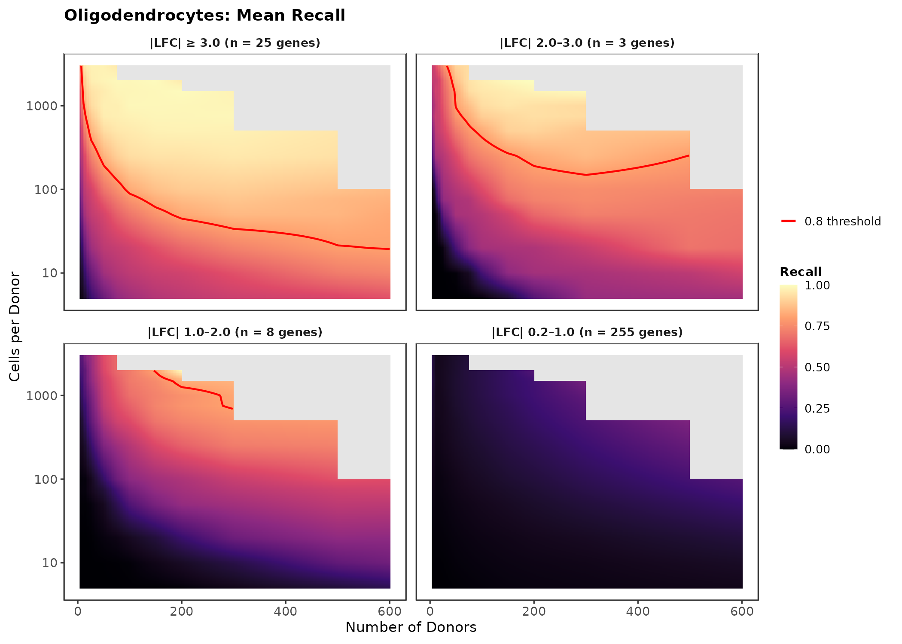
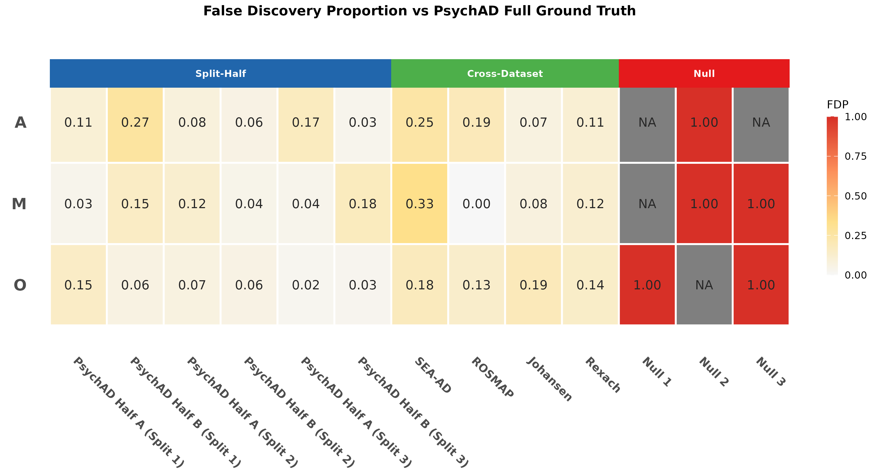

# Abstract

Differential expression analysis in single-cell RNA-sequencing is typically planned without empirical benchmarks: the few available power calculators extrapolate from small pilot datasets through parametric simulation, with no large-scale real-data validation. We show this gap has consequences: current study designs are systematically underpowered for the effect sizes biological discovery actually targets. We construct an empirical reference of over 22 million per-gene detection outcomes by split-half downsampling of up to 1,303 PsychAD donors across donor count, cells-per-donor, and sequencing-depth grids in three glial cell types, with sex-biased expression validated as a reproducible case-control signal by six other datasets. Across this reference, the smallest-effect genes (|LFC| 0.2 to 2) fail to reach 80% recall across the entire observable design space, while only larger-effect genes (|LFC| > 2) are reliably recovered at realistic cohort sizes. We release the full outcome-dataset, diagnostic visualisations, a caveated logistic planning heuristic, and the open-source framework, enabling researchers to refit with arbitrary covariates, extend the design space, and adapt the approach to other case-control variables.

**Keywords:** snRNA-seq; scRNA-seq; power analysis; experimental design; pseudobulk differential expression; cell type comparison; empirical downsampling; DESeq2;

------------------------------------------------------------------------

<!-- # Impact Statement -->

<!-- Systematic downsampling of 1,214-1,303 donors across 22 million detection outcomes reveals that small- and tiny-effect genes (|LFC| 1–2 and 0.2—1) remain undetectable even at 600 donors, that the apparent cell type power hierarchy is an artefact of ground truth censorship by sequencing depth and cell count, and that current single-cell study designs are fundamentally underpowered for the subtle effects most studies seek to detect. -->

<!-- ------------------------------------------------------------------------ -->

# Introduction

Single-cell and single-nucleus RNA-seq (sc/snRNA-seq) have become standard tools for characterising cell type–specific gene expression. When performing differential expression analysis, pseudobulk aggregation, that is, summing counts across all cells per donor and testing at the donor level, has emerged as the recommended approach because it controls pseudoreplication and dramatically reduces false positives [@squair2021; @murphy2023; @zimmerman2021pseudoreplication]. However, single-cell studies typically rely on modest cohort sizes of 10–100 donors (Supp. Table 1) with variable sequencing depths, raising fundamental questions about statistical power: How many donors are needed to reliably detect genes of a given effect size? How many cells per donor? How deeply should they be sequenced?

Existing power calculators [@zimmerman2021hierarchicell; @schmid2021; @vieth2017] rely on parametric simulations fitted to pilot data. These approaches inherit the noise and estimation errors of small pilots and lack empirical validation against large real datasets. In neuroimaging, large-scale empirical studies have demonstrated that small samples systematically overstate effect sizes and inflate false positives [@Marek2022; @liu2023], underscoring the need for empirical power benchmarks in high-dimensional omics.

Here we address this gap by performing a comprehensive empirical power analysis using the PsychAD cohort [@fullard2025], filtered from 1,491 donors and constituting the largest available human brain single nucleus RNA-seq dataset. We systematically downsample donors and cells across a pair of two-dimensional grids to map precision–recall trade-offs across realistic experimental designs, varying donor count with both the number of cells and the number of UMIs. We use sex-biased expression as the case-control variable, chosen for its methodological advantages: (1) datasets naturally exhibit roughly 50:50 sex splits without recruitment bias; (2) sex-biased differentially expressed genes are well documented to exist and thus provide an objective ground truth for validation; (3) sex-biased expression is reproducible across independent cohorts, enabling cross-dataset validation; and (4) small-effect sex-biased DEGs are predominantly autosomal, supporting extrapolation of these power estimates to other case-control studies.

Our analysis focuses on three major glial cell types: astrocytes, microglia, and oligodendrocytes. We validate that sex-biased DE is reproducible across five independent cohorts and a bulk RNA-seq reference, then systematically downsample donors, cells, and reads to accumulate over 22 million per-gene detection outcomes as an empirical reference for pseudobulk power. Alongside this dataset we release a caveated logistic planning heuristic, diagnostic recall and precision surfaces, and the open-source pipeline, enabling researchers to refit with arbitrary covariates, extend the design space, or apply the framework to any other case-control variable. The resulting reference reveals that small-effect genes (|LFC| < 2) remain systematically underdetected across the observable design space, and that an apparent cell-type power hierarchy is an artefact of ground-truth censorship by sequencing depth, as opposed to an intrinsic property of the cell-types.

------------------------------------------------------------------------

# Results

Figure \@ref(fig:FigOverview) presents an overview of the analytical framework, from cohort assembly through Cartesian downsampling to fitted power models.

```{r FigOverview, echo=FALSE, eval=TRUE, out.width="99%", fig.cap="Overview of the empirical power analysis framework. (A) Analytical workflow: the PsychAD cohort (1,214–1,303 donors across three glial cell types) is split 50/50 into ground truth and validation sets across six robustness runs, with the validation set systematically downsampled across Cartesian grids in both cells-based and reads-based modes. Over 22 million per-gene detection outcomes are accumulated and fitted with logistic regression models. (B) Stylised recall heatmaps for large-effect (|LFC| > 3, top) and small-effect (|LFC| 1–2, bottom) genes across the three cell types. Red dashed borders indicate the region achieving ≥80% recall. Large-effect genes are readily detected; small-effect genes remain elusive even at the largest sample sizes. (C) Ground truth censorship by sequencing depth: DESeq2 independent filtering removes a larger proportion of genes from shallowly sequenced cell types (63% testable in microglia versus 96% in oligodendrocytes), creating an illusion of higher power. (D) Fitted power curves at median gene covariates, showing the number of donors required for 80% detection probability for each cell type."}
knitr::include_graphics("Figure1_Diagram.png")
```

## Dataset Characteristics and Filtering Rationale

We analysed five independent single-cell/single-nucleus RNA-seq datasets of human brain tissue, totalling over 4.2 million cells from up to 1,912 donors (Figure \@ref(fig:FigOverview)—source data 1). The primary analysis used the PsychAD (Roussos) dataset comprising 1,486/1,480/1,491 donors (astro/micro/oligo) before filtering. The remaining four datasets (Allen/SEA-AD, DeJager/ROSMAP, Rexach, Johansen) ranged from 19 to 449 donors post-filtering and served for cross-dataset framework validation.

Principal component analysis on the unfiltered Roussos dataset revealed that principal component 1 (PC1) was dominated by per-donor cell count across all three cell types, with donors below 30 cells showing progressively larger deviations consistent with gene dropout artefacts (Figure \@ref(fig:FigOverview)—figure supplement 2). PC2 showed a trend with donor age and clear clustering in the case of microglia for donors younger than 40. These observations motivated the filtering criteria: a minimum of 30 cells per donor and age $\geq$ 40 years to stabilise the age covariate with minimal loss of donors. The filtered analysis cohort comprised 1,293 astrocyte donors (mean 523 cells, median 466 per donor), 1,214 microglia donors (mean 209 cells, median 187), and 1,303 oligodendrocyte donors (mean 1,603 cells, median 1,364).

Per-cell library sizes varied substantially: astrocytes exhibited the deepest sequencing (mean 9,456 UMIs per cell), followed by oligodendrocytes (5,742 UMIs) and microglia (4,426 UMIs). The difference in mean number of UMIs per donor between microglia and oligodendrocytes is ten-fold (~0.9 million UMIs per donor for microglia versus 9.2 million for oligodendrocytes). This technical heterogeneity creates differential statistical power for ground truth estimation, which we explicitly attempt to account for in the downsampling framework. This hierarchy of cell types in terms of UMIs per cell and number of cells per donor is consistent across all five datasets \@ref(fig:FigOverview)—source data 1. 

## Framework Validation: Sex-Biased Expression is Reproducible Across Independent Cohorts

Before using sex-biased DE for power analysis, we validated that it serves as a reproducible case-control variable across independent cohorts. Differential expression analysis using DESeq2 with dataset-specific covariates revealed strong cross-dataset agreement on genes with $|LFC| \geq 1$. We quantified gene set reproducibility using universe-controlled Intersection over Union (IoU, equivalent to the Jaccard index restricted to genes present in both datasets' count matrices): $\text{IoU}(A,B) = |A \cap B| / |A \cup B|$. This approach normalised results to account for the fact that a few datasets such as ROSMAP and Johansen had ~10,000 fewer long non-coding RNA genes than the rest which would have presented as poorer agreement than was warranted. Without this gene-universe control the IoU values dropped by over half for these datasets (\@ref(fig:FigOverview)—figure supplement 7).

Universe-controlled IoU values between the PsychAD cohort and four external datasets ranged from 0.60 to 0.92 across all cell types (Figure \@ref(fig:FigOverview)—figure supplement 1; Figure \@ref(fig:FigOverview)—source data 2). Within-dataset split-half comparisons (three independent 50/50 Roussos partitions) provided an empirical ceiling of 0.65–0.87, while null label-flip permutations yielded IoU values of 0–0.03, confirming that the permutation procedure successfully breaks sex associations. Cross-dataset values reached, and in some cases exceeded, the split-half ceiling, confirming highly reproducible sex-biased DE when gene universe differences are accounted for. Even the smallest dataset (Johansen, 19–33 donors post-filtering) achieved IoU values of 0.76–0.87 with Roussos. These results support the use of sex-biased DE as a robust framework validation variable.

A notable technical finding was the depth-dependent testability gap: DESeq2's independent filtering mechanism excluded approximately 37% of genes in microglia, versus 4% in oligodendrocytes and 27% in astrocytes. This creates differential gene universe coverage that must be accounted for when comparing power across cell types. Low-count pre-filtering removed an additional 0.1%, 1.8%, and <0.01% of genes for astrocytes, microglia and oligodendrocytes respectively. Eight significant DEGs with $|LFC| \geq 1$ found in astrocytes and oligodendrocytes were untestable in microglia, though all microglial DEGs were testable in the other two cell types.

To further anchor the PsychAD ground truth against an orthogonal modality, we compared it with a bulk RNA-seq reference of 79 sex-biased genes that were significant (LFSR < 0.05) in at least 90% of 44 GTEx v8 tissues (Figure \@ref(fig:FigOverview)—figure supplement 9). Of the 79 reference genes, 72 were present in the Roussos single-cell gene universe, with the same 7 absent in every cell type for technical rather than biological reasons (retired Ensembl IDs, CellRanger PAR1 masking, oligo-dT invisibility of a non-polyadenylated lncRNA, and pseudogene exclusion). Among the 72 testable genes, astrocytes recovered 72% (52/72), oligodendrocytes 68% (49/72), and microglia 54% (39/72), with sex-chromosome genes recovered at consistently higher rates than autosomal genes (Astro 79% vs 65%; Oligo 76% vs 59%; Micro 66% vs 41%; Figure \@ref(fig:FigOverview)—figure supplement 11). This asymmetry is expected: the sex-chromosome subset is enriched for X-inactivation escapees (e.g. KDM6A, KDM5C, DDX3X, ZFX) whose cell-intrinsic dosage mechanism should produce consistent fold changes in every cell type, whereas autosomal sex-biased expression is typically mediated by downstream hormonal or transcription-factor pathways that vary across cell types and are diluted in whole-tissue homogenates. For genes significant in both modalities, bulk and single-cell LFCs were strongly concordant after excluding XIST (Pearson R = 0.91 astrocytes, 0.93 microglia, 0.88 oligodendrocytes; Figure \@ref(fig:FigOverview)—figure supplement 10), and the non-recovered genes clustered near zero on the single-cell axis despite non-zero bulk LFCs, consistent with genuine cell-type-specific absence of sex bias rather than insufficient power. Conversely, the single-cell analysis also detected strong Y-linked signals (UTY, DDX3Y, EIF1AY, TTTY14) that are structurally excluded from the MASH-based bulk reference owing to undefined male-versus-female fold changes, demonstrating that cell-type-resolved pseudobulk captures sex-biased biology beyond what tissue-level averaging can validate.

## Empirical Power Analysis Across Experimental Designs

To empirically quantify detection power, we developed a Cartesian downsampling framework. The filtered Roussos cohort was randomly partitioned 50/50 into ground truth (GT) and validation sets, repeated for six independent robustness runs with different random seeds. The validation half was systematically downsampled across a grid spanning 12 donor counts (5–600) and 14 cell counts per donor (5–3,000), with 20 iterations per grid point, yielding a maximum of 20,160 independent DE analyses per cell type. In practice, the full grid search space was not tested owing to insufficient donor counts and sampling depth.

The oligodendrocyte ground truth sets contained an average of 328 significant genes per run at |LFC| > 0.2 (range 157-371), of which approximately 90% fell in the tiny-effect bin (|LFC| 0.2–1.0). Genes with |LFC| > 1 averaged ~38 per run and were predominantly sex-chromosome genes whose sex-exclusive expression produces large, consistent fold changes with minimal dispersion. We focus on oligodendrocytes for the main results as they provide the most representative ground truth: their higher per-donor sampling depth and cell counts (mean 1,603 cells/donor, 5,742 UMIs/cell) yield near-complete gene representation, with only 4% of genes excluded by DESeq2's independent filtering. There was a consistent power hierarchy across the cell types which saw power for equivalent experimental setups following: microglia > astrocytes > oligodendrocytes, consistently across the landscape. For example in the tiny-effect bin for 300 donors and 100 cells each: microglia was 20% recall, astrocytes 15%, and oligodendrocytes 14%. Full astrocyte and microglial results are provided in Figure \@ref(fig:FigRecall)—figure supplement 1 and 2, along with the discrete grids with values for oligodendrocytes.

The continuous recall surface for oligodendrocytes (Figure \@ref(fig:FigRecall)) reveals the power landscape across the full experimental design space, interpolated from the discrete measured grid points. Large-effect genes (|LFC| > 3) achieved 80% recall with as few as 10 donors when at least 1,500 cells each were available. At 50 donors with 250 cells, oligodendrocyte large-LFC recall was 87%, increasing to over 94% at 100 donors.
Genes with moderate effect sizes (|LFC| 2–3) first crossed the 80% recall threshold at approximately 75 donors with 500 cells.

Small-effect genes (|LFC| 1–2) never exceeded 80% recall across the entire experimental space, even at the maximum configuration of 600 donors with all available cells. This pattern was consistent across all three cell types tested (Figure \@ref(fig:FigRecall)—figure supplement 1). The systematic underdetection of this effect class suggests that current study designs are systematically underpowered for the types of effects most studies target. In the tiny effect bin, the recall never exceeded 42%, and didn't rise above 10% until there were at least 75 donors present, regardless of the number of cells, and even then it only went up to 21% with 200 donors. This is the opposite of the larger effect size bins, where there seems to be a strong benefit from more donors early on, but after around 200, the benefits of more donors plateau. This indicates an interplay between target |LFC| and resource distribution: seeking more subtle effects requires more donors, larger and more obvious effects can be detected with sufficient power from fewer, more deeply sequenced donors.

```{r FigRecall, echo=FALSE, eval=TRUE, out.width="99%", fig.cap="Continuous recall surface for oligodendrocytes from Cartesian downsampling analysis (y-axis log-transformed). Recall is shown as a continuous function of donor count and cells per donor across LFC magnitude bins: large (|LFC| > 3), medium (|LFC| 2–3), small (|LFC| 1–2), and tiny (|LFC| 0.2–1). Values represent mean recall across six independent robustness runs with bilinear interpolation. Large-effect genes achieve 80% recall at modest sample sizes, while small-effect genes remain below 80% across the entire experimental space. Oligodendrocytes are shown as the primary reference owing to their most complete ground truth (96% gene testability). Astrocyte and microglial recall surfaces are provided in Figure \\@ref(fig:FigRecall)—figure supplement 1."}

```

We performed a parallel analysis using reads-based downsampling, where grid axes were donor count and total UMI budget per donor rather than cells per donor (Figure \@ref(fig:FigRecall)—figure supplement 4). Reads-based recall patterns were qualitatively identical to cells-based results, providing an alternative sampling approach that would mitigate the bias in cells-based downsampling towards cell types whose cells contained more UMIs natively. In practice this showed a similar hierarchy as with cells-based downsampling, but with oligodendrocytes and astrocytes outperforming each other interchangeably.

Precision exhibited more complex patterns than recall, with a strong dependence on effect size (Figure \@ref(fig:FigRecall)—figure supplement 4). For large-effect oligodendrocyte genes (|LFC| > 3, n = 25), precision exceeded 80% across nearly all donor–cell configurations, reaching 93-94% at moderate-to-high sample sizes. This indicates that when pseudobulk DE identifies a large-effect gene, it is almost always a true positive regardless of experimental design, but with 5 donors proving insufficient and even degrading as cell count increases. Medium-effect genes (|LFC| 2–3, n = 4) showed an intermediate pattern, with precision rising above 80% primarily at higher donor counts ($\geq$ 75 donors). Small-effect genes (|LFC| 1–2, n = 9) revealed a qualitatively different regime. Precision plateaued at 30-40% even at the largest configurations (600 donors, 3,000 cells per donor). 

# Power Curve Fitting and Predictor Decomposition

To examine the relative contributions of gene-level characteristics and experimental design, we fitted logistic regression models to the binary per-iteration detection outcomes. The fitting dataset combined cells-based and reads-based downsampling modes across all six robustness runs, yielding over 22 million observations (Figure \@ref(fig:FigPower)—source data 1). The fitted model formula was:

$$\text{logit}(P(\text{detected}) = \beta_0 + \beta_1 \log(N_{\text{donors}}) + \beta_2 \log(N_{\text{cells}}) + \beta_3 \log(\text{RPC}) + \beta_4 \log(|\text{LFC}|) + \beta_5 \log(\text{baseMean}) + \beta_6 \log(\text{dispersion})$$
where RPC denotes reads per cell. The per-cell type models achieved McFadden's pseudo-$R^2$ values of 0.666 (astrocytes), 0.733 (microglia), and 0.655 (oligodendrocytes), indicating that the six predictors capture approximately two-thirds of the deviance in detection outcomes. 

Among the design covariates, donor count had the largest positive coefficients (1.50–1.69), followed by cells per donor (0.93–1.43), confirming that biological replication is the primary power driver in experimental setup. Reads per cell showed variable directionality across cell types (coefficients –0.87 to +0.10), with negative coefficients for astrocytes and oligodendrocytes indicating that, after accounting for cells per donor, additional per-cell sequencing depth provides negligible or even counterproductive returns at the expression levels of truth set genes. This is most likely a technical artefact of the fitting data which we address in the discussion.

Among gene covariates, absolute log-fold change was by far the strongest predictor (coefficients 2.59–3.11), followed by base mean expression (positive, 0.70–1.06) and dispersion (negative, –0.98 to –1.11). The dominance of |LFC|, with coefficients roughly double those of any design parameter, confirms that effect size is the primary gene-level determinant of detectability, but that mean expression and dispersion are still considerable factors.

A likelihood ratio test comparing the combined model (no cell type term; pseudo-$R^2$ = 0.653) to the additive model (with a cell type intercept; pseudo-$R^2$ = 0.667) was overwhelmingly significant ($\chi^2 = 212{,}014$, $p \approx 10^{-46{,}036}$). The cell type ordering in model fit (microglia \> astrocytes \> oligodendrocytes) appears paradoxical when viewed through conventional technical metrics. Microglia have the lowest base mean expression, fewest cells per donor, and shallowest sequencing depth (Figure \@ref(fig:FigPower)—source data 3), yet they achieve the highest apparent detection power. This initially suggested that biological factors beyond technical metrics might drive cell type differences in power. However, the suggestion that cell type identity thus adds substantial explanatory power proved artefactual, due to the testing framework, as cell type was confounded by cell counts per donor and UMIs per cell in the ground truth sets. This is shown by the depth equalisation experiments.

## Depth Equalisation and Ground Truth Power Sensitivity Analysis

To determine whether these cell type differences were innate or confounded by ground truth sequencing characteristics, we generated two depth-equalised astrocyte sets by multinomially downsampling each cell to match microglial sequencing characteristics in both sets, and further randomly removing cells to match the per-donor cell count distribution in only one of them. Microglia, with a mean count and depth of 209 cells and 4,426 reads per cell, has the most aggressively censored ground truth, excluding genes with small mean expression, likely to be hardest to detect. Astrocytes (mean 523 cells per donor, 9,456 reads per cell) and oligodendrocytes (mean 1,603 cells per donor, 5,742 reads per cell), retaining more of these difficult genes in their truth sets, would consequently appear to have poorer recall despite no underlying difference in detectability.

The initial experiment equalising reads per cell while holding cells per donor at native levels only partially closed the gap between cell types. However, the additional downsampling of cells per donor revealed a substantial further impact, and on this depth+cell-equalised set the power ordering reversed: astrocytes achieved higher recall than microglia, confirming that the apparent hierarchy (microglia \> astrocytes \> oligodendrocytes) was driven by ground truth censorship rather than intrinsic cell type properties. Oligodendrocyte DEGs appeared hardest to detect only because their deeper per-donor sampling yielded a more complete, and therefore more demanding, truth set. Once depth was equalised, microglial truth genes' characteristics, including lower LFC, higher dispersion, and lower signal-to-noise ratio (Figure \@ref(fig:FigPower); Figure \@ref(fig:FigPower)—source data 3), manifested as genuinely poorer aggregate power.

## Practical Power Predictions and Framework Application

The median gene in the truth set has |LFC| = 0.3, a tiny effect size. At these median covariates (|LFC| = 0.3, baseMean = 15, dispersion = 0.34), 80% detection power is unachievable within the explored experimental space for all cell types. Even at 600 donors with 75 cells each, predicted power is below 10% for oligodendrocytes and astrocytes (Figure \@ref(fig:FigPower)). This underscores that the majority of genes with detectable sex-biased expression have effect sizes too small for reliable detection at any feasible cohort size. For genes with moderate effect sizes (|LFC| = 1.5, baseMean = 50, dispersion = 0.5, 250 cells per donor), oligodendrocytes require approximately 289 donors for 80% power; astrocytes require 125 and microglia 59 (Figure \@ref(fig:FigPower)—source data 5). For large-effect genes (|LFC| = 3.0, baseMean = 100), the requirements drop to 82, 38, and 16 donors respectively. The fitted models enable practical experimental planning (Figure \@ref(fig:FigPower); Figure \@ref(fig:FigPower)—source data 4). We recommend oligodendrocyte power curves for approximate experimental design, as they provide the most robust ground truth, however, if researchers wish for a more precise and reliable estimate, we recommend fitting models with larger capacity to the generated dataset. 

```{r FigPower, echo=FALSE, eval=TRUE, out.width="99%", fig.show='hold', fig.cap="Practical power predictions for experimental design across all five cell type models: native astrocytes (red), depth-equalised astrocytes (orange), depth-cell-equalised astrocytes (purple), microglia (blue), and oligodendrocytes (green). (Top) Power curves at median gene covariates from the expanded truth set (|LFC| = 0.3, baseMean = 15, dispersion = 0.34, n_cells = 75, RPC = 5,742): predicted detection probability never approaches 80% within the explored experimental space, demonstrating that the typical gene with detectable sex-biased expression is effectively undetectable at any feasible cohort size. (Bottom) Power curves at a practical reference point (|LFC| = 1.5, baseMean = 50, dispersion = 0.5, 250 cells per donor) showing predicted detection probability as a function of donor count for all five cell type models. The power hierarchy reversal from depth equalisation confirms that apparent cell type differences reflect ground truth censorship. Oligodendrocytes require the largest sample sizes but provide the most robust ground truth."}
img1 <- "Datalink/Power_Curve_Fitting/Plots/with_shallow/full_per_iteration/Power_Curve_Overlay.png"
img2 <- "Datalink/Power_Curve_Fitting/Plots/with_shallow/full_per_iteration/CellType_Sensitivity_Simple.png"

knitr::include_graphics(c(img1, img2))
```


------------------------------------------------------------------------

# Discussion

By systematically downsampling from 1,214-1,303 donors from the PsychAD cohort across two-dimensional grids of donor count, cell count, and sequencing depth, we directly measured detection probability for pseudobulk differential expression across over 22 million per-gene outcomes. This empirical approach, analogous to the large-scale studies that reshaped sample size expectations in neuroimaging [@Marek2022; @liu2023], bypasses the distributional assumptions and pilot-derived parameter estimates that limit existing power calculators, and reveals several findings with immediate implications for experimental design in single-cell genomics.

The most consequential finding is the systematic underdetection of small-effect genes. As shown in the recall surfaces (Figure \@ref(fig:FigRecall)), genes with |LFC| 0.2–2 never reached 80% recall across the entire experimental space, implying that many published single-cell studies, which typically employ 10–100 donors, have limited sensitivity for the subtle regulatory differences they seek to detect, especially those with |LFC| < 1. Closing this gap will likely require either substantially larger cohorts (exceeding 1,000 donors with adequate cells per-donor) or meta-analytic aggregation across studies. By contrast, large-effect genes are readily detected with modest sample sizes (10–50 donors), confirming that current designs are adequate when the targets of interest have large, consistent fold changes.

Across all configurations we observed a counter-intuitive pattern: precision fell as cells per donor rose, the mirror image of the recall trend. Within the small-effect bin this inverse relationship appears to be a statistical artefact. Higher cell counts pull marginal, low-expression genes across the detectability threshold and into the feasibly-testable universe; because these genes sit in the noisy tail of the expression distribution, their dispersion estimates are unstable and false discoveries accumulate. The same trend held under reads-based downsampling, ruling out depth parameterisation as the cause. A parallel effect emerged in the tiny-effect bin, where increasing donors at fixed total cell count also degraded precision: added biological replicates raise statistical power, but the correspondingly shallower per-sample depth prevents stable count estimates. For experimental design this implies a strict trade-off: recovering small-effect genes requires tolerating a higher false discovery rate, unless researchers impose stricter significance thresholds or expression cutoffs at the cost of recall. Two caveats temper this interpretation. First, at cell counts an order of magnitude beyond our grid, per-gene count stability may improve enough to restore precision. Second, the apparent precision loss may reflect genuine, hard-to-detect DEGs that were absent from our ground truth set rather than true false positives

Our depth-equalisation experiments establish a point that goes beyond the standard caveat that low-expression genes are harder to detect: insufficient per-donor depth removes real, case-control-relevant DEGs from the testable universe entirely. When astrocyte sequencing depth and cell count were downsampled to match microglial characteristics, the ground truth shrank from a mean of 371 DEGs to 262 (depth-equalised) and 172 (depth- and cell count-equalised), a loss of approximately 29% and 54% of genuinely significant genes respectively. This reduction reflects both genes excluded by DESeq2's independent filtering before they could be tested and genes that lost statistical significance at the shallower depth. These are not false negatives in the conventional sense; they are genes the experiment was structurally unable to evaluate. The practical consequence is a fundamental trade-off for experimental planners: deeper per-donor sequencing brings otherwise inaccessible DEG candidates into the testable universe but reduces the number of donors a fixed budget can support, whereas spreading reads across more donors increases statistical power but shrinks the set of genes that can feasibly be tested.

A consistent corollary emerged in our empirical grid: including every available cell from every donor (the "Max" configuration) sometimes underperformed configurations that enforced a minimum cells-per-donor threshold. In microglia at 15 donors, for example, recall on medium-effect genes rose from 0.62 under Max to 0.81 when restricted to donors contributing at least 500 cells, and the same pattern held under reads-based downsampling. The likely mechanism is that shallowly sequenced donors contribute noisy pseudobulk profiles that dilute the aggregate signal, offsetting the gain from a larger nominal sample size. The effect was frequent but not uniform across configurations, so we interpret it cautiously; if it holds up under further scrutiny, it implies that stretching a fixed budget across poorly sequenced donors is more harmful than retaining fewer, more deeply sequenced ones.

The cross-dataset analysis revealed that gene universe size is a stronger determinant of DEG count than donor count: DeJager (445-449 donors) consistently detected fewer DEGs than Allen (78-81 donors) because its gene universe was substantially smaller. What can be tested determines what can be found, and preprocessing decisions that discard genes mechanically constrain discovery. This has two implications. When comparing results across studies, auditing gene universe composition should precede any biological interpretation of discordant DEG counts, and when planning experiments, researchers should favour pipelines that maximise the set of testable genes where feasible. The cost of incomplete coverage is also partly hidden by our reporting: the universe-controlled IoU metric appropriately accounts for annotation differences across datasets, but the approximately 15,000 genes (primarily lncRNA) absent from ROSMAP and Johansen represent real transcripts that would go undetected in those experiments, and their exclusion from the denominator inflates apparent reproducibility relative to what an investigator would experience in practice.

To contextualise our findings, we surveyed the most recent 30 primary human tissue sc/snRNA-seq studies published between 2022 and 2026 (Supplementary Table \@ref(tab:supp-table-1)) that performed differential expression analysis in brain cell types across neurodegenerative and neuropsychiatric conditions. We emphasise that this survey serves as a rough calibration of study sizes and target effect sizes, not a methodological audit; each study operates within its own biological and technical context, and analytical diversity in the field reflects genuine differences in design, research question, and cell-type granularity. Across studies with extractable donor counts, the median number of biological replicates was ~50, with a range from 3 to over 1,400 donors. Where log~2~ fold-change values were extractable, the majority of highlighted genes had |log~2~FC| between 0.5 and 2.0, with many studies applying significance thresholds as low as |log~2~FC| of 0.1 to 0.25. Our power analysis offers a framework for interpreting these ranges: at 50 donors with 250 cells per donor, a design at or above the current median, we observed 87% recall for genes with |log~2~FC| > 3, 56% for |log~2~FC| between 2 and 3, and less than 10% for |log~2~FC| between 0.2 and 1.0. This last category encompasses the effect-size range targeted by many published thresholds, and aligns with benchmarking results showing poor performance across all tested DE methods at fold changes of 1.2 or below [@gagnon2022]. The implication is not that these studies have failed to detect real biology, as many have been validated by orthogonal approaches including spatial transcriptomics and proteomics, but that detection probability for smaller-effects is substantially lower than might be assumed from statistical significance alone. Many real DEGs could have been missed, and false discovery rates for the smaller studies could be much higher than expected (or perhaps harder to reproduce).

Our empirical approach contrasts with simulation-based power tools such as hierarchicell [@zimmerman2021hierarchicell], powsimR [@vieth2017], and muscat [@schmid2021], which fit parametric models to pilot data whose adequacy at scale is difficult to verify. By downsampling directly from a large reference cohort, we sidestep the parametric assumptions that govern simulation output and instead observe how detection probability behaves under real biological and technical variability. This reveals that detection probability shifts substantially with gene-level characteristics: mean expression, dispersion, and fold-change magnitude interact with donor count, cells per donor, and sequencing depth in ways that are difficult to anticipate from first principles and that a parametric simulator would need to capture explicitly to reproduce. The Cartesian downsampling framework and logistic fitting procedure are not specific to sex-biased DE in glia; the same approach extends to any case-control contrast for which a sufficiently large reference cohort exists, offering a route to empirical power characterisation wherever parametric assumptions are suspect. Nevertheless, several important limitations constrain the interpretation of these results.

We justify DESeq2 over alternatives in detail in Materials and Methods. In brief, we prioritised its conservative behaviour and peripheral features (independent filtering, LFC shrinkage, outlier handling) for robustness in low-power settings, with only a marginal recall cost in well-powered ones. edgeR performs comparably overall and slightly better at large sample sizes, so the estimates here reflect DESeq2's specific behaviour rather than a universal ceiling. We held the method constant across conditions to keep comparisons clean, and repeating the analysis with edgeR would be a useful extension for gauging package sensitivity. We also use independent filtering as an indicator of gene testability. It is a well-grounded signal, tied directly to the statistics DESeq2 uses to allocate its multiple-testing budget, and it tracks closely with whether a gene can realistically be detected under a given design. It remains a derived quantity rather than an intrinsic gene property, so testable/untestable labels should be read as operational, but within that scope it is a genuinely informative metric.

The medium (|LFC| 2–3) and small (|LFC| 1–2) bins contain only 2–4 and 6–9 truth-set genes per run respectively across cell types, so precision and recall estimates in these bins carry substantial sampling uncertainty and should be interpreted as indicative rather than definitive. Where recall or precision for medium- and small-effect genes is cited, researchers should treat the bin boundary effects and per-gene variance as appreciably larger than for the large (22–29 genes) or tiny (120–340 genes) bins. The downstream conclusions we draw from them (precision ceiling, donor–depth trade-off, failure to reach 80% recall) rest on patterns that are qualitatively robust across runs rather than on any specific numerical estimate and as such, the specific recall and precision values in these bins should not be over-read.

A reasonable concern about sex-biased expression as a case-control variable is that its strongest signals (Y-linked and X-linked escape genes) are atypical of the subtler effects typical of most disease contrasts. Splitting the recall surfaces by chromosome type (Figure \@ref(fig:FigRecall)—figure supplement 3) confirms this at face value: in the tiny-effect bin (|LFC| 0.2-1.0), sex-chromosome genes achieve satisfactory recall while autosomal counterparts perform substantially worse than the aggregated report. The per-gene characteristics explain why: autosomal genes in this bin have median dispersion roughly four to eight fold higher (Astro 0.46 vs 0.10; Micro 0.59 vs 0.07; Oligo 0.51 vs 0.14) and median expression five to six fold lower (Astro 9.7 vs 62.4; Micro 5.1 vs 27.9; Oligo 8.1 vs 44.7), placing them in a much harder region of the power surface. Because our logistic model conditions on baseMean, dispersion, and |LFC|, these differences are absorbed as predictors rather than confounders. The implication is nuanced: sex-chromosome genes alone are a poor generalisable benchmark, but sex-biased DE as a whole remains defensible once gene characteristics are accounted for, with the fitted data accounting for any autosomal gene of given expression, dispersion, and effect size. If anything, the autosomal-only surfaces sharpen our central conclusion: realistic sample sizes for detecting typical autosomal genes with modest effects are larger still, reinforcing that current study sizes are materially underpowered.

The logistic regression model warrants explicit qualification, because its role in this work is easy to misread. The paper's principal artefact is the empirical dataset itself: approximately 22 million per-gene detection outcomes spanning donor, cells, reads, cell-type, and per-gene expression and dispersion space. The qualitative findings (the cell-type power ordering, the depth censorship of microglia, the donor-versus-cells trade-off, the failure of small-effect genes to reach 80% recall even at 600 donors) and the coarser quantitative statements derive directly from that dataset. The LFC-binned recall and precision surfaces are one lens on it, and necessarily a crude one, since binning by |LFC| alone collapses over per-gene baseMean and dispersion, which we and others show are first-order determinants of detectability. The fitted logistic model is a second lens on the same data, trading interpretability for resolution: a smooth, additive, log-odds linear function over donors, cells, RPC, baseMean, dispersion, and |LFC|. Its low capacity and additive form are what make it easy to interpret, but they also limit what it can faithfully represent. The clearest symptom is the negative reads-per-cell coefficient for astrocytes and oligodendrocytes. Under our fixed-UMI-budget grid, sampling cells with more UMIs consumes the read budget faster and mechanically reduces the number of cells that can be retained, so in the training data higher reads per cell co-occurs with lower cells per donor. Because cells per donor has the larger marginal effect on detection, the model attributes the shared signal to cells and the residual load falls onto reads as a spurious negative term. The negative coefficient is an under-fitting artefact of the summary diagnostic model rather than a feature of the underlying biology. A practical reading is that the read depths sampled here already sit near a saturation regime for these cell types, and the marginal value of recruiting additional cells from the same budget exceeds the marginal value of deeper sequencing of fewer cells. Researchers designing new studies should therefore aim for UMI-per-cell counts comparable to, or modestly below, those typical of the PsychAD dataset, and spend any remaining budget on recruiting more cells per donor. We have chosen to treat the logistic model primarily as a diagnostic summary and a lightweight planning heuristic, rather than as a canonical interpolator. Users who need finer-grained predictions should refit the released dataset directly using approaches capable of representing interactions and non-linearities, such as generalised additive models, random forests, or gradient-boosted trees. The dataset and its interpretations, not the model coefficients, are the durable contribution.

The 50:50 ground truth split (half of the donors for establishing truth, half for downsampling) was chosen to maximise the spread of experimental setups that could be tested, but has not been subjected to sensitivity analysis; alternative splits (e.g., 70:30 or 80:20) might yield more robust power estimates in exchange for fewer experimental conditions tested. These modelling choices do not affect the qualitative conclusions: the power ordering, depth censorship effects, and donor-versus-cell trade-offs emerge directly from the empirical grid. Researchers planning experiments without access to 600 donors may wish to shift the split ratio in favour of the ground truth, aiming for more robust predictions in their feasible experimental space, but should be cautioned that precision estimates appeared to deteriorate as donor count increased for the tiny-effect size bin, perhaps indicating that a ground truth with more donors but no deeper sequencing, may strengthen noisy false positives, instead of producing more robust findings.

Finally, neither the split-half IoU plots nor the recall/precision curves with all donors converged on a robust truth set. Trends in the downsampling results indicate that more donors and cells could improve recall, however only if they have sufficient cells. Alternatively, a methodological flaw could impose an artificial ceiling through statistical model inadequacy, insufficient covariate modelling, or simply an impenetrable noise barrier inherent in measurement of a stochastic variable. We encourage researchers to repeat the experiments with methodological perturbations (such as alternative covariate models or different statistical packages), to investigate the robustness of our findings to method choice.

------------------------------------------------------------------------

# Conclusions

Sex-biased expression proved a robust case-control variable for this analysis: universe-controlled IoU values of 0.60–0.92 across five independent cohorts reached, and in some cases exceeded, the within-dataset split-half upper bound of 0.65–0.87, with concordance against GTEx bulk providing an additional external anchor. Disagreements between datasets primarily reflected gene universe coverage rather than biological discordance. Gene universe coverage emerged as a limiting factor for discovery more broadly: the strong association between universe size and DEG count underscores that what can be tested determines what can be found, warranting caution when filtering genes or cells during preprocessing. On this validated substrate, the central finding is that current single-cell RNA-seq study designs are systematically underpowered for reliably detecting differentially expressed genes with |LFC| < 2.

With respect to detection power, large-effect genes (|LFC| > 3) are readily detected, requiring only 10 donors at 1,500 cells each, or 100 donors at 100 cells each, for over 80% recall; these are predominantly sex-chromosome genes with consistent, large fold changes. Small-effect genes, by contrast, remain elusive: even at 600 donors recall does not reach 80%. Current designs may therefore be systematically underpowered for the effect class that contains the genes most studies target for biological discovery. The apparent cell type power hierarchy proved artefactual: microglia initially appeared to have the highest power, but when per-donor depth was equalised by downsampling both cells per donor and reads per cell, microglia performed worse than astrocytes within matched experimental conditions. The shallow ground truth in microglia, despite comprising 600 donors, was censored by DESeq2's filtering due to too few cells, creating the illusion of high power; only oligodendrocytes, with robust per-donor sampling, yielded an almost complete ground truth.

The core contribution is an empirical map of how detection probability in pseudobulk single-cell differential expression depends on donor count, cells per donor, sequencing depth, and gene-level properties, generated by direct downsampling from a large reference cohort rather than parametric extrapolation from pilot data. We release the full set of over 22 million downsampled observations, together with the pipelines that produced it, as an open dataset and framework. The same resources support a wide range of follow-on work: investigators can fit their own power curves or predictive models tailored to their preferred parameterisation, apply the framework to entirely different case-control contrasts within the PsychAD cohort, rerun the downsampling with alternative covariate sets or statistical models (e.g. edgeR in place of DESeq2) to probe robustness, or extend the analysis to additional cell types and subtype resolutions. The framework generalises to any case-control contrast, provided a sufficiently large reference cohort exists, which remains the binding constraint. The resources released here are intended as a substrate for methodological inquiry, not a fixed result. The broader implication is that empirical characterisation, where feasible, offers a more faithful account of single-cell statistical behaviour than simulation or pilot-based approximation, and that the field would benefit from building comparable reference maps for other tissues, contrasts, and analysis pipelines as large cohorts become available.

------------------------------------------------------------------------

# Materials and Methods

## Datasets and Cohort Assembly

The analysis used five independent single-cell and single-nucleus RNA-seq datasets of human brain tissue. The primary cohort was PsychAD (Roussos; dorsolateral prefrontal cortex; approximately 1,214-1,303 donors after filtering) [@fullard2025]. Four external cohorts were used for validation: SEA-AD (Allen; middle temporal gyrus; 78-81) [@gabitto2023], ROSMAP (DeJager; dorsolateral prefrontal cortex, Brodmann area 9; 445-449 donors) [@green2024], Rexach (insular cortex; 38-42 donors) [@rexach2024], and Johansen (cerebral cortex; 19-33 donors) [@johansen2023]. Raw data from heterogeneous source formats (h5ad, h5Seurat, qs, and raw tar archives) were converted to standardised donor-level shards. Each shard consisted of a single `SingleCellExperiment` object per donor, partitioned by cell type and dataset, and serialised using the `qs` binary format. Gene identifiers were harmonised to Ensembl IDs using a shared mapping table derived from the union of all source annotations.

Donor-level sharding was adopted because it enables deterministic donor-stratified subsampling without reloading whole-dataset objects into memory. The alternative of working with dataset-level combined objects would have required loading more than 100 GB into memory for each subsampling iteration, and would have provided no mechanism for parallelising across donors without custom chunking logic. The `qs` format was chosen in preference to RDS or HDF5 because of its substantially faster read and write performance on small objects, which is relevant given that each iteration of the downsampling grid reads a varying subset of donor shards. Ensembl harmonisation was necessary because source datasets used a mixture of gene symbols, Ensembl IDs, and legacy identifiers, and the downstream universe-controlled Intersection over Union computations require exact gene ID equality across datasets.

Three glial cell types were analysed: astrocytes, microglia, and oligodendrocytes. These were selected for their consistent presence across datasets, lower subtype heterogeneity than neurons, and their relevance to neurodegenerative conditions. The framework developed is flexible and could comfortably be applied to alternative cell types of interest.

### Donor and cell filtering

Donors with age below 40 years, or with fewer than 30 cells in a given cell type, were excluded from that cell type's analysis. Filtering was applied  per donor, per cell type. Filtering thresholds were derived empirically from principal component analysis of the unfiltered Roussos cohort (Figure \@ref(fig:FigOverview), figure supplement 2). The first principal component was dominated by per-donor cell count, with donors below approximately 30 cells forming an elongated tail consistent with gene dropout artefacts. This threshold is conservative relative to the point at which the tail becomes visible (around 20 cells), leaving a margin for cell-type-specific dropout variation. The second principal component exhibited age-dependent structure, with distinct clustering in microglia for younger donors, consistent with published literature on age-dependent microglial state transitions. The 40-year threshold was chosen to stabilise the age covariate with minimal donor loss in the primary Roussos cohort, while ensuring that downstream models were not dominated by developmental or early-adult biology. The same thresholds were applied to all external datasets for consistency. Johansen lost the largest proportion of donors (from 75 to 19-33 per cell type) on account of its younger-donor bias, a limitation that is acknowledged when interpreting its cross-dataset Intersection over Union values.

## Differential Expression Analysis

Pseudobulk aggregation summed raw UMI counts across all cells from each donor within the target cell type, producing one count vector per donor per cell type. Pseudobulk aggregation was selected in preference to cell-level differential expression methods (such as MAST, the Wilcoxon test applied to cells, and mixed-effects models on single cells) for three reasons. First, pseudobulk treats the biological replicate (the donor) as the statistical unit, thereby modelling the hierarchical structure of the data, in which cells are not independent observations. Cell-level methods, by contrast, systematically inflate the effective sample size by treating each cell as independent, producing anticonservative $p$-values and inflated type I error. Second, pseudobulk counts preserve count-based statistics (negative binomial distribution and dispersion estimation), allowing the use of mature count-based differential expression frameworks that have been validated on bulk RNA-seq. Third, pseudobulk aggregation is computationally tractable for the up to 20,160 differential expression analyses performed across the grid, whereas cell-level methods with random-effects structures would have been prohibitive at this scale. The cost is reduced sensitivity to within-donor heterogeneity, which is acceptable given that the biological question concerns population-level sex differences.

### DESeq2 with apeglm shrinkage

DESeq2 (v1.40) [@Love2014] was used with the design formula `~ covariates + age_scaled + sex`. Log fold-change estimates were shrunk using apeglm [@zhu2019]. Genes were declared significant at Benjamini and Hochberg adjusted $p < 0.05$.

edgeR is the more common pseudobulk tool in the brain snRNA-seq literature we surveyed, and edgeR with a likelihood-ratio test has been reported to give the strongest overall performance across benchmarked differential expression algorithms [@squair2021]. Our choice reflects the fact that the primary focus of this paper is not the well-powered regime in which such benchmarks are typically evaluated, but the underpowered regime in which real pseudobulk experiments operate. In this regime, the conservative biases that make DESeq2 somewhat less sensitive than edgeR at large sample sizes become advantages. Three properties are particularly relevant. First, DESeq2 applies an automatic Cook's distance-based outlier detection step that either excludes genes with outlier counts or imputes mean values in their place when donor counts are sufficient. Second, DESeq2 performs independent filtering [@Love2014; @Bourgon2010]: genes with mean normalised expression below a data-adaptive threshold are excluded from the multiple-testing correction in order to maximise the number of discoveries among adequately expressed genes. The threshold is optimised per analysis and varies with pseudobulk sequencing depth, so that deeper libraries yield lower thresholds and a larger testable gene universe. Third, DESeq2's median-of-ratios size factor estimation is robust to compositional shifts that can bias the trimmed mean of M-values (TMM) normalisation used by edgeR when a small number of genes dominate total counts, as is the case for XIST and Y-linked transcripts in sex-biased analyses. The marginal gain from edgeR at large subsamples was judged to be outweighed by this package of conservative safeguards at small subsamples, and using a single tool throughout the grid avoids introducing tool-switching as a covariate of the power curve.

apeglm shrinkage was selected in preference to the default `normal` and `ashr` priors because apeglm provides approximately unbiased log fold-change estimates for genes with strong signal, while shrinking noisy estimates toward zero. This property is particularly important when fitting logistic regression models downstream, where large log fold-change estimates with poor confidence can disproportionately influence the fit.

The $|\text{LFC}| > 1$ threshold for significance was chosen for cross-dataset analysis because below this level log fold-change estimates are prone to estimation noise rather than reproducible signal, thus providing a more robust benchmark for reproducibility. A lower threshold of $|\text{LFC}| > 0.2$ was retained for the expanded truth set used in Cartesian downsampling results reporting and the power curve fitting, in order to ensure that the models could be calibrated across a wider range and attempt to model the real effect sizes that differential analysis studies report.

### Covariate selection

Dataset-specific covariates were included in the design matrix only if they satisfied five criteria: they were present in the dataset metadata; they exhibited more than one unique level within the donor sample (zero-variance covariates were excluded); they were not perfectly collinear with sex, as assessed by cross-tabulation of the covariate against sex within the donor set; they did not cause rank deficiency in the model matrix for any of the three cell types; and they had a plausible biological effect on gene expression. The first two criteria are enforced automatically at runtime, with failing covariates silently dropped. The remaining criteria were resolved per dataset during pipeline development. For Roussos this yielded `source`, `ethnicity`, and `disease`; for other datasets, analogous covariates were added where available \@ref(fig:FigOverview)—source data 1. Age was used in all datasets as a numerical variable, not split into categorical bins. However, in cases where age bins were reported, the mean age was imputed.

The overall philosophy was to include as many plausible covariates as the dataset could support, in order to remove cohort-specific confounds and maximise cross-dataset reproducibility, while accepting that a larger covariate set inflates standard errors. We did not adopt an automated stepwise covariate selection procedure for two reasons. First, it would have introduced cohort-specific model-selection uncertainty that is difficult to propagate into the power analysis. Second, the set of plausible covariates is small enough that manual inspection remained tractable.

## Cartesian Downsampling Framework

### Ground truth and validation split

The filtered Roussos cohort was randomly partitioned 50/50 into ground truth and validation sets using sex-stratified sampling, which preserves the global sex ratio in each half. This partition was repeated for six independent robustness runs with different random seeds. Ground truth differential expression was performed on all donors in each GT half in order to establish the reference set of differentially expressed genes. Validating power against a held-out truth set guards against the circularity of measuring recall on the same donors used to define truth, also known as data leakage. Fully downsampling the entire dataset would always converge at 100% recall and precision, regardless of dataset size, yielding unreliable power estimates.

The 50/50 split ratio represents a direct trade-off between ground truth precision (more ground truth donors yield a more reliable truth set) and the dynamic range of testable experimental setups (more validation donors yield a higher maximum donor count in the grid). A 50/50 split maximises the grid range on the validation side (up to 600 donors) while still providing 600 donors of ground truth, which we considered to be sufficient for the ground truth gene count to stabilise in split-half comparisons. Alternative ratios such as 70:30 or 80:20 might yield a more robust ground truth but would limit the validation grid to 180 or 360 donors. Alternatively, sequencing depth or cells per donor may be the bottleneck, in which case increasing the number of ground-truth donors would shrink the experimental grid without improving ground-truth reliability. We favoured grid range because the primary goal is to characterise power as a function of design parameters, and we used the six independent robustness runs to bound the truth-set noise introduced by the 50% ground truth allocation.

Sex-stratified sampling was adopted because, without stratification, random splits in small-denominator cell types would occasionally produce sex-imbalanced halves that distort the truth set. Stratifying by the target case-control variable (here, sex) is standard practice in case-control power analyses and eliminates this source of iteration noise.

### Grid design

The validation set was downsampled across a Cartesian grid of 12 donor counts by 14 cell counts per donor, with 20 iterations per grid point. The donor counts were 5, 10, 15, 25, 50, 75, 100, 150, 200, 300, 500, and 600. The cell counts per donor were 5, 10, 20, 50, 75, 100, 250, 500, 750, 1,000, 1,500, 2,000, 3,000, and a "Max" level representing the all-available-cells configuration. Iteration seeds were derived deterministically from the robustness run, number of donors, number of cells (or read budget), and iteration index. This enables precise debugging and guarantees reproducibility.

Both axes are spaced approximately logarithmically in order to concentrate resolution where detection probability is changing most rapidly (at low donor and cell counts) and to cover multiple orders of magnitude efficiently. The upper cell bound of 3,000 exceeds the per-donor cell count available for most donors, so the "Max" point captures the all-available-cells configuration. Cells were sampled without replacement, and donors were excluded if they had insufficient cells to match the grid point's count requirements. Grid points that had insufficient donors with enough cells were not performed and are represented in grey in results to indicate an untested region of the search space. With 6 robustness runs, 12 donor points, 14 cell points, and 20 iterations, the design yields 20,160 maximum subsamples per cell type, each requiring a full pseudobulk differential expression analysis, yielding a substantial compute cost.

### Reads-based mode

A parallel reads-based downsampling mode replaced the cells-per-donor axis with a total-UMI-per-donor budget axis, spanning 25,000 to 15,000,000 UMIs across 13 levels including a "Max" level, yielding 156 grid points (12 donor counts by 13 read counts). For each donor at each read budget, cells were drawn sequentially and accumulated until the running UMI total exceeded the target; the final "overflow" cell was subjected to multinomial downsampling so as to bring the total exactly to the target, while stochastically preserving representative gene-level count proportions.

The cells-based mode answers the question "for a given number of cells per donor, what power is achieved?", while the reads-based mode answers the complementary and arguably more common planning question "for a given sequencing budget per donor, what power is achieved?". These are not equivalent questions, because cells vary widely in UMI yield (astrocyte cells carry approximately twice the UMIs of microglia cells), and a fixed cells-per-donor number therefore implies different total read budgets across cell types. For experimental planning at a fixed monetary or flow-cell budget, the reads-based parameterisation is the more appropriate decision axis. The overflow multinomial downsampling is necessary because UMI budgets never land exactly on a cell boundary; stochastic multinomial downsampling of the overflow cell preserves expected gene-level proportions while delivering the exact target budget.

## Power Curve Fitting

### Binary per-iteration outcomes

For each grid subsample and each gene in the ground truth gene set, a binary outcome was recorded: 1 if the gene reached $p_{\text{adj}} < 0.05$ in that subsample's differential expression analysis, and 0 otherwise. These binary outcomes formed the response variable for the logistic regression. Across all three cell types, grid points, iterations, and robustness runs, the combined cells-based and reads-based dataset contained more than 22 million per-gene detection observations.

Fitting to per-iteration binary outcomes, rather than to per-grid-point recall rates, preserves the information that some genes are near-universally detected while others are near-universally missed due to their individual characteristics, such as higher dropout rate. Aggregating to rates before fitting would lose this gene-level heterogeneity and force the use of rate-scale regressions (such as beta regression and quasi-binomial generalised linear models). Per-iteration fitting also naturally accommodates missing observations (for example, grid points with fewer available donors than the target) without requiring inverse-variance weighting.

### Model specification

Logistic regression models were fitted using R's `glm()` with `family = binomial(link = "logit")`:

$$\text{logit}(\text{P(detected)}) = \beta_0 + \beta_1 \log N_{\text{donors}} + \beta_2 \log N_{\text{cells}} + \beta_3 \log \text{RPC} + \beta_4 \log|\text{LFC}| + \beta_5 \log\text{baseMean} + \beta_6 \log\text{dispersion}$$

where RPC denotes reads per cell. Three primary model variants were fitted. The first was a set of per-cell-type models, with one model per cell type (astrocytes, microglia, oligodendrocytes) and no cell type term. The second was a combined model, fitted across all cell types and including no cell type term. The third was an additive model that included a cell type dummy variable adjusting only the intercept.

Log transformation of all predictors was adopted both to stabilise values across orders of magnitude, and because detection probability responds multiplicatively rather than additively to each covariate: doubling the number of donors has a similar logit effect whether applied at 50 or 500 donors, and this behaviour is well captured by the log transformation. Without it, the model would over-emphasise absolute differences at high values and would fit poorly at the low end of the grid.

The six predictors cover the two categories of determinant: design parameters ($N_{\text{donors}}$, $N_{\text{cells}}$, and RPC) that the researcher controls, and gene characteristics ($|\text{LFC}|$, baseMean, and dispersion) that vary by gene. Together they span the empirically observed axes of variation in detection probability.

Logistic regression was preferred over several alternatives. Earlier pilot fits using beta regression on per-grid-point rate responses performed worse: collapsing the binary outcomes to bounded rates on $[0,1]$ lost information and required ad hoc boundary transformations (shrinking values away from 0 and 1) that distorted the fit. Generalised additive models, random forests, and gradient-boosted trees would likely improve fit, but would sacrifice the closed-form prediction function that makes the logistic model useful as a standalone planning tool. Similarly, for interpreting model behaviour, the coefficients are directly comparable and mutually interpretable in a way that is diminished or lost in higher-capacity models. The logistic model is accordingly framed in the Discussion as an interpolation convenience, not as the paper's primary contribution.

Fitting per cell type yields the most flexible cell-type-specific predictions but cannot be compared directly across cell types. The combined and additive models enable formal likelihood-ratio tests of whether cell type identity adds explanatory power beyond design and gene covariates. All three are reported so that the relative contribution of cell type can be quantified and an appropriate model selected for different use cases.

### Model evaluation

Model fit was assessed using McFadden's pseudo-$R^2$, which ranged from 0.655 to 0.733 across the per-cell-type fits. Likelihood ratio tests were used to compare nested model variants. McFadden's pseudo-$R^2$ was selected in preference to the Cox and Snell or the Nagelkerke variants because it is most directly interpretable as the fraction of log-likelihood improvement over the null model, and because it is widely reported alongside logistic regression results in the biostatistics literature. Values in the 0.65 to 0.73 range are substantial for binary-outcome models; for reference, values above 0.2 are considered good for logistic regression. These values confirm that the six predictors capture the bulk of the observed variation in detection outcomes. The remaining approximately 30% of deviance unexplained by the model is attributable to the absence of interactions between predictors, to gene-level factors not captured by the three gene covariates, to model capacity, and to inherent per-iteration sampling noise.

## Depth Equalisation

In order to test whether apparent cell type differences in power were driven by per-cell-type differences in ground truth sequencing characteristics, astrocyte cells were multinomially downsampled to match microglial sequencing characteristics. Three astrocyte truth set variants were generated. The "Native Astro" variant used the original astrocyte cells, with no downsampling. The "Astro (Depth-Equalised)" variant applied multinomial downsampling to each astrocyte cell's UMI vector so as to match the microglia mean of approximately 4,426 UMIs per cell, using a downsampling factor of 0.4681 (the ratio of microglia mean UMIs to astrocyte mean UMIs). The "Astro (Depth+Cell-Equalised)" variant was depth-equalised as above, and additionally had per-donor cell counts randomly removed from the ground truth sets so as to match the microglia per-donor cell count distribution in their ground truths. Removing cells only from the ground truth set allowed for copying the exact downsampling iteration jobs as the full astrocyte set for a fair comparison, but still testing if ground truth depth is the problem.

Multinomial downsampling of UMIs was adopted in preference to random per-cell dropout because it preserves the expected gene-level count proportions within each cell while reducing the total count, producing cells that are statistically equivalent to shallowly sequenced versions of the originals. Alternative approaches such as proportionally reducing all UMI counts per gene or whole-cell removal would introduce biases that do not correspond to the technical phenomenon being simulated (namely, differential sequencing depth per cell).

The full Cartesian downsampling and power curve fitting pipelines were rerun on these two new variants, using the same ground truth and validation partitions as the primary analysis on astrocytes. Using identical donor assignments between the native and equalised analyses ensures that differences in recall reflect the depth manipulation rather than sampling variation in the partition itself. This constitutes a tighter comparison than independent repartitioning would allow.

## Cross-Dataset Validation

### Universe-controlled Intersection over Union

Gene set reproducibility was quantified using universe-controlled Intersection over Union:

$$\text{IoU}(A,B) = \frac{|A \cap B|}{|A \cup B|}$$

where $A$ and $B$ are the sets of significant genes ($p_{\text{adj}} < 0.05$, $|\text{LFC}| > 1$) in two datasets, and the comparison is restricted to the intersection of the two datasets' count matrix gene universes. That is, the comparison considers only those genes that were present and measurable in both datasets' raw count matrices, whether or not they subsequently survived DESeq2's independent filtering.

A naive Intersection over Union computed on the union of all gene annotations would penalise datasets for the absence of genes that they never had the opportunity to measure (for example, long non-coding RNAs absent from the ROSMAP count matrix), thereby deflating the statistic for reasons unrelated to differential expression reproducibility. Crucially, genes that a dataset did have in its raw count matrix but failed to surface as significant (owing to low depth, low expression, or independent filtering) are correctly counted as non-matches, thereby penalising technical limitations, rather than excluded from the denominator, which would over-credit shallow datasets.

### Empirical reproducibility bounds

An upper bound was obtained by computing within-dataset split-half Intersection over Union on three independent 50/50 partitions of the Roussos cohort, yielding values of 0.65 to 0.87 across cell types. This bounds the maximum reproducibility achievable when the two compared halves are drawn from an identical population.

A lower bound was obtained by generating null label-flip permutations. Sex labels were permuted within each dataset while minimising the mutual information between the permuted and true labels, and the full differential expression pipeline was then run on the permuted data. Mutual-information-minimised permutation was used in preference to simple random permutation because random permutations can accidentally retain correlation with the true labels, producing an inflated null. Minimising the mutual information between permuted and true labels enforces a conservative null that rules out this form of leakage, while maximally destroying any true signal associated with sex labels. These permutations yielded Intersection over Union values of 0 to 0.03, confirming that the observed agreement is not a trivial consequence of gene frequency distributions.

The absolute Intersection over Union value has no prior interpretation in the absence of a reference scale. Reporting it alongside an empirical upper bound (representing what perfect reproducibility looks like in this dataset, given finite donor count) and a lower bound (representing what chance looks like) makes the result interpretable. Cross-dataset values approaching the split-half ceiling therefore constitute evidence of highly reproducible signal.

### Bulk RNA-seq validation

To assess whether the Roussos single-cell pseudobulk analysis captures genuine sex-biased biology rather than pipeline artefacts, we benchmarked its output against a bulk tissue reference derived from the GTEx v8 sex-biased expression resource. Bulk and single-cell results were integrated under a shared gene annotation: Ensembl IDs were resolved through biomaRt [@durinck2009] against Ensembl v109 on assembly GRCh38, selected as the most recent release where the fewest reference identifiers (two) had been deprecated (five identifiers were retired in v115). Each gene was annotated to its chromosome of origin so that downstream comparisons could be stratified by autosomes, X and Y. The bulk reference reports log fold changes as female-over-male, whereas our pseudobulk analysis reports male-over-female, so all bulk LFCs were sign-inverted prior to comparison. To isolate ubiquitous, body-wide sex effects likely to persist within any cell type, bulk genes were retained only if they reached local false sign rate (lfsr) $< 0.05$ in at least 90% of the 44 GTEx tissues examined, and the mean LFC across those significant tissues was taken as the reference effect size. This tissue-consistency filter yielded 79 reference genes. Y-linked genes were absent from the bulk reference because the MASH framework cannot estimate a fold change when one sex has no expression, so the male-exclusive Y genes detected in our single-cell analysis are reported separately. Concordance with the Roussos pseudobulk result was quantified in two ways. First, for genes significant in both analyses, Pearson correlations between bulk and single-cell LFCs were computed on the full shared gene set, and separately on autosomal-only and sex-chromosome-only subsets, with reporting converted from Ensembl IDs to HGNC symbols. Second, each of the 79 reference genes was classified, per cell type, into one of four recovery states: Recovered (FDR $< 0.05$ in the single-cell analysis with concordant LFC sign), Insignificant (present in the single-cell gene universe but not significant or discordant in sign), NA-Filtered (removed by DESeq2's independent filtering or Cook's outlier step), or Absent (not present in the single-cell count matrix). Recovery was then stratified by chromosome type (autosome vs allosome), by $|\text{LFC}|$ bin and by pseudobulk mean expression quintile (DESeq2 baseMean), to test whether any non-recovery was explained by chromosomal origin, effect size or expression level rather than by a genuine cell-type-specific difference from the tissue-level signal.

## Reproducibility and Computational Environment

All analyses are deterministic given a fixed random seed at each level of the hierarchy (partition, iteration, and subsample). Analysis pipelines are organised by functional step (`sharding/`, `full_ground_truth/`, `Cartesian_downsampling/`, `power_curve_fitting/`, `de_diagnostics/`, `depth_equalization/`,`bulk_deg_processing/`, `eda_roussos/`, `figure_data_generation/`, `glial_characteristics/` ) and are publicly available (see the Code and Data Availability section). Fitted power equation coefficients and the standalone `predict_power.R` function are provided as Supplementary Software, enabling researchers to estimate detection probability for arbitrary combinations of design parameters and gene characteristics without rerunning the pipeline.

Splitting the code by functional step, rather than by dataset or cell type, enables partial reruns when a single step is updated, independent testing of each stage on toy data, and reuse of individual pipelines (in particular Cartesian downsampling and power curve fitting) for case-control variables other than sex, or alternative statistical methodologies.

------------------------------------------------------------------------

# Code and Data Availability

All datasets used in this study are publicly available. Raw data sources and access information are listed in Figure \@ref(fig:FigOverview)—source data 1. Processed data and analysis outputs are available at https://github.com/neurogenomics/Empirical_Power_Analysis. Fitted model coefficients and the prediction function are provided as Supplementary Software. Analysis code is available at https://github.com/neurogenomics/Empirical_Power_Analysis.

For custom predictions, we provide fitted coefficients and a standalone `predict_power.R` function (Supplementary Software). Users can estimate detection probability for any combination of design parameters and gene characteristics:

``` r
source("predict_power.R")
predict_power(n_donors = 100, n_cells = 500, reads_per_cell = 6000,
              abs_lfc = 3.0, basemean = 100, dispersion = 0.5,
              cell_type = "Oligo")
```

All analysis pipelines are publicly available to enable generation of cell type–specific or dataset-specific power curves for any case-control comparison. Researchers can substitute their own case-control variable (disease status, treatment condition, genetic variant) using the same empirical downsampling framework. The sex-biased analysis presented here serves as a template for the general approach.

------------------------------------------------------------------------

# Acknowledgements

*(To be added)*

------------------------------------------------------------------------

# References

::: {#refs}
:::

------------------------------------------------------------------------

# Figure Supplements

## Figure \@ref(fig:FigOverview)—figure supplement 1. Cross-dataset IoU matrices

```{r FigOverview-Supp1-IoU, echo=FALSE, eval=TRUE, out.width="32%", fig.show='hold', fig.cap="Universe-controlled Intersection over Union (IoU) matrices across five single-cell datasets for astrocytes, microglia, and oligodendrocytes. IoU measures the proportion of shared significant genes relative to the union, computed only on genes present in both datasets' count matrices. Cross-dataset universe-controlled IoU values (0.60–0.92, green) approach the within-dataset split-half ceiling (0.65–0.87, blue), confirming highly reproducible gene set detection across independent cohorts. The null permutation floor (approximately 0, red) validates successful label permutation."}
knitr::include_graphics(c(
  "Datalink/Full_Ground_Truth/Astro/Diagnostic_Results/Expanded_IoU_Matrix_Universe_Controlled.png",
  "Datalink/Full_Ground_Truth/Micro/Diagnostic_Results/Expanded_IoU_Matrix_Universe_Controlled.png",
  "Datalink/Full_Ground_Truth/Oligo/Diagnostic_Results/Expanded_IoU_Matrix_Universe_Controlled.png"
))
```

## Figure \@ref(fig:FigOverview)—figure supplement 2. Complete PCA gallery for unfiltered and filtered Roussos cohorts

Principal component analysis (PCA) of pseudobulked donors showing the effect of filtering. Top row: unfiltered cohort (N = 1,486/1,480/1,491 donors for Astro/Micro/Oligo); bottom row: filtered cohort (age $\geq$ 40, $\geq$ 30 cells; N = 1,293/1,214/1,303 donors). Columns show astrocytes (left), microglia (centre), and oligodendrocytes (right). Each panel shows one metadata covariate: log2 cell count, sex, age, brain bank source, disease status, and self-reported ethnicity.

```{r Figure1-Supp1-PCA-Unfiltered, echo=FALSE, eval=TRUE, out.width="32%", fig.show='hold', fig.cap="Complete PCA gallery for the unfiltered Roussos dataset. Each row shows one metadata covariate, columns show astrocytes (left), microglia (centre), and oligodendrocytes (right). From top to bottom: log2 cell count, sex, age, brain bank source, disease status, and self-reported ethnicity."}
# Row 1: Log2 Cells
knitr::include_graphics(c(
  "Datalink/Exploratory_Analysis/Astro/Roussos_Full/PCA/PCA_FullCohort_Log2_Cells_scaled.png",
  "Datalink/Exploratory_Analysis/Micro/Roussos_Full/PCA/PCA_FullCohort_Log2_Cells_scaled.png",
  "Datalink/Exploratory_Analysis/Oligo/Roussos_Full/PCA/PCA_FullCohort_Log2_Cells_scaled.png"
))
# Row 2: Sex
knitr::include_graphics(c(
  "Datalink/Exploratory_Analysis/Astro/Roussos_Full/PCA/PCA_FullCohort_sex_scaled.png",
  "Datalink/Exploratory_Analysis/Micro/Roussos_Full/PCA/PCA_FullCohort_sex_scaled.png",
  "Datalink/Exploratory_Analysis/Oligo/Roussos_Full/PCA/PCA_FullCohort_sex_scaled.png"
))
# Row 3: Age
knitr::include_graphics(c(
  "Datalink/Exploratory_Analysis/Astro/Roussos_Full/PCA/PCA_FullCohort_Age_Years_scaled.png",
  "Datalink/Exploratory_Analysis/Micro/Roussos_Full/PCA/PCA_FullCohort_Age_Years_scaled.png",
  "Datalink/Exploratory_Analysis/Oligo/Roussos_Full/PCA/PCA_FullCohort_Age_Years_scaled.png"
))
# Row 4: Source
knitr::include_graphics(c(
  "Datalink/Exploratory_Analysis/Astro/Roussos_Full/PCA/PCA_FullCohort_Source_scaled.png",
  "Datalink/Exploratory_Analysis/Micro/Roussos_Full/PCA/PCA_FullCohort_Source_scaled.png",
  "Datalink/Exploratory_Analysis/Oligo/Roussos_Full/PCA/PCA_FullCohort_Source_scaled.png"
))
# Row 5: Disease
knitr::include_graphics(c(
  "Datalink/Exploratory_Analysis/Astro/Roussos_Full/PCA/PCA_FullCohort_disease_scaled.png",
  "Datalink/Exploratory_Analysis/Micro/Roussos_Full/PCA/PCA_FullCohort_disease_scaled.png",
  "Datalink/Exploratory_Analysis/Oligo/Roussos_Full/PCA/PCA_FullCohort_disease_scaled.png"
))
# Row 6: Ethnicity
knitr::include_graphics(c(
  "Datalink/Exploratory_Analysis/Astro/Roussos_Full/PCA/PCA_FullCohort_self_reported_ethnicity_scaled.png",
  "Datalink/Exploratory_Analysis/Micro/Roussos_Full/PCA/PCA_FullCohort_self_reported_ethnicity_scaled.png",
  "Datalink/Exploratory_Analysis/Oligo/Roussos_Full/PCA/PCA_FullCohort_self_reported_ethnicity_scaled.png"
))
```

```{r Figure1-Supp1-PCA-Filtered, echo=FALSE, out.width="32%", fig.show="hold", fig.cap="Complete PCA gallery for the filtered Roussos analysis cohort (age >= 40, >= 30 cells). Layout identical to unfiltered gallery above. Compared with the unfiltered gallery, the cell-count gradient is attenuated and the overall point cloud is more compact."}
# Row 1: Log2 Cells
knitr::include_graphics(c(
  "Datalink/Exploratory_Analysis/Astro/Roussos/PCA/PCA_FilteredCohort_Log2_Cells_scaled.png",
  "Datalink/Exploratory_Analysis/Micro/Roussos/PCA/PCA_FilteredCohort_Log2_Cells_scaled.png",
  "Datalink/Exploratory_Analysis/Oligo/Roussos/PCA/PCA_FilteredCohort_Log2_Cells_scaled.png"
))
# Row 2: Sex
knitr::include_graphics(c(
  "Datalink/Exploratory_Analysis/Astro/Roussos/PCA/PCA_FilteredCohort_sex_scaled.png",
  "Datalink/Exploratory_Analysis/Micro/Roussos/PCA/PCA_FilteredCohort_sex_scaled.png",
  "Datalink/Exploratory_Analysis/Oligo/Roussos/PCA/PCA_FilteredCohort_sex_scaled.png"
))
# Row 3: Age
knitr::include_graphics(c(
  "Datalink/Exploratory_Analysis/Astro/Roussos/PCA/PCA_FilteredCohort_Age_Years_scaled.png",
  "Datalink/Exploratory_Analysis/Micro/Roussos/PCA/PCA_FilteredCohort_Age_Years_scaled.png",
  "Datalink/Exploratory_Analysis/Oligo/Roussos/PCA/PCA_FilteredCohort_Age_Years_scaled.png"
))
# Row 4: Source
knitr::include_graphics(c(
  "Datalink/Exploratory_Analysis/Astro/Roussos/PCA/PCA_FilteredCohort_Source_scaled.png",
  "Datalink/Exploratory_Analysis/Micro/Roussos/PCA/PCA_FilteredCohort_Source_scaled.png",
  "Datalink/Exploratory_Analysis/Oligo/Roussos/PCA/PCA_FilteredCohort_Source_scaled.png"
))
# Row 5: Disease
knitr::include_graphics(c(
  "Datalink/Exploratory_Analysis/Astro/Roussos/PCA/PCA_FilteredCohort_disease_scaled.png",
  "Datalink/Exploratory_Analysis/Micro/Roussos/PCA/PCA_FilteredCohort_disease_scaled.png",
  "Datalink/Exploratory_Analysis/Oligo/Roussos/PCA/PCA_FilteredCohort_disease_scaled.png"
))
# Row 6: Ethnicity
knitr::include_graphics(c(
  "Datalink/Exploratory_Analysis/Astro/Roussos/PCA/PCA_FilteredCohort_self_reported_ethnicity_scaled.png",
  "Datalink/Exploratory_Analysis/Micro/Roussos/PCA/PCA_FilteredCohort_self_reported_ethnicity_scaled.png",
  "Datalink/Exploratory_Analysis/Oligo/Roussos/PCA/PCA_FilteredCohort_self_reported_ethnicity_scaled.png"
))
```

## Figure \@ref(fig:FigOverview)—figure supplement 3. Sign agreement matrices

Sign agreement matrices showing directional concordance of sex-biased differential expression across datasets. Values represent the proportion of Roussos significant genes (adjusted p \< 0.05, \|LFC\| \> 1) where the direction of the sex effect (up- or down-regulated in males) is identical in both datasets. Values near 1.0 indicate perfect directional agreement; values near 0.5 indicate random disagreement. High sign agreement (\>0.95 for most dataset pairs) confirms that effect directions are consistent even when gene sets differ due to technical factors.

```{r Figure1-Supp2-Sign-Agreement, echo=FALSE, out.width="32%", fig.show="hold", fig.cap="Sign agreement matrices for astrocytes (left), microglia (centre), and oligodendrocytes (right). High values (>0.95, green) indicate consistent effect direction across datasets; values near 0.5 (red) would indicate random disagreement. Grey cells indicate no shared significant genes."}
knitr::include_graphics(c(
  "Datalink/Full_Ground_Truth/Astro/Diagnostic_Results/Sign_Agreement_Matrix_Roussos_Sig_Genes.png",
  "Datalink/Full_Ground_Truth/Micro/Diagnostic_Results/Sign_Agreement_Matrix_Roussos_Sig_Genes.png",
  "Datalink/Full_Ground_Truth/Oligo/Diagnostic_Results/Sign_Agreement_Matrix_Roussos_Sig_Genes.png"
))
```

## Figure \@ref(fig:FigOverview)—figure supplement 4. LFC agreement matrices

Log fold change (LFC) agreement matrices showing correlation of effect sizes across datasets for genes significant in Roussos. Each cell shows the Pearson correlation of LFC values between dataset pairs, restricted to genes significant in the Roussos reference (adjusted p \< 0.05, \|LFC\| \> 1). High correlations (\>0.8 for most cross-dataset comparisons) confirm that effect sizes are consistent even when gene universe coverage differs. Cross-dataset correlations (mean r = 0.82) approach the split-half ceiling (mean r = 0.92), validating reproducible sex-biased DE patterns across independent cohorts.

```{r Figure1-Supp3-LFC-Agreement, echo=FALSE, out.width="32%", fig.show="hold", fig.cap="LFC agreement matrices for astrocytes (left), microglia (centre), and oligodendrocytes (right). Each cell shows Pearson correlation of LFC values between dataset pairs, restricted to Roussos significant genes. High correlations (>0.8, blue-green) confirm consistent effect sizes across datasets."}
knitr::include_graphics(c(
  "Datalink/Full_Ground_Truth/Astro/Diagnostic_Results/LFC_Agreement_Matrix_Roussos_Sig_Genes.png",
  "Datalink/Full_Ground_Truth/Micro/Diagnostic_Results/LFC_Agreement_Matrix_Roussos_Sig_Genes.png",
  "Datalink/Full_Ground_Truth/Oligo/Diagnostic_Results/LFC_Agreement_Matrix_Roussos_Sig_Genes.png"
))
```

## Figure \@ref(fig:FigOverview)—figure supplement 5. DEG chromosome distribution

Chromosomal origin of sex-biased DEGs from the Roussos full ground truth, stratified by absolute LFC magnitude and chromosome type (autosomal, X chromosome, Y chromosome). Counts (top row) and proportions (bottom row) show that at \|LFC\| \> 3.0, DEGs are overwhelmingly Y-linked (male-biased), consistent with Y-chromosome genes escaping X-inactivation dosage compensation. At moderate LFC (1.0–2.0), a small autosomal contribution appears. This pattern is consistent across all three cell types, confirming sex-biased DE as a reproducible ground truth for framework validation.

```{r Figure1-Supp4-Chromosome-Distribution, echo=FALSE, out.width="99%", fig.cap="Chromosomal origin of sex-biased DEGs stratified by LFC magnitude. Top row: counts by chromosome type and LFC bin (1.0–2.0, 2.0–3.0, >3.0) for astrocytes (left), microglia (centre), and oligodendrocytes (right). Bottom row: corresponding proportions. At |LFC| > 3.0, DEGs are predominantly Y-linked; at moderate LFC, autosomal contribution increases."}
knitr::include_graphics("Datalink/DE_Diagnostics/Chromosome_Grid/DEG_Chr_Grid_Combined.png")
```

## Figure \@ref(fig:FigOverview)—figure supplement 6. Raw IoU matrices (not universe-controlled)

Standard Intersection over Union (IoU) matrices computed without universe control for astrocytes (left), microglia (centre), and oligodendrocytes (right). Unlike the universe-controlled version shown in Figure \@ref(fig:FigOverview)A, these raw IoU values include all genes present in the reference dataset regardless of whether they were present in the comparison dataset's count matrix. Cross-dataset raw IoU values range from 0.31–0.52, substantially lower than universe-controlled values (0.60–0.92), demonstrating that differential gene universe coverage across datasets mechanically reduces apparent reproducibility. These matrices are provided as a reference point for comparing the two approaches.

```{r Figure1-Supp5-Raw-IoU, echo=FALSE, out.width="99%", fig.show="hold", fig.cap="Raw IoU matrices (not universe-controlled) for astrocytes (left), microglia (centre), and oligodendrocytes (right). Standard IoU computed on all genes without restriction to shared count matrix presence. Cross-dataset raw IoU values (0.31–0.52) are substantially lower than universe-controlled values (0.60–0.92), illustrating the mechanical penalty imposed by differential gene universe coverage."}
img1 <- "Datalink/Full_Ground_Truth/Astro/Diagnostic_Results/Expanded_IoU_Matrix.png"
img2 <- "Datalink/Full_Ground_Truth/Micro/Diagnostic_Results/Expanded_IoU_Matrix.png"
img3 <- "Datalink/Full_Ground_Truth/Oligo/Diagnostic_Results/Expanded_IoU_Matrix.png"

knitr::include_graphics(c(img1, img2, img3))
```

## Figure \@ref(fig:FigOverview)—figure supplement 7. Side-by-side IoU comparison summary

Comparison of raw versus universe-controlled IoU values across all dataset pairs and cell types. Universe-controlled IoU (count-matrix-based) restricts comparisons to genes present in both datasets' count matrices, penalising datasets for genes they possessed but failed to detect due to insufficient sequencing depth (counted as "not significant"), while not penalising them for genes absent from their count matrix entirely. Raw IoU values (0.31–0.52) are substantially lower than universe-controlled values (0.60–0.92), with the largest improvements seen in comparisons involving datasets with smaller gene universes (for example, DeJager–Roussos microglia: raw 0.39, controlled 0.92).

| Cell Type | Dataset Pair | Raw IoU | Universe-Controlled IoU | Improvement |
|-------------|-------------|-------------|-------------------|-------------|
| Astrocytes | DeJager–Roussos | 0.34 | 0.81 | +138% |
| Astrocytes | Allen–Roussos | 0.48 | 0.72 | +50% |
| Astrocytes | Johansen–Roussos | 0.35 | 0.87 | +149% |
| Astrocytes | Rexach–Roussos | 0.43 | 0.80 | +86% |
| Microglia | DeJager–Roussos | 0.39 | 0.92 | +136% |
| Microglia | Allen–Roussos | 0.43 | 0.60 | +40% |
| Microglia | Johansen–Roussos | 0.38 | 0.86 | +126% |
| Microglia | Rexach–Roussos | 0.47 | 0.88 | +87% |
| Oligodendrocytes | DeJager–Roussos | 0.39 | 0.87 | +123% |
| Oligodendrocytes | Allen–Roussos | 0.52 | 0.79 | +52% |
| Oligodendrocytes | Johansen–Roussos | 0.35 | 0.76 | +117% |
| Oligodendrocytes | Rexach–Roussos | 0.38 | 0.78 | +105% |

## Figure \@ref(fig:FigOverview)—figure supplement 8. False discovery proportion (FDP) heatmap

False discovery proportion (FDP) analysis complements the IoU analysis (which measures gene set overlap recovered from the ground truth) by quantifying the rate of unsupported discoveries. FDP measures, for each query source's significant genes that Roussos also tested, what proportion Roussos deemed insignificant.

```{r Figure1-Supp7-FDP-Heatmap, echo=FALSE, eval=TRUE, out.width="80%", fig.cap="False discovery proportion (FDP) heatmap across cell types and query sources. Each cell shows the proportion of the query source's significant genes (adjusted p < 0.05, |LFC| > 1) that Roussos tested but deemed insignificant. Columns are grouped by source type: cross-dataset (green; Allen, DeJager, Johansen, Rexach), split-half (blue; Halves A and B from 3 independent Roussos 50/50 splits compared against the full Roussos ground truth), and null label-flip (red; 3 MI-minimised permutation runs). Cross-dataset FDP values (mean 0.15) fall only modestly above the split-half baseline (mean 0.09), indicating that most cross-dataset disagreements reflect power limitations rather than biological discordance. Null runs produce FDP = 1.00 when any genes reach significance, confirming complete absence of true signal under permuted labels. Grey gridpoints indicate NA (no significant genes detected by the query source)."}

```

## Figure \@ref(fig:FigOverview)—figure supplement 9. GTEx bulk RNA-seq reference volcano plot

Volcano plot of the 79 tissue-consistent sex-biased DEGs from GTEx v8 bulk RNA-seq analysis (voom-limma + MASH framework, 838 donors across 44 tissues). Each point represents a gene significant (LFSR < 0.05) in at least 90% of tissues; LFC and significance values are averaged across significant tissues. XIST dominates with a bulk LFC of -9.29. Genes are coloured by chromosome (autosomal = grey, X = pink, Y = blue) with the top 10 most significant labelled.

```{r Figure1-Supp8-Bulk-Volcano, echo=FALSE, eval=TRUE, out.width="99%", fig.cap="Volcano plot of the 79 tissue-consistent sex-biased DEGs from the GTEx v8 bulk RNA-seq analysis. Each point represents a gene significant (LFSR < 0.05) in at least 90% of 44 tissues; log~2~ fold change and significance values are averaged across significant tissues. XIST dominates the plot with a bulk LFC of -9.29. The top 10 most significant genes are labelled. Genes shared with the single-cell analysis are shown as translucent."}
knitr::include_graphics("Datalink/Bulk_Analysis/Bulk_Results/Bulk_Volcano_Plot.png")
```

## Figure \@ref(fig:FigOverview)—figure supplement 10. Bulk–single-cell LFC concordance

Correlation of log~2~ fold changes between GTEx bulk tissue and Roussos single-cell pseudobulk for genes significant in both datasets. Pearson correlations (excluding XIST) are R = 0.91 (astrocytes), R = 0.93 (microglia), and R = 0.88 (oligodendrocytes), validating the biological accuracy of single-cell pseudobulk estimates. Autosomal genes shown in grey, X-chromosome in pink; translucent points indicate genes not significant in the single-cell analysis. The black dashed line is the identity (y = x).

```{r Figure1-Supp9-Bulk-SC-Correlation, echo=FALSE, eval=TRUE, out.width="32%", fig.show="hold", fig.cap="Bulk-anchored LFC concordance between GTEx and Roussos single-cell pseudobulk. Pearson correlations (excluding XIST) validate single-cell pseudobulk accuracy: R = 0.91 (astrocytes, left), R = 0.93 (microglia, centre), and R = 0.88 (oligodendrocytes, right). Autosomal genes shown in grey, X-chromosome in pink; translucent points indicate genes not significant in single-cell. The black dashed line follows y = x."}
knitr::include_graphics(c(
  "Datalink/Bulk_Analysis/Astro/Compare_Correlation_BulkAnchored.png",
  "Datalink/Bulk_Analysis/Micro/Compare_Correlation_BulkAnchored.png",
  "Datalink/Bulk_Analysis/Oligo/Compare_Correlation_BulkAnchored.png"
))
```

## Figure \@ref(fig:FigOverview)—figure supplement 11. Recovery of bulk reference genes by single-cell analysis

Recovery of the 79 GTEx tissue-consistent bulk DEGs by Roussos single-cell pseudobulk, stratified by chromosome type and LFC magnitude. Recovery rates are higher for sex-chromosome genes (66–79%) than autosomal genes (41–65%), and increase with expression level. Non-recovery reflects either genuine cell type-specific absence of sex-biased expression (bulk tissue averages all cell types) or technical filtering (low expression in shallowly-sequenced cell types).

```{r Figure1-Supp10-Recovery-Stats, echo=FALSE, eval=TRUE, out.width="32%", fig.show="hold", fig.cap="Recovery of the 79 tissue-consistent bulk DEGs by the Roussos single-cell pseudobulk analysis, stratified by chromosome type (Autosome vs Sex Chromosome) and bulk log~2~ fold change magnitude. Genes are classified as Recovered (FDR < 0.05 with matching LFC direction; green), Insignificant (tested but not significant or discordant direction; yellow), NA-Filtered (removed by DESeq2 independent filtering; salmon), or Absent (not in single-cell gene set; grey). Results shown for astrocytes (left), microglia (centre), and oligodendrocytes (right). The vast majority of bulk DEGs fall in the |LFC| < 0.5 bin, reflecting the modest magnitude of ubiquitous sex-biased expression."}
knitr::include_graphics(c(
  "Datalink/Bulk_Analysis/Astro/Recovery_Stats_Stratified.png",
  "Datalink/Bulk_Analysis/Micro/Recovery_Stats_Stratified.png",
  "Datalink/Bulk_Analysis/Oligo/Recovery_Stats_Stratified.png"
))
```

## Figure \@ref(fig:FigRecall)—figure supplement 1. Astrocyte and microglial continuous recall surfaces

Continuous recall surfaces for astrocytes and microglia, complementing the oligodendrocyte surface shown in Figure \@ref(fig:FigRecall). The same qualitative patterns are observed across all three cell types: large-effect genes are readily detected at modest sample sizes, while small-effect genes remain below 80% recall across the entire experimental space. The apparent power ordering (microglia > astrocytes > oligodendrocytes) is an artefact of ground truth censorship, as explained in the main text.

```{r FigRecall-Supp1-AstroMicro, echo=FALSE, eval=TRUE, out.width="99%", fig.show='hold', fig.cap="Continuous recall surfaces (semi-log scale) for astrocytes (left) and microglia (right). Layout and colour scale identical to the oligodendrocyte surface in Figure \\@ref(fig:FigRecall). The apparent higher recall in microglia reflects ground truth censorship rather than genuinely superior detection power."}
knitr::include_graphics(c(
  "Datalink/Cartesian_Downsampling/Astro/Roussos/cells/Continuous_Viz_Log/Mean_Recall_Total_Continuous_SemiLog.png",
  "Datalink/Cartesian_Downsampling/Micro/Roussos/cells/Continuous_Viz_Log/Mean_Recall_Total_Continuous_SemiLog.png"
))
```
```{r FigRecall-Supp1-AstroMicro-reads, echo=FALSE, eval=TRUE, out.width="99%", fig.show='hold', fig.cap="Continuous recall surfaces (semi-log scale) for astrocytes (left) and microglia (right). Layout and colour scale identical to the oligodendrocyte surface in Figure \\@ref(fig:FigRecall). The apparent higher recall in microglia reflects ground truth censorship rather than genuinely superior detection power."}
knitr::include_graphics(c(
  "Datalink/Cartesian_Downsampling/Astro/Roussos/reads/Continuous_Viz_Log/Mean_Recall_Total_Continuous_SemiLog.png",
  "Datalink/Cartesian_Downsampling/Micro/Roussos/reads/Continuous_Viz_Log/Mean_Recall_Total_Continuous_SemiLog.png"
))
```

## Figure \@ref(fig:FigRecall)—figure supplement 2. Discrete recall heatmaps for all three cell types

Discrete recall heatmaps for all three cell types, showing the original grid-point values before continuous interpolation.

```{r FigRecall-Supp2-DiscreteHeatmaps, echo=FALSE, eval=TRUE, out.width="99%", fig.show='hold', fig.cap="Empirical recall heatmaps from Cartesian downsampling for astrocytes (left), microglia (centre), and oligodendrocytes (right). Heatmaps show mean recall across six robustness runs at each grid point. Red borders indicate configurations achieving at least 80% recall."}
knitr::include_graphics(c(
  "Datalink/Cartesian_Downsampling/Astro/Roussos/cells/Plots/Mean_Recall_Total.png",
  "Datalink/Cartesian_Downsampling/Micro/Roussos/cells/Plots/Mean_Recall_Total.png",
  "Datalink/Cartesian_Downsampling/Oligo/Roussos/cells/Plots/Mean_Recall_Total.png"
))
```


```{r Figure2-Supp2-Recall-Reads, echo=FALSE, out.width="99%", fig.show="hold", fig.cap="Empirical recall heatmaps from Cartesian downsampling for astrocytes (left), microglia (centre), and oligodendrocytes (right). Heatmaps show mean recall across six robustness runs at each grid point. Red borders indicate configurations achieving at least 80% recall."}
knitr::include_graphics(c(
  "Datalink/Cartesian_Downsampling/Astro/Roussos/reads/Plots/Mean_Recall_Total.png",
  "Datalink/Cartesian_Downsampling/Micro/Roussos/reads/Plots/Mean_Recall_Total.png",
  "Datalink/Cartesian_Downsampling/Oligo/Roussos/reads/Plots/Mean_Recall_Total.png"
))
```

## Figure \@ref(fig:FigRecall)—figure supplement 3. Chromosome-stratified recall heatmaps

Recall heatmaps stratified by chromosome type and LFC magnitude bins. (A–C) Autosomal genes only for astrocytes, microglia, and oligodendrocytes. (D–F) Sex-chromosome genes only. Autosomal genes show substantially lower recall than sex-chromosome genes at matched effect sizes, reflecting both their rarity and smaller effect sizes.

### Autosomal genes only

```{r Figure2-Supp1-Recall-Autosomal, echo=FALSE, out.width="99%", fig.show="hold", fig.cap="Autosomal-only recall heatmaps for astrocytes (left), microglia (centre), and oligodendrocytes (right). Restricted to genes on chromosomes 1–22. Autosomal sex-biased genes are rare and exhibit small effect sizes, resulting in substantially lower recall than the total heatmaps."}
knitr::include_graphics(c(
  "Datalink/Cartesian_Downsampling/Astro/Roussos/cells/Plots/Mean_Recall_Autosomal.png",
  "Datalink/Cartesian_Downsampling/Micro/Roussos/cells/Plots/Mean_Recall_Autosomal.png",
  "Datalink/Cartesian_Downsampling/Oligo/Roussos/cells/Plots/Mean_Recall_Autosomal.png"
))
```

### Sex-chromosome genes only

```{r Figure2-Supp1-Recall-SexChr, echo=FALSE, out.width="99%", fig.show="hold", fig.cap="Sex-chromosome-only recall heatmaps for astrocytes (left), microglia (centre), and oligodendrocytes (right). Restricted to X and Y chromosome genes. Sex-chromosome genes dominate the large-LFC bin and are detected with high recall at moderate sample sizes, driving the overall pattern in the total heatmaps."}
knitr::include_graphics(c(
  "Datalink/Cartesian_Downsampling/Astro/Roussos/cells/Plots/Mean_Recall_SexChr.png",
  "Datalink/Cartesian_Downsampling/Micro/Roussos/cells/Plots/Mean_Recall_SexChr.png",
  "Datalink/Cartesian_Downsampling/Oligo/Roussos/cells/Plots/Mean_Recall_SexChr.png"
))
```

### Gene Location Diagnostics

```{r Figure2-Supp2-Gene-Location-Diagnostics, echo=FALSE, out.width="99%", fig.show="hold", fig.cap="Sex-chromosome-only recall heatmaps for astrocytes (left), microglia (centre), and oligodendrocytes (right). Restricted to X and Y chromosome genes. Sex-chromosome genes dominate the large-LFC bin and are detected with high recall at moderate sample sizes, driving the overall pattern in the total heatmaps."}
autosomal_vs_sexchr <- read.csv(
  here::here("Datalink", "_scratch_autosomal_vs_sexchr_summary.csv")
)

autosomal_vs_sexchr <- autosomal_vs_sexchr[
  autosomal_vs_sexchr$n >= 5,
  c("cell_type", "bin", "chr_group", "n",
    "baseMean_median", "dispersion_median", "absLFC_median")
]
autosomal_vs_sexchr$chr_group <- gsub("_", " ", autosomal_vs_sexchr$chr_group)
autosomal_vs_sexchr <- autosomal_vs_sexchr[
  order(autosomal_vs_sexchr$cell_type,
        autosomal_vs_sexchr$bin,
        autosomal_vs_sexchr$chr_group), ]

knitr::kable(autosomal_vs_sexchr,
             caption = "Autosomal vs sex chromosome gene properties in the Roussos truth set, stratified by cell type and $|LFC|$ bin. Within each bin, sex chromosome genes show systematically higher baseMean and lower dispersion than autosomal genes, placing them in a favourable region of the power surface at equivalent fold change. Rows with $n < 5$ are suppressed.",
             col.names = c("Cell Type", "|LFC| Bin", "Group", "N",
                           "Median BaseMean", "Median Dispersion", "Median |LFC|"),
             row.names = FALSE,
             escape = FALSE,
             digits = c(0, 0, 0, 0, 1, 3, 2))

```

## Figure \@ref(fig:FigRecall)—figure supplement 4. Precision heatmaps (cells-based and reads-based modes)

Precision heatmaps for cells-based downsampling, stratified by LFC magnitude bin. (A–C) Astrocytes, microglia, and oligodendrocytes in cells-based mode. (D–F) Same cell types in reads-based mode. Large-effect precision remains high across most configurations; small-effect precision degrades at higher cell counts, reflecting the precision–recall trade-off.

### Cells-based mode

```{r Figure2-Supp2-Precision-Cells, echo=FALSE, out.width="99%", fig.show="hold", fig.cap="Precision heatmaps for cells-based downsampling. Astrocytes (left), microglia (centre), and oligodendrocytes (right). Large-effect precision remains >0.90 across most configurations; small-effect precision degrades at higher cell counts, reflecting the precision–recall trade-off."}
knitr::include_graphics(c(
  "Datalink/Cartesian_Downsampling/Astro/Roussos/cells/Plots/Mean_Precision_Total.png",
  "Datalink/Cartesian_Downsampling/Micro/Roussos/cells/Plots/Mean_Precision_Total.png",
  "Datalink/Cartesian_Downsampling/Oligo/Roussos/cells/Plots/Mean_Precision_Total.png"
))
```

### Reads-based mode

```{r Figure2-Supp2-Precision-Reads, echo=FALSE, out.width="99%", fig.show="hold", fig.cap="Precision heatmaps for reads-based downsampling. Astrocytes (left), microglia (centre), and oligodendrocytes (right). Layout identical to cells-based mode, but columns represent reads per cell rather than cells per donor."}
knitr::include_graphics(c(
  "Datalink/Cartesian_Downsampling/Astro/Roussos/reads/Plots/Mean_Precision_Total.png",
  "Datalink/Cartesian_Downsampling/Micro/Roussos/reads/Plots/Mean_Precision_Total.png",
  "Datalink/Cartesian_Downsampling/Oligo/Roussos/reads/Plots/Mean_Precision_Total.png"
))
```

## Figure \@ref(fig:FigPower)—figure supplement 1. Depth decomposition visualisations

Depth decomposition of detection power showing predicted detection rate as a function of cells per donor and reads per cell simultaneously, with separate curves for different donor counts. The steeper response to cells per donor relative to reads per cell quantifies the diminishing returns of deeper sequencing versus broader cellular sampling.

```{r Figure3-Supp1-Depth-Decomposition, echo=FALSE, out.width="99%", fig.cap="Depth decomposition of detection power. Predicted detection rate as a function of cells per donor and reads per cell, with separate curves for different donor counts (25, 50, 100, 200, 400). The steeper response to cells per donor relative to reads per cell quantifies the diminishing returns of deeper sequencing versus broader cellular sampling."}
knitr::include_graphics("Datalink/Power_Curve_Fitting/Plots/full_per_iteration/Depth_Decomposition.png")
```

## Figure \@ref(fig:FigPower)—figure supplement 2. Coefficient forest plots for all predictors

Forest plots showing logistic regression coefficients for all six predictors across all five cell type models (Astro, Micro, Oligo, Astro (Depth-Eq.), Astro (Depth+Cell-Eq.)) plus combined and additive models. Per-cell type estimates are shown as coloured circles; combined model as filled diamond; additive model as open diamond. Non-overlapping confidence intervals confirm significant differences between cell types and sensitivity variants.

```{r Figure3-Supp2-Forest-Plots, echo=FALSE, out.width="99%", fig.cap="Forest plots showing logistic regression coefficients for all six predictors across all five cell type models (Astro = red circles, Micro = blue triangles, Oligo = green squares, Astro (Depth-Eq.) = orange open circles, Astro (Depth+Cell-Eq.) = purple open triangles). Distinct colours for each astrocyte variant enable clear visual discrimination in bar charts and forest plots. Non-overlapping 95% confidence intervals confirm significant differences between cell types and that depth equalisation modifies coefficient magnitudes."}
knitr::include_graphics("Datalink/Power_Curve_Fitting/Plots/with_shallow/full_per_iteration/Forest_All_Coefficients.png")
```

## Figure \@ref(fig:FigPower)—figure supplement 3. Cross-validation results

Cross-validation of per-cell type logistic regression models. Models trained on merged cells-and-reads data were used to predict detection outcomes for each mode subset independently. Pearson correlations between predicted probabilities and observed binary outcomes range from 0.81–0.87 across cell types, confirming model generalisation across experimental paradigms.

```{r Figure3-Supp3-Cross-Validation, echo=FALSE, out.width="99%", fig.cap="Cross-validation of per-cell type logistic regression models. Scatter plots showing predicted versus observed detection outcomes for each mode subset (cells-based and reads-based). Pearson correlations range from 0.81–0.87 across cell types, confirming model generalisation across experimental paradigms."}
knitr::include_graphics("Datalink/Power_Curve_Fitting/Plots/Cross_Validation/Combined_vs_PerCT.png")
```

## Figure \@ref(fig:FigPower)—figure supplement 4. Cell type power comparison

Power curve comparison showing predicted detection probability as a function of donor count for all five cell type models. This single-panel visualisation provides a cleaner alternative to the multi-panel sensitivity grid (Figure \@ref(fig:FigPower)—figure supplement 5) for presentation purposes, clearly showing the relative power ordering and the complete hierarchy reversal when depth is equalised: Astro (Depth+Cell-Eq.) achieves 80% power at substantially fewer donors than native astrocytes, demonstrating that cellular yield per donor is more critical than sequencing depth alone.

```{r Figure3-Supp4-Simplified-Sensitivity, echo=FALSE, out.width="99%", fig.cap="Power curve comparison for all five cell type models shown as distinct colours (Astro = red, Micro = blue, Oligo = green, Astro (Depth-Eq.) = orange, Astro (Depth+Cell-Eq.) = purple) with horizontal reference lines at 50%, 80%, and 90% power. Predictions are computed at practical reference values: |LFC| = 1.5, base mean expression = 50, dispersion = 0.5, 250 cells per donor, and median reads per cell (~6,000). The power hierarchy reversal from depth equalisation confirms that apparent cell type differences in power reflect ground truth censorship rather than intrinsic biological properties."}
knitr::include_graphics("Datalink/Power_Curve_Fitting/Plots/with_shallow/full_per_iteration/CellType_Sensitivity_Simple.png")
```

## Figure \@ref(fig:FigPower)—figure supplement 5. Complete sensitivity grid across covariate range

Comprehensive sensitivity analysis showing predicted detection probability across uniformly spaced intervals within the observed range of each gene covariate (cells per donor, reads per cell, |LFC|, base mean expression, dispersion). The complete grid demonstrates that the power hierarchy ordering (Astro (Depth+Cell-Eq.) > Micro > Astro (Depth-Eq.) > Astro > Oligo) is **preserved across virtually all covariate combinations**, confirming that the relative power differences between cell types are robust to gene-level characteristics. Minor variations occur at extreme values (e.g., very high dispersion or very low LFC), but the overall pattern remains consistent. Each row corresponds to one covariate, with columns showing values at the minimum, 25%, 75%, and maximum of the observed range while all other covariates are held at their midpoint.

```{r Figure3-Supp5-Full-Sensitivity-Grid, echo=FALSE, out.width="99%", fig.cap="Complete sensitivity grid across the observed covariate range. Five rows (one per covariate: cells per donor, reads per cell, |LFC|, base mean expression, dispersion) $\times$ four columns (Min, 25%%, 75%%, Max of observed range) showing power curves for all five cell type models (Astro = red, Micro = blue, Oligo = green, Astro (Depth-Eq.) = orange, Astro (Depth+Cell-Eq.) = purple). The power hierarchy ordering is preserved across nearly all covariate combinations, demonstrating that relative power differences are robust to gene-level characteristics."}
knitr::include_graphics("Datalink/Power_Curve_Fitting/Plots/full_per_iteration/CellType_Sensitivity_Grid.png")
```

------------------------------------------------------------------------

# Source Data

## Figure \@ref(fig:FigOverview)—source data 1. Dataset summary

**File:** `Datalink/Dataset_Statistics_Table/Supplementary_Table_1_Dataset_Characteristics.csv`

Complete dataset metadata including donor counts, cell counts, brain regions, covariates, and download URLs for all five single-cell datasets.

```{r sourcedata-table1, echo=FALSE}
source_data_1 <- read.csv(
  here::here("Datalink", "Paper_Source_Data", "dataset_statistics.csv"),
  stringsAsFactors = FALSE,
  check.names = FALSE
)

# Preserve the paper's reduced column set (drop the SD columns the CSV carries)
source_data_1 <- source_data_1[, c(
  "Dataset", "Brain_Region", "Cell_Type", "N_Donors", "N_Cells",
  "Mean_Cells_Per_Donor", "Median_Cells_Per_Donor",
  "Mean_UMIs_Per_Cell", "Median_UMIs_Per_Cell",
  "Mean_Genes_Per_Cell", "Median_Genes_Per_Cell"
)]

knitr::kable(
  source_data_1,
  caption = "Dataset characteristics for all five single-cell datasets. Roussos (PsychAD) and DeJager (ROSMAP) are the primary power analysis datasets from the Dorsolateral Prefrontal Cortex; Allen (Middle Temporal Gyrus), Rexach (Insular Cortex), and Johansen (CerebralCortex) are cross-validation datasets. Mean and median cells per donor, UMIs per cell, and genes per cell computed after filtering (age ≥40 years, cells ≥30 per donor).",
  col.names = c("Dataset", "Brain Region", "Cell Type", "N Donors", "N Cells",
                "Mean Cells/Donor", "Median Cells/Donor", "Mean UMIs/Cell",
                "Median UMIs/Cell", "Mean Genes/Cell", "Median Genes/Cell"),
  digits = c(0, 0, 0, 0, 0, 1, 0, 0, 0, 0, 0)
)

fig1_source_data_1 <- data.frame(
  Dataset = c("Psych-AD (Roussos)", "SEA-AD Allen", "DeJager (ROSMAP)", "Rexach", "Johansen", "GTEx (Bulk)"),
  Type = c("snRNA-seq", "scRNA-seq", "scRNA-seq", "scRNA-seq", "scRNA-seq", "Bulk RNA-seq"),
  `Brain Region` = c("Dorsolateral Prefrontal Cortex", "Middle Temporal Gyrus", "Dorsolateral Prefrontal Cortex", "Insular Cortex", "Cerebral Cortex", "44 Tissues"),
  `Num Donors` = c("1,214-1,303", "78-81", "445-449", "38-42", "19-33", "838"),
  Covariates = c("Source, ethnicity, disease", "Ethnicity, disease, PMI", "Study, PMI", "Ethnicity, disease", "Medical conditions", "N/A"),
  Availability = c("[CELLxGENE](https://cellxgene.cziscience.com/collections/84ce6837-548d-4a1f-919f-0bc0d9a3952f)", 
                   "[CELLxGENE](https://cellxgene.cziscience.com/collections/1ca90a2d-2943-483d-b678-b809bf464c30)",
                   "[Synapse](https://www.synapse.org/Synapse:syn31512863)",
                   "[CELLxGENE](https://cellxgene.cziscience.com/collections/c53573b2-eff4-4c5e-9ad0-b24d422dfd9b)",
                   "[NeMO](https://assets.nemoarchive.org/dat-p3eei0g)",
                   "[GTEx Portal](https://gtexportal.org/home/downloads/adult-gtex#qtl)")
)

knitr::kable(fig1_source_data_1)

# Load gene audit data for the full gene universe
audit_full <- read.csv("Datalink/Full_Ground_Truth/Gene_Audit_Full_Universe_Combined.csv",
                       stringsAsFactors = FALSE)
# Filter to 5 active datasets
audit_full <- audit_full[audit_full$Dataset %in% c("Roussos", "Allen", "DeJager", "Johansen", "Rexach"), ]
# Show one cell type (Astro) as representative — gene universes are nearly identical across cell types within a dataset
audit_display <- audit_full[audit_full$CellType == "Astro",
                            c("Dataset", "Total", "protein_coding", "lncRNA", "pseudogene",
                              "X_chr", "Y_chr", "autosomal", "PAR")]
knitr::kable(audit_display, row.names = FALSE,
             caption = "Dataset summary. (Top) Five single-cell/single-nucleus RNA-seq datasets of human brain tissue and one bulk RNA-seq reference (GTEx v8) were used in this analysis. All single-cell datasets contain post-mortem samples with donor-level metadata. Covariates were selected per dataset based on availability and non-collinearity with sex. 
             (Bottom) Gene composition audit for the full gene universe (astrocytes) across five datasets. Columns show the total number of genes and their breakdown by biotype and chromosome location. Differences in gene universe size, particularly DeJager's smaller total after symbol-to-Ensembl harmonisation, contribute to cross-dataset concordance differences.",
             col.names = c("Dataset", "Total", "Protein-coding", "lncRNA", "Pseudogene",
                           "X chr", "Y chr", "Autosomal", "PAR"))
```

## Figure \@ref(fig:FigOverview)—source data 2. Universe-controlled IoU matrix

**Files:** 
- `Datalink/Full_Ground_Truth/Astro/Diagnostic_Results/Expanded_IoU_Matrix_Universe_Controlled.csv`
- `Datalink/Full_Ground_Truth/Micro/Diagnostic_Results/Expanded_IoU_Matrix_Universe_Controlled.csv`
- `Datalink/Full_Ground_Truth/Oligo/Diagnostic_Results/Expanded_IoU_Matrix_Universe_Controlled.csv`

Pairwise universe-controlled Intersection over Union (IoU) values quantifying gene set overlap between all dataset pairs and cell types. Universe-controlled IoU computed as |A $\cap$ B| / |A $\cup$ B| where A and B are sets of significant genes (adjusted p < 0.05, |LFC| > 1), restricted to genes present in both datasets' count matrices. Genes that DESeq2 filtered out (NA adjusted p-value) are counted as "not detected" rather than excluded from the comparison. Each CSV contains a 15 $\times$ 15 matrix of IoU values for all dataset comparisons including Roussos split-halves (3 runs), Allen, DeJager, Johansen, Rexach, and null permutations (3 runs).

## Figure \@ref(fig:FigOverview)—source data 3. False discovery proportion (FDP) summary

**File:** `Datalink/Full_Ground_Truth/FDP_Summary.csv`

False discovery proportion (FDP) for each query source relative to the full Roussos ground truth. FDP quantifies the proportion of each query source's significant genes (adjusted p < 0.05, |LFC| > 1) that Roussos tested but deemed insignificant. CSV contains columns: CellType, Source, Group (Cross-Dataset/Split-Half/Null), FDP, N_Sig (number of significant genes in query), N_In_Universe (number of query significant genes present in Roussos universe), N_Disagreed (number deemed insignificant by Roussos). Cross-dataset FDP values range from 0.00–0.33 (mean 0.15), split-half baseline 0.02–0.27 (mean 0.09), null runs 0–1.00 (when any genes reach significance).

```{r sourcedata-fdp, echo=FALSE}
fdp_summary <- read.csv(
  here::here("Datalink", "Paper_Source_Data", "fdp_summary.csv"),
  stringsAsFactors = FALSE
)

# Match column order previously shown in the paper
fdp_display <- fdp_summary[, c("Cell_Type", "Source", "Group",
                               "FDP", "N_Sig", "N_Disagreed")]

knitr::kable(
  fdp_display,
  caption = "False discovery proportion (FDP) by cell type and query source. Cross-dataset: Allen, DeJager, Johansen, Rexach compared to full Roussos GT. Split-Half: Roussos 50/50 partitions (3 runs $\\times$ 2 halves). Null: Label-permuted controls. NA indicates no significant genes detected.",
  col.names = c("Cell Type", "Source", "Group", "FDP", "N Significant", "N Disagreed"),
  digits = c(0, 0, 0, 2, 0, 0)
)
```

## Figure \@ref(fig:FigRecall)—source data 1. Cartesian downsampling results

**Files:** 
- `Datalink/Cartesian_Downsampling/Astro/Roussos/cells/Plots/Aggregated_Summary_Data.qs`
- `Datalink/Cartesian_Downsampling/Micro/Roussos/cells/Plots/Aggregated_Summary_Data.qs`
- `Datalink/Cartesian_Downsampling/Oligo/Roussos/cells/Plots/Aggregated_Summary_Data.qs`
- Corresponding reads mode files: `.../Roussos/reads/Plots/Aggregated_Summary_Data.qs`

Aggregated precision and recall values for all grid points (12 donor counts $\times$ 14 cell counts) across six robustness runs, stratified by LFC magnitude bin (Small 1.0–2.0, Medium 2.0–3.0, Large >3.0) and chromosome type (Autosomal vs Sex chromosome). **Format:** Serialized R objects (qs format). Load using `qs::qread()` in R. Each file contains a data frame with columns: n_donors, n_cells, run_id, iteration_id, mean_recall, mean_precision, and stratified metrics by LFC bin and chromosome type.

## Figure \@ref(fig:FigPower)—source data 1. Model fitting data

**Files:**
- `Datalink/Power_Curve_Fitting/Fitting_Data/Astro/unified_fitting_data_per_iteration.qs`
- `Datalink/Power_Curve_Fitting/Fitting_Data/Micro/unified_fitting_data_per_iteration.qs`
- `Datalink/Power_Curve_Fitting/Fitting_Data/Oligo/unified_fitting_data_per_iteration.qs`
- `Datalink/Power_Curve_Fitting/Fitting_Data/Astro (Depth-Eq.)/unified_fitting_data_per_iteration.qs` (depth-equalized)
- `Datalink/Power_Curve_Fitting/Fitting_Data/Astro (Depth+Cell-Eq.)/unified_fitting_data_per_iteration.qs` (depth+cell-equalized)

Per-iteration binary detection outcomes and predictor values for all observations used in logistic regression model fitting (|LFC| > 0.2 truth sets). **Format:** Serialized R objects (qs format). Load using `qs::qread()` in R. Each file contains: gene_id, n_donors, n_cells, reads_per_cell, abs_lfc, basemean, dispersion, cell_type, run_id, iteration_id, detected (0/1), and padj. Data combines both cells-based and reads-based downsampling modes across all 6 robustness runs. Total observations across all cell types: 22,440,900 (native) / 32,121,400 (including depth-equalised variants).

## Figure \@ref(fig:FigPower)—source data 2. Model coefficients

**File:** `Datalink/Power_Curve_Fitting/Exports/power_equation_coefficients.csv`

Fitted logistic regression coefficients, standard errors, z-statistics, p-values, and pseudo-R² for all six predictors across all three cell types plus depth-equalised astrocytes.

```{r sourcedata-model-coeffs, echo=FALSE}
mc_raw <- read.csv(
  here::here("Datalink", "Paper_Source_Data", "model_coefficients.csv"),
  stringsAsFactors = FALSE
)

# Friendly Model label (combines model_type + cell_type)
mc_raw$Model <- ifelse(mc_raw$model_type == "combined",
                       "Combined",
                       mc_raw$cell_type)

model_coeffs <- mc_raw[, c(
  "Model", "intercept",
  "beta_log_donors", "beta_log_n_cells", "beta_log_reads_per_cell",
  "beta_log_lfc", "beta_log_basemean", "beta_log_dispersion",
  "pseudo_r2", "n_obs"
)]

knitr::kable(
  model_coeffs,
  caption = "Logistic regression coefficients for power prediction models by cell type (v2, |LFC| > 0.2 truth sets). Coefficients represent log-odds change per unit increase in log-transformed predictors. Five of six predictors are statistically significant (p < 10^-14); reads per cell is non-significant for microglia (p = 0.075). McFadden's pseudo-R² values (0.655–0.733) indicate the six predictors capture approximately two-thirds of the deviance in detection outcomes. Note the negative reads-per-cell coefficients for astrocytes and oligodendrocytes, indicating negligible returns from deeper per-cell sequencing after accounting for cell count.",
  col.names = c("Model", "Intercept", "$\\beta$ Log(Donors)", "$\\beta$ Log(Cells)",
                "$\\beta$ Log(RPC)", "$\\beta$ Log(|LFC|)", "$\\beta$ Log(BaseMean)",
                "$\\beta$ Log(Disp)", "Pseudo R²", "N Obs"),
  digits = c(0, 2, 3, 3, 3, 3, 3, 3, 3, 0)
)
```

## Figure \@ref(fig:FigPower)—source data 3. Truth gene characteristics

**File:** `Datalink/DE_Diagnostics/Shared_Gene_Diagnostics/Full_Truth_Set_Summary.csv`

Gene-level characteristics of truth sets across cell types at |LFC| > 1 threshold, showing both median (robust to outliers) and mean (reflecting distribution skew) values for |LFC|, baseMean, dispersion, and signal-to-noise ratio (|LFC|/SE).

**A. Median characteristics (robust estimates)**

```{r sourcedata-truth-chars-median, echo=FALSE}
truth_chars <- read.csv(
  here::here("Datalink", "Paper_Source_Data", "truth_gene_characteristics.csv")
)

truth_chars_median <- truth_chars[, c(
  "Cell_Type", "N_Genes",
  "Median_LFC", "Median_SNR", "Median_BaseMean", "Median_Dispersion"
)]

knitr::kable(truth_chars_median,
             caption = "Median truth gene characteristics by cell type. LFC = log2 fold change, SNR = signal-to-noise ratio ($|LFC|$/SE). Median baseMean values are modest, reflecting the typical expression level of sex-biased DEGs.",
             col.names = c("Cell Type", "N Genes", "Median |LFC|", "Median SNR",
                           "Median BaseMean", "Median Dispersion"),
             escape = FALSE,
             digits = c(0, 0, 3, 2, 2, 3))
```

**B. Mean characteristics (reflecting distribution skew)**

```{r sourcedata-truth-chars-mean, echo=FALSE}
truth_chars <- read.csv(
  here::here("Datalink", "Paper_Source_Data", "truth_gene_characteristics.csv")
)

truth_chars_mean <- truth_chars[, c(
  "Cell_Type", "N_Genes",
  "Mean_LFC", "Mean_SNR", "Mean_BaseMean", "Mean_Dispersion"
)]

knitr::kable(truth_chars_mean,
             caption = "Mean truth gene characteristics by cell type. Means reflect the right-skewed distribution of expression levels, with mean baseMean substantially higher than median baseMean. Mean $|LFC|$ values remain comparable to medians, indicating consistent effect sizes across the truth set.",
             col.names = c("Cell Type", "N Genes", "Mean |LFC|", "Mean SNR",
                           "Mean BaseMean", "Mean Dispersion"),
             escape = FALSE,
             digits = c(0, 0, 3, 2, 2, 3))
```

## Figure \@ref(fig:FigPower)—source data 4. Power prediction summary

**File:** `Datalink/Power_Curve_Fitting/Summary/pipeline_summary.csv`

Pipeline summary including model configuration, LFC threshold, and per-cell type reads per cell values.

```{r sourcedata-model-summary, echo=FALSE}
model_summary <- read.csv(
  here::here("Datalink", "Paper_Source_Data", "model_summary.csv"),
  stringsAsFactors = FALSE
)

knitr::kable(
  model_summary,
  caption = "Model performance and required sample sizes by cell type and gene set (|LFC| > 0.2 truth sets). R² = McFadden's pseudo-R². N Obs = number of per-gene detection outcomes in fitting data. Required donors for 80% power are shown at two reference points: moderate effect (|LFC| = 1.5, baseMean = 50, dispersion = 0.5, 250 cells/donor) and large effect (|LFC| = 3.0, baseMean = 100, dispersion = 0.5, 250 cells/donor). At the median gene covariates (|LFC| = 0.3), 80% power is unachievable within the explored experimental space for all models.",
  col.names = c("Model", "Gene Set", "Pseudo R²", "N Obs",
                "80% Power (moderate)", "80% Power (large)"),
  digits = c(0, 0, 3, 0, 0, 0)
)
```

## Figure \@ref(fig:FigPower)—source data 5. Power prediction for representative gene characteristics

**File:** `Datalink/Power_Curve_Fitting/Exports/power_lookup_table.csv`

Predicted detection probabilities for combinations of design parameters (n_donors: 25–600, n_cells: 100–1,000) and gene characteristics (|LFC|: 1–5, baseMean: 10–500, dispersion: 0.1–1.0). The CSV contains columns: n_donors, n_cells, reads_per_cell, abs_gt_lfc, gt_basemean, gt_dispersion, and predicted power for each cell type model (power_Astro, power_Micro, power_Oligo, power_Astro (Depth-Eq.), power_Astro (Depth+Cell-Eq.), power_combined). Users can filter rows to find the predicted detection probability for their specific experimental design and gene characteristics.

------------------------------------------------------------------------
# Supplementary Table

```{r supp-table-1, echo=FALSE, message=FALSE}
library(knitr)

supp_tab2 <- tibble::tribble(
  ~`#`, ~Study,                                                          ~Year,  ~Donors, ~`LFC threshold`,
  1,  "Soreq et al. [@soreq2023singlecellrnasequencing]",                  2023,  "4",     "FC > 1.2",
  2,  "Puvogel et al. [@puvogel2024singlenucleusrnaseqcharacterizes]",     2024,  "8",     "0.1 / 0.25",
  3,  "Bøstrand et al. [@bøstrand2024mappingtheglial]",                    2024,  "12",    "0.25 / 0.8",
  4,  "Belchikov et al. [@belchikov2025asinglecelllongread]",              2025,  "12",    "0.1",
  5,  "Chia et al. [@chia2025singlenucleustranscriptomicsreveals]",        2025,  "20",    "1.0 / none",
  6,  "Christodoulou et al. [@christodoulou2023unravelingthetranscriptomic]", 2023, "23",  "1.0",
  7,  "Gamache et al. [@gamache2023integrativesinglenucleusmultiomics]",   2023,  "24",    "0.2",
  8,  "Almeida et al. [@almeida2024singlenucleusrnasequencing]",           2024,  "27",    "none / 0.25",
  9,  "Martirosyan et al. [@martirosyan2024unravellingcelltypespecific]",  2024,  "29",    "none",
  10, "Li et al. [@li2025singlenucleusrnasequencing]",                     2025,  "31",    "0.25",
  11, "Nishioka et al. [@nishioka2026disturbancesofparaventricular]",      2026,  "41",    "0.14–0.26",
  12, "Sayed et al. [@sayed2021]",                                         2021,  "46",    "not extracted",
  13, "Murphy et al. [@murphy2023avoidingfalsediscoveries]",               2023,  "48",    "none",
  14, "Mathys et al. [@mathys2019]",                                       2019,  "48",    "not extracted",
  15, "Yu et al. [@yu2024diseaseassociatedneurotoxicastrocyte]",           2024,  "53",    "0.25",
  16, "Soelter et al. [@soelter2024alteredglianeuroncommunication]",       2024,  "56",    "0.2 / 0.5",
  17, "Barba-Reyes et al. [@barbareyes2025oligodendrogliavulnerabilityin]", 2025, "63",    "0.5 (ln)",
  18, "Maitra et al. [@maitra2023celltypespecific]",                       2023,  "71",    "0.137",
  19, "Johansen et al. [@johansen2023]",                                   2023,  "~75",   "not extracted",
  20, "Miyoshi et al. [@miyoshi2024spatialandsinglenucleus]",              2024,  "~75",   "0.25",
  21, "Arbabi et al. [@arbabi2025transcriptomicpathologyof]",              2025,  "76",    "not stated",
  22, "Clarence et al. [@clarence2025atranscriptomicroadmap]",             2025,  "97",    "not stated",
  23, "Vidal et al. [@vidal2026celltypespecifictranscriptomicsignatures]", 2026,  "111",   "not stated",
  24, "Ruzicka et al. [@ruzicka2024]",                                     2024,  "140",   "0.1",
  25, "Hoffman et al. [@hoffman2024efficientdifferentialexpression]",      2024,  "299",   "not stated",
  26, "Green et al. [@green2024]",                                         2024,  "424",   "not extracted",
  27, "Mathys et al. [@mathys2024]",                                       2024,  "427",   "not extracted",
  28, "Sun et al. [@sun2023]",                                             2023,  "443",   "0.1 (coeff)",
  29, "Tang et al. [@tang2025nvuatlasacomprehensive]",                     2025,  "748",   "0.2",
  30, "Lee et al. [@lee2024singlecellatlasof]",                            2024,  "1,494", "not stated"
)

kable(
  supp_tab2,
  caption = "Human brain sc/snRNA-seq differential expression studies surveyed (2022--2026). Ordered by donor count (ascending). LFC thresholds are |log~2~FC| unless otherwise noted. 'FC' denotes untransformed fold change; 'ln' denotes natural-log fold change; 'coeff' denotes a MAST regression coefficient.",
  align = c("r", "l", "c", "r", "l"),
  booktabs = TRUE
)
```

# Supplementary Software

## predict_power.R

**File:** `Datalink/Power_Curve_Fitting/Exports/predict_power.R`

Standalone R function for predicting detection probability given experimental design parameters and gene-level characteristics. The function implements the fitted logistic regression models with embedded coefficients for all cell types (Astro, Micro, Oligo, Astro (Depth-Eq.), Astro (Depth+Cell-Eq.)). Usage:

``` r
source("Datalink/Power_Curve_Fitting/Exports/predict_power.R")
predict_power(n_donors = 100, n_cells = 500, reads_per_cell = 6000,
              abs_lfc = 3.0, basemean = 100, dispersion = 0.5,
              cell_type = "Oligo")
```

Returns predicted detection probability (0–1) based on the selected cell type model. Coefficients and model formulae are embedded in the function, making it a standalone tool that does not require loading fitted model objects.
